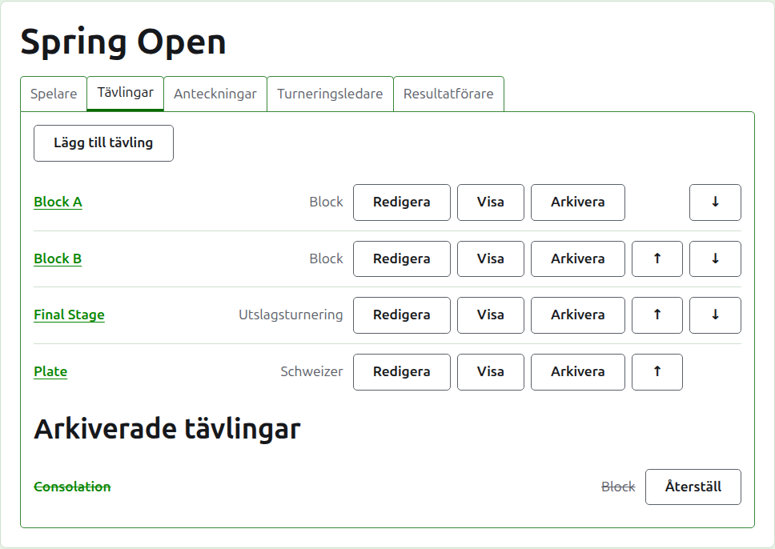
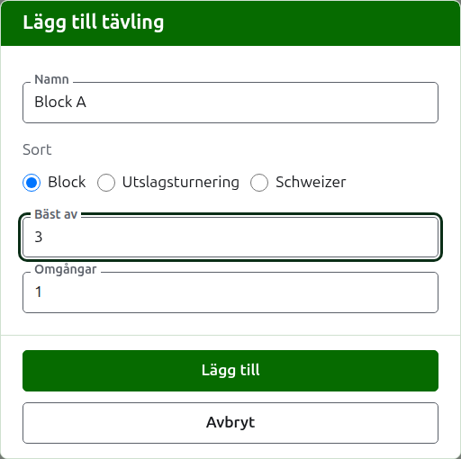
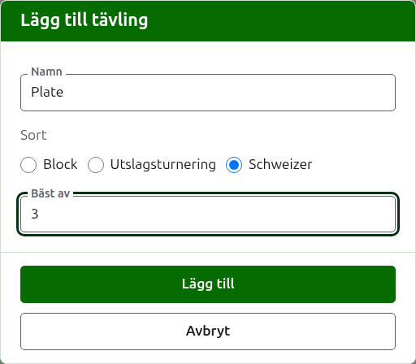
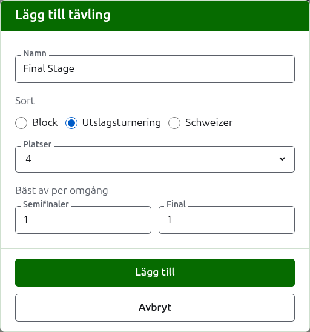

# Tävlingar

Fliken **Tävlingar** på en turnerings sida är där dess tävlingar läggs till, ordnas och läggs undan. En tävling är ett block, en utslagsturnering eller en schweizer. Var och en har en egen sida, där dess spelare sätts in och dess resultat skrivs in.

## Lägga till en tävling

Tryck på **Lägg till tävling**, ovanför listan. En dialogruta öppnas över sidan och frågar efter tävlingens namn, dess sort och den form sorten har.

**Namn** är det spelarna letar efter på turneringens sida för att hitta sina partier. Det är mellan 1 och 254 tecken, och en ensam bokstav räcker, eftersom ett block ofta kallas med en. Två tävlingar i en turnering kan inte ha samma namn.

**Sort** är ett block, en utslagsturnering eller en schweizer. Dialogrutan börjar på block, vilket de flesta tävlingar är.

### Ett block eller en schweizer

Ett block och en schweizer frågar bara vad varje match spelas **bäst av**, vilket börjar på 1. Bäst av 3 vinns av den som vinner två partier. Det får vara ett jämnt tal, eftersom en spelare i ett block eller en schweizer rangordnas efter de partier spelaren vinner, och en match på två partier som delas ett vardera är ett resultat som vilket annat.

### En utslagsturnering

En utslagsturnering frågar hur många **platser** dess lottning har, och vad varje omgång spelas bäst av. Platserna erbjuds som 2, 4, 8, 16, 32, 64 och 128, eftersom inget annat antal kan halveras omgång för omgång ned till en final, och dialogrutan börjar på 8. Platser som blir över när spelarna har satts in fylls med frilotter, som läggs till där spelarna läggs till.

En lottning har så många omgångar som det tar att halvera dess platser ned till en, så en lottning med 8 platser har tre omgångar. Dialogrutan frågar vad var och en spelas bäst av, samlat under **Bäst av per omgång**, i den ordning de spelas. De tre sista är namngivna som man talar om en lottnings omgångar, **Kvartsfinaler**, **Semifinaler** och **Final**, och de före dem efter nummer, Omgång 1 först. Att välja fler platser lägger till omgångar i början av lottningen, och att välja färre tar bort dem från början, så det som skrevs för finalen är fortfarande finalens. Varje omgång spelas bäst av ett udda antal partier, eftersom en match i en utslagsturnering måste ha en vinnare.

### Lägga till flera på en gång

Tryck på **Lägg till**. Tävlingen läggs till, dialogrutan säger det, och namnet töms för nästa, med sorten och dess form kvar som de var: tävlingar som läggs till tillsammans är för det mesta lika, så "Block B" efter "Block A" är bara dess namn. Tryck på **Avbryt** för att stänga dialogrutan när alla är inlagda.

## Ändra en tävling

**Redigera** öppnar samma dialogruta på tävlingen, med rubriken Redigera tävling, med dess namn och dess form som de är. Dess sort frågas inte efter, eftersom ett block inte görs till en utslagsturnering genom att ändras: en tävling av fel sort arkiveras och läggs till igen. Tryck på **Spara** för att spara ändringen och stänga dialogrutan.

En utslagsturnering som har ett parti har spelare placerade i sin lottning, och en ändring av dess platser skulle flytta dem, så den godtas inte när ett parti har skrivits in. Omgångarnas bäst av kan fortfarande ändras.

## Ordning

Tävlingarna listas i turneringens ordning, som är den ordning de visas i på de offentliga sidorna och i det mörkgröna fältet. **Upp** och **Ned** flyttar en tävling ett steg.

## Gå till en tävling

En tävlings namn, eller **Visa**, öppnar dess sida, där dess spelare sätts in och dess resultat skrivs in. Det mörkgröna fältet under sidhuvudet leder också dit, från vilken sida som helst i turneringen.

## Arkivera en tävling

**Arkivera** lägger undan en tävling, vare sig den har partier eller inte; de behålls med den och kommer tillbaka när den återställs. En arkiverad tävling listas under **Arkiverade tävlingar**, överstruken, erbjuder bara **Återställ** och finns inte på de offentliga sidorna. Att arkivera frågar inte först, eftersom att återställa ångrar det.

Nästa: [Sätta in spelare i en tävling](entering-players-in-a-competition.md).
