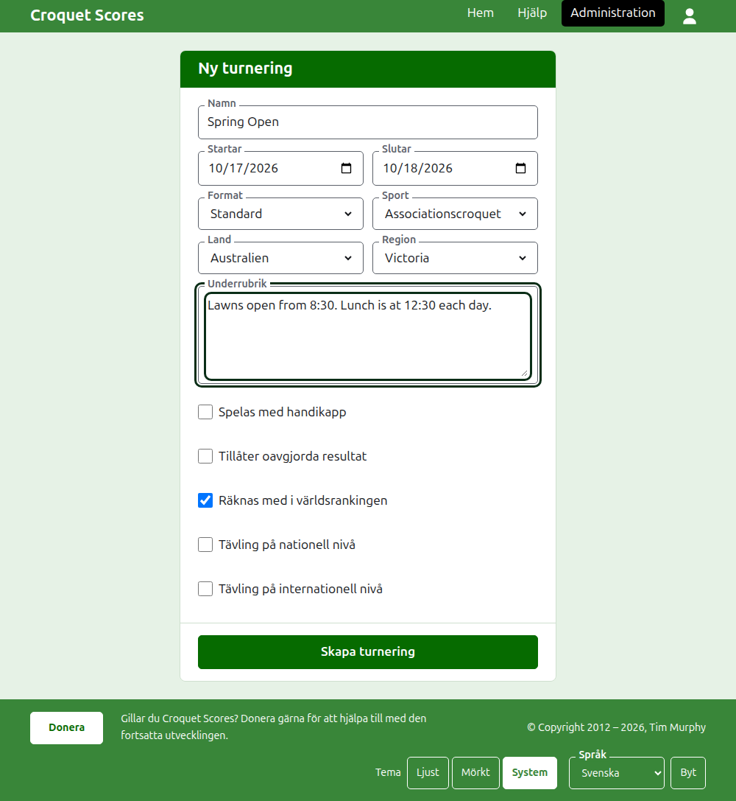

# Skapa en turnering

Tryck på **Ny turnering** ovanför listan över turneringar i administrationen. Den ligger ovanför listan i stället för under den, så att en lång lista inte trycker den utanför en telefons skärm.

Formuläret frågar efter allt en turnering börjar med. En turnering av det vanliga slaget är bara ett namn, två dagar och ett land bort: allt annat avgörs åt dig och kan ändras.

## Vad formuläret frågar efter

**Namn.** Det läsarna letar efter för att hitta turneringen, till exempel "Spring Open". Det är mellan 3 och 254 tecken. Ett namn helt med gemener, eller helt med versaler, godtas inte, eftersom det skulle se ut som ett misstag på varje sida det visas på. Två turneringar får ha samma namn, eftersom samma turnering spelas varje år.

**Börjar** och **Slutar.** De dagar turneringen pågår. En turnering kan inte sluta innan den startar, och kan inte starta eller sluta senare än slutet av nästa år. En turnering hör till det år den startar, vilket också är året i dess adress, så en som pågår över nyår listas under det år den startar.

**Format.** Välj **Standard** för en turnering som spelas mellan spelare. De övriga formaten är för turneringar som spelas mellan lag, och de har en egen guide.

**Sport.** De sporter webbplatsen erbjuder, i dess ordning: Association croquet, Golfcroquet, Amerikansk 6-bågars croquet och Ricochet på Croquet Scores. Gateball Scores frågar varken efter sport eller format, eftersom varje turnering där är en standardturnering i gateball.

**Land** och **Region.** Var turneringen spelas. En region frågas efter bara där det land du väljer är indelat i regioner, som Australiens delstater; ett land som är sin egen enda region frågar inte efter någon. En region behöver inte väljas ens där en erbjuds.

**Underrubrik.** Det du vill att läsarna ska veta och som inte har något eget fält: var man parkerar, när det är lunch, vem man ringer. Den visas under turneringens namn på varje offentlig sida. Den skrivs i Markdown, så ett ord kan göras fett med asterisker runt det och en lista kan göras med ett bindestreck först på varje rad. Den får vara upp till 2000 tecken och kan lämnas tom.

Hur dess tävlingar spelas och räknas, med handikapp, med oavgjorda resultat och i världsrankingen, avgör varje tävling själv när den läggs till.

**Nationell tävling** och **Internationell tävling.** En turnering kan vara det ena, det andra eller inget av dem, men aldrig båda: bockar du för det ena bockas det andra av.

## Att skapa den

Tryck på **Skapa turnering**. Du förs till turneringens sida i administrationen, där den leds från, och du är dess första arrangör. Den listas i administrationen under det år den startar.

Turneringens offentliga adress bildas av dess år, dess sport och dess namn, som `/2026/ac/spring-open`. Den behåller den adressen när namnet rättas senare, så att en länk som redan har skickats fortfarande hittar den; den flyttar bara när det år den startar, eller dess sport, ändras.

## Om något inte godtas

Det som inte godtas sägs under det fält det gäller, och det du skrev står kvar. Ingenting sparas förrän varje fält har godtagits. Det som oftast inte godtas är ett namn skrivet helt med gemener, ett slut före starten och ett land som inte har valts.

Nästa: [Spelare](players.md).
