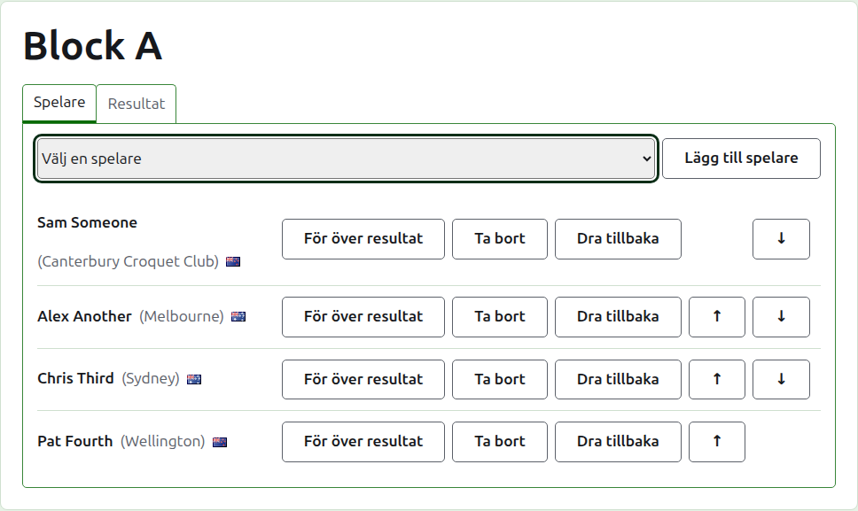
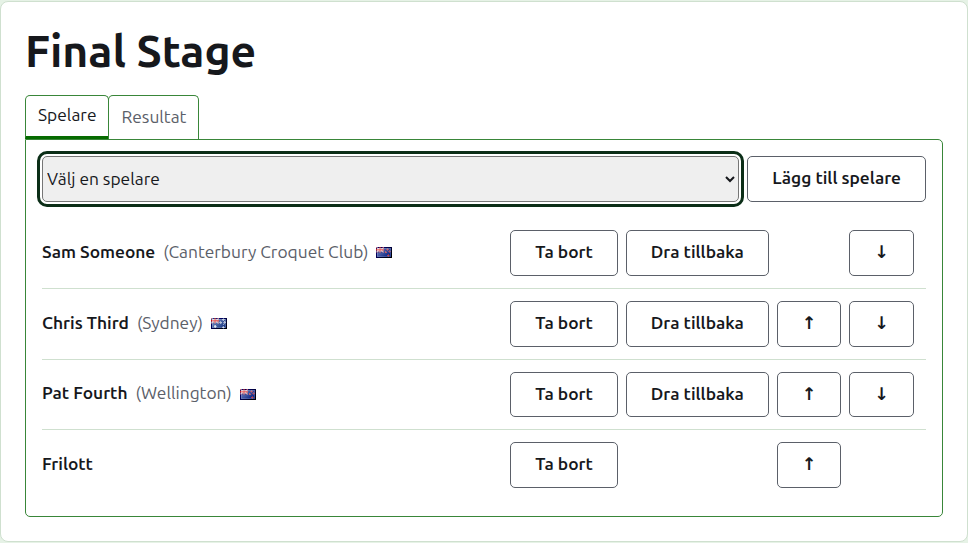
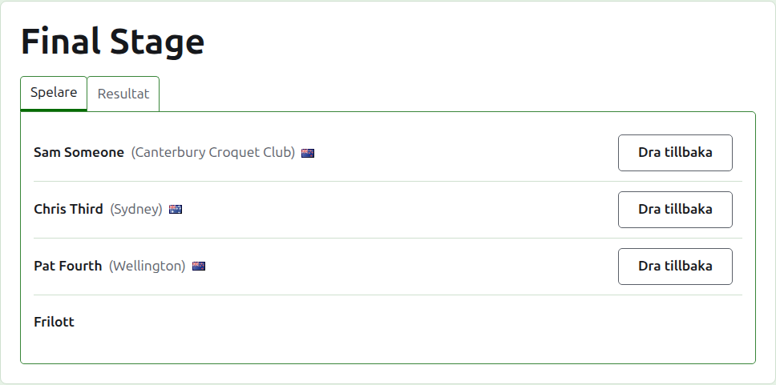
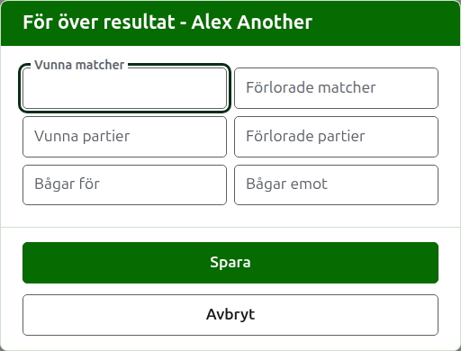
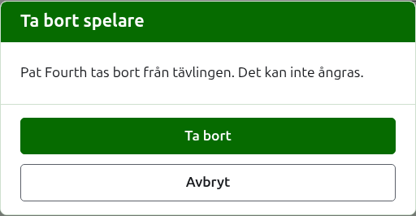
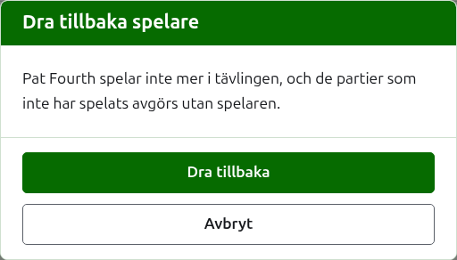
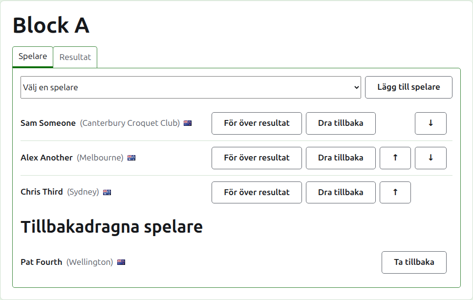

# Sätta in spelare i en tävling

En tävlings sida öppnas från dess namn på fliken Tävlingar, eller från det mörkgröna fältet. Den har tävlingens namn som rubrik, med två flikar under: **Spelare** och **Resultat**. Den öppnas på Spelare, eftersom spelarna sätts in innan något spelas.

En spelare i en tävling är en av turneringens spelare, så de sätts in genom att väljas i stället för att skrivas. Allt om dem utom deras plats i tävlingen, och det de för över in i den, ändras på turneringens flik Spelare.

## Lägga till en spelare

Ovanför listan erbjuder en rullgardinslista varje spelare i turneringen som inte redan är med i tävlingen, i turneringens ordning. Välj en och tryck på **Lägg till spelare**. Spelaren sätts in i turneringens ordning bland dem som redan är insatta, rullgardinslistan erbjuder inte längre spelaren, och markören går tillbaka till rullgardinslistan så att nästa kan väljas från tangentbordet. När varje spelare i turneringen är med i tävlingen visas inte rullgardinslistan, och fliken säger det.

Turneringens arkiverade spelare erbjuds inte.

## Byes i en utslagning

En utslagning spelas först när varje plats i dess lottning är fylld, och de platser spelarna lämnar över fylls med byes. Så i en utslagning erbjuder rullgardinslistan **Bye** först, före spelarna, och fortsätter erbjuda den hur många byes som än läggs till, eftersom en lottning kan behöva flera.

En bye placeras i lottningen som en spelare: den kan flyttas upp och ned och tas bort, men den kan inte dras tillbaka, eftersom den inte spelar något. En spelare som sätts in i en utslagning vars alla platser är fyllda godtas inte, och fliken säger det under rullgardinslistan.

Ordningen på en utslagnings spelare är dess lottning. De två första platserna möts i den första matchen, de två nästa i den nästa, och så vidare. Lägg spelarna i den ordning lottningen ska spelas i innan något resultat skrivs in, eftersom spelarna ligger fast när utslagningen har ett parti i bruk: ingen kan läggas till, tas bort eller flyttas. En spelare kan fortfarande dras tillbaka.

## Ordning

Spelarna listas i tävlingens ordning, som är den ordning en utslagning lottas i och ett block listas i på sin offentliga sida. **Upp** och **Ner** flyttar en spelare ett steg.

## Föra över resultat

**För vidare** säger vad en spelare tar med sig in i en tävling från spel som inte fördes här: resultaten från ett tidigare skede, eller från partier som spelades innan tävlingen fördes här. Det erbjuds i ett block och en schweizer, som har en ställning för det att räknas i, och inte i en utslagning.

Dialogrutan frågar efter sex tal: vunna och förlorade matcher, vunna och förlorade partier, och bågar för och emot. Varje tal är frivilligt. Ett tal som lämnas tomt för inte över något, vilket inte är detsamma som att föra över 0, så att den som ändrar det senare ser det som det lämnades. Tryck på **Spara** för att spara alla sex.

## Ta bort en spelare

**Ta bort** tar ut en spelare som satts in av misstag. Spelaren förblir en av turneringens spelare och erbjuds igen i rullgardinslistan, men ingenting behålls av spelarens plats i tävlingen, så Ta bort frågar först.

En spelare som har något parti i bruk i tävlingen kan inte tas bort, eftersom partierna då skulle vara mot någon som inte längre finns där, och erbjuds inte Ta bort. En spelare vars enda partier är arkiverade kan tas bort, och de arkiverade resultaten följer med.

## Dra tillbaka en spelare

**Dra tillbaka** är för en spelare som inte spelar mer i tävlingen. Spelaren stannar i den, med de partier spelaren har spelat, och listas under **Tillbakadragna spelare** efter dem som fortfarande spelar. I en utslagning går spelarens motståndare i en match som inte är avgjord vidare.

Dra tillbaka frågar först, eftersom det ändrar tävlingens utgång: de partier spelaren inte har spelat avgörs utan spelaren.

En tillbakadragen spelare erbjuder bara **Återinsätt**, som sätter spelaren tillbaka bland dem som spelar, efter dem som stannade, utan att fråga.

Nästa: [Resultat](scores.md).
