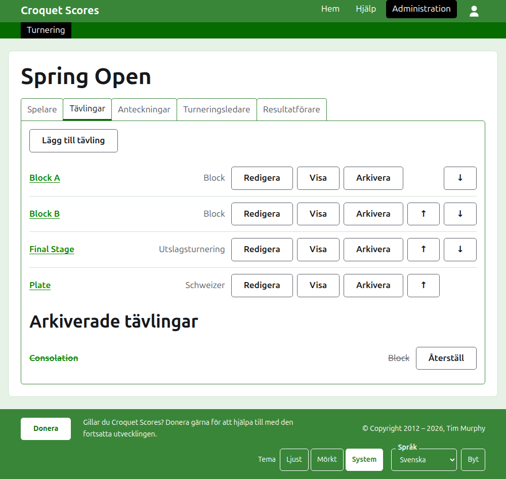

# Att leda en standardturnering

En standardturnering är en turnering som spelas mellan spelare som anmäls en och en: en klubbhelg, en öppen tävling, ett mästerskap. Spelarna sätts in i block, utslagningar och schweizer, och resultaten läggs upp i takt med att de spelas. Den här guiden tar en arrangör från inloggningen till en turnering vars resultat är tillgängliga för allmänheten.

Den står på egna ben. Ingenting i den bygger på guiden till en turnering som spelas av lag, som är skriven för sig.

## Innan du börjar

Du behöver ett konto. Klicka [här](/account/register) för att registrera ett konto.

Allt en arrangör gör görs i webbplatsens administrationsdel. De offentliga sidorna, där spelare och åskådare följer turneringen, hämtas från det som administrationen innehåller, så ingenting behöver publiceras: ett resultat som skrivs in finns på de offentliga sidorna på en gång.

## Sidorna i ordning

1. [Skapa en turnering](creating-a-tournament.md): dess namn, dess dagar, dess sport, var den spelas och om den är en nationell eller internationell tävling.
2. [Spelare](players.md): att lägga till turneringens spelare, rätta dem och lägga undan dem som lades till av misstag.
3. [Tävlingar](competitions.md): att lägga till block, utslagningar och schweizer, och att ordna dem.
4. [Sätta in spelare i en tävling](entering-players-in-a-competition.md): vem som spelar i varje tävling, byes i en utslagning, överförda resultat, borttagning och tillbakadragning.
5. [Resultat](scores.md): att skriva in resultat, rätta dem och lägga undan dem som skrevs in av misstag.
6. [Anteckningar](notes.md): att berätta för spelarna vad de behöver veta medan turneringen pågår.
7. [Arrangörer och resultatförare](managers-and-scorers.md): att dela på ledningen av turneringen, och att låta någon skriva in resultat utan att kunna ändra något annat.
8. [Rankingar](rankings.md): filen som skickas till världsrankingen, och vad som återstår för dig att fylla i.
9. [Ändra, arkivera och återställa en turnering](changing-and-archiving.md): att rätta turneringens uppgifter, och att lägga undan en turnering.
10. [Vad allmänheten ser](what-the-public-sees.md): sidorna dina spelare följer, och hur det du skriver in visas på dem.

## Så är administrationen upplagd

Administrationens startsida listar de turneringar du har en del i, ett år i taget.

Trycker du på en turnerings namn, eller på **Hantera**, öppnas dess sida. Allt som finns att sköta ligger i sex flikar under dess namn: **Spelare**, **Tävlingar**, **Anteckningar**, **Arrangörer**, **Resultatförare** och **Rankingar**. Sidan öppnas på Spelare, eftersom spelarna är det första som läggs till.

Det mörkgröna fältet under sidhuvudet är till för att gå mellan sidor. Det leder till turneringen, som **Turnering**, och till var och en av dess tävlingar med namn, så att du kan gå från turneringen till en tävling och mellan tävlingar utan att gå tillbaka via fliken Tävlingar. Sidan du är på är markerad i svart.

## Sådant som gäller överallt

**Ingenting tas bort för gott utom en anteckning.** Spelare, tävlingar, resultat och själva turneringen arkiveras i stället för att tas bort: de läggs undan, stryks över och listas under en egen rubrik, med **Återställ** för att hämta dem tillbaka. Att arkivera, återställa och flytta upp och ned ber aldrig om bekräftelse, eftersom vart och ett ångras genom att trycka åt andra hållet. Det som inte kan ångras, som att ta bort en spelare från en tävling eller ta bort en anteckning, frågar först.

**En dialogruta över sidan sparar ingenting förrän du trycker på dess knapp.** Avbryt, eller Escape-tangenten, stänger den och lämnar allt som det var. Dialogrutor som lägger till saker, som Lägg till spelare och Lägg till resultat, står kvar öppna efter varje tillägg, så att en lista kan skrivas in i ett svep.

**Det som inte godtas sägs bredvid det fält det gäller.** Ingenting som inte godtas sparas, och det du skrev står kvar, så att det kan rättas i stället för att skrivas om.

**Administrationen fungerar på en telefon.** Varje knapp är stor nog att trycka på med tummen, och ingenting är bredare än skärmen.

Nästa: [Skapa en turnering](creating-a-tournament.md).
