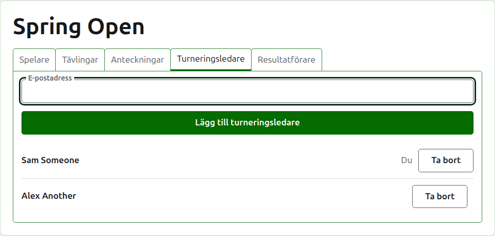
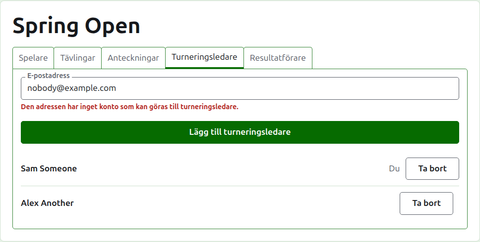
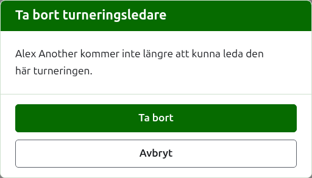
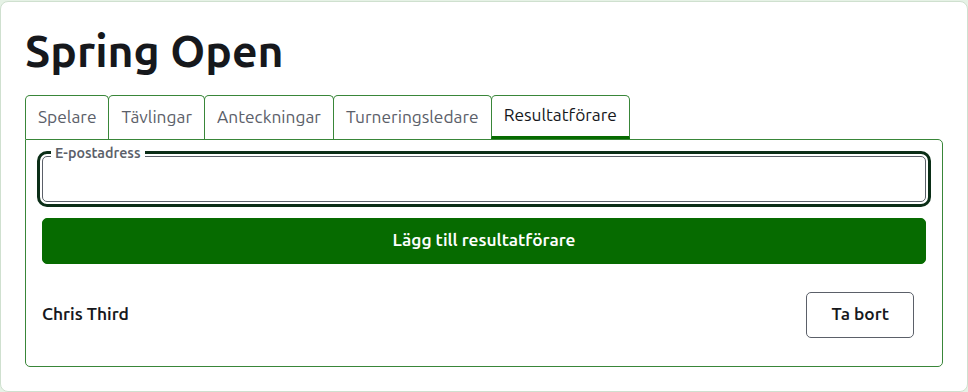
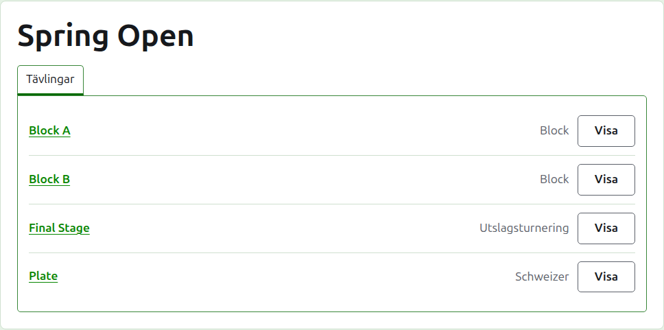

# Arrangörer och resultatförare

En turnering har arrangörer, som kan göra allt som kan göras med den, och kan ha resultatförare, som skriver in dess resultat och inget annat. Den som skapade turneringen är dess första arrangör.

## Arrangörer

Fliken **Arrangörer** listar vem som leder turneringen, i den ordning de gjordes till arrangörer, med ditt eget namn markerat som ditt. Det är där en turnering delas, eller lämnas över.

Någon görs till arrangör via sin e-postadress. Skriv in den i fältet ovanför listan och tryck på **Lägg till arrangör**. Adressen måste höra till ett konto som är registrerat och bekräftat; en adress utan ett sådant godtas inte, vilket sägs under fältet, och webbplatsen säger inte mer om det än så. En resultatförare som görs till arrangör slutar vara resultatförare.

**Ta bort** tar bort en arrangör. Ingenting behålls av en borttagen arrangör, så Ta bort frågar först; den görs till arrangör igen via sin adress om den vill ha tillbaka. En turnering har alltid en arrangör, så den sista erbjuds inte Ta bort.

Du kan ta bort dig själv. Frågan säger då vad det innebär: du förlorar din egen väg tillbaka till turneringen, och ingen på sidan kan ångra det åt dig. En annan arrangör kan göra dig till arrangör igen.

## Resultatförare

Fliken **Resultatförare** är fliken Arrangörer för resultatförare, och fungerar på samma sätt: en e-postadress och **Lägg till resultatförare** ovanför listan, och **Ta bort** på var och en.

En resultatförare ser turneringen i sin egen lista i administrationen, med **Resultat** i stället för Hantera, och erbjuds bara dess tävlingar: inga spelare, anteckningar, arrangörer, resultatförare eller rankingar. På en tävlings sida ser de bara fliken Resultat, där de kan skriva in, rätta, arkivera och återställa resultat som en arrangör kan. Vem som spelar i en tävling är arrangörernas sak.

En arrangör görs inte till resultatförare, eftersom en arrangör redan kan göra allt en resultatförare kan. En turnering behöver ingen resultatförare, så varje resultatförare kan tas bort, även den sista.

Nästa: [Rankingar](rankings.md).
