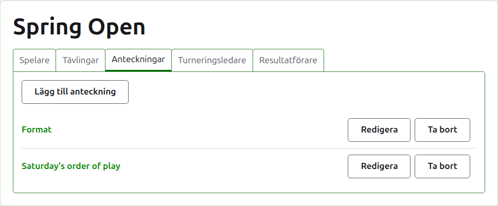
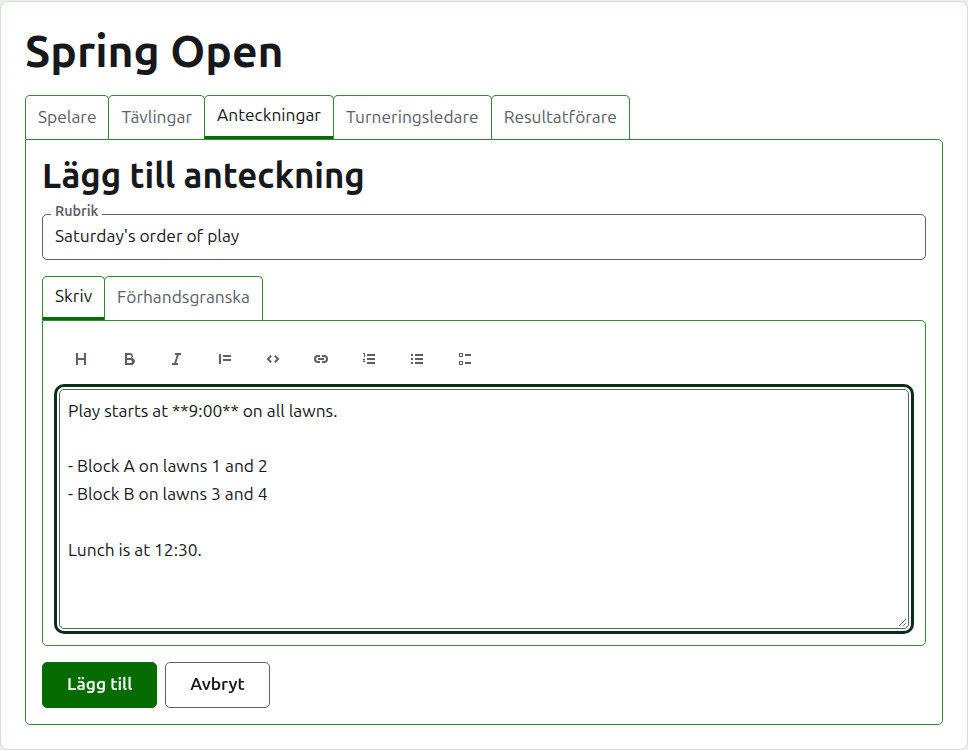
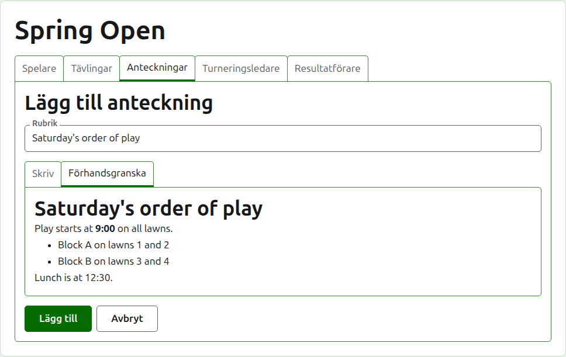
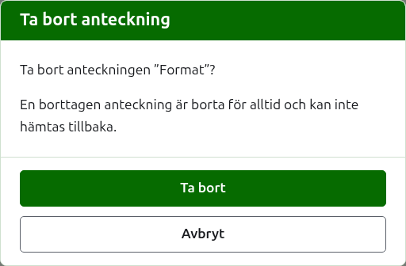

# Anteckningar

Fliken **Anteckningar** på en turnerings sida är där dess turneringsledare skriver det spelarna behöver veta medan turneringen pågår: formatet, en ändring i spelordningen, lunchtiden. Läsarna hittar dem på turneringens offentliga sida Anteckningar, och en anteckning de inte har läst markeras där med en röd asterisk, som också markerar avdelningen Anteckningar på varje sida i turneringen tills de öppnar den.

## Skriva en anteckning

Tryck på **Lägg till anteckning**, ovanför listan. En panel tar listans plats, eftersom en anteckning skrivs utförligt och behöver utrymmet.

**Rubrik** krävs, och är det anteckningen listas under. Den är vanlig text.

**Beskrivning** skrivs i Markdown och kan lämnas tom där rubriken säger allt som finns att säga. Verktygsfältet ovanför rutan skriver Markdown åt dig: Rubrik, Fet stil, Kursiv stil, Citat, Kod, Länk, Numrerad lista, Punktlista och Uppgiftslista. Vart och ett verkar på det som är markerat, eller i början av varje markerad rad, eller sätter markören där orden ska stå.

**Förhandsgranska** visar anteckningen som en läsare kommer att se den på dess sida.

Tryck på **Lägg till**. Anteckningen sparas, listan kommer tillbaka med den överst, och den finns på den offentliga sidan Anteckningar på en gång.

## Redigera en anteckning

Tryck på en antecknings rubrik, eller på dess **Redigera**, för att öppna panelen på den anteckningen. Tryck på **Spara** för att spara ändringen. En anteckning som redigerats sedan en läsare läste den markeras för den läsaren igen.

## Ta bort en anteckning

En anteckning som inte längre gäller tas bort. En borttagen anteckning är borta för gott, så **Ta bort** frågar först.

Nästa: [Turneringsledare och resultatförare](managers-and-scorers.md).
