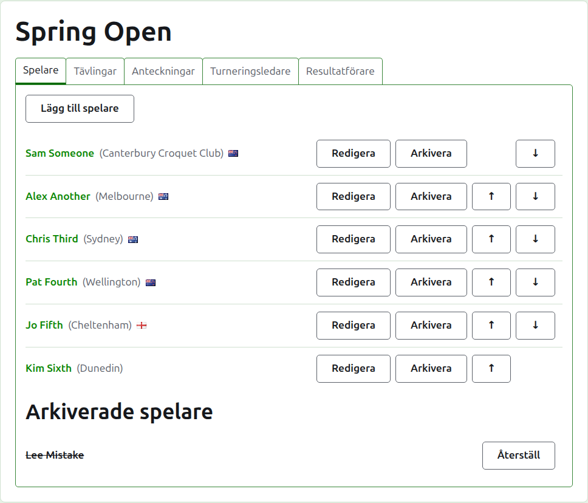
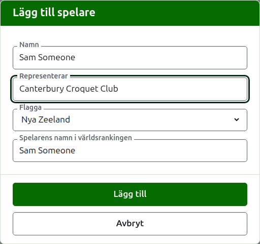
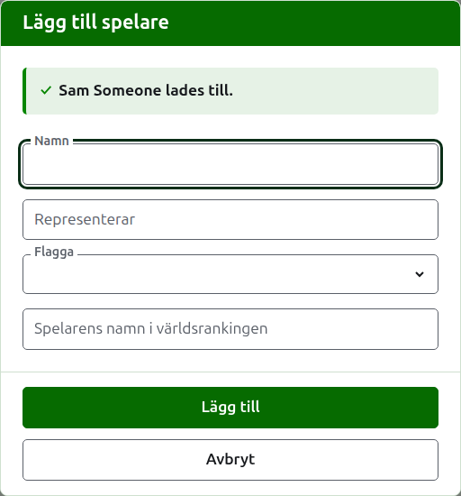
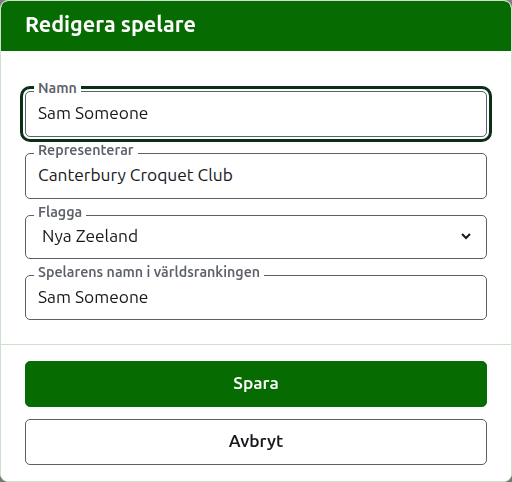
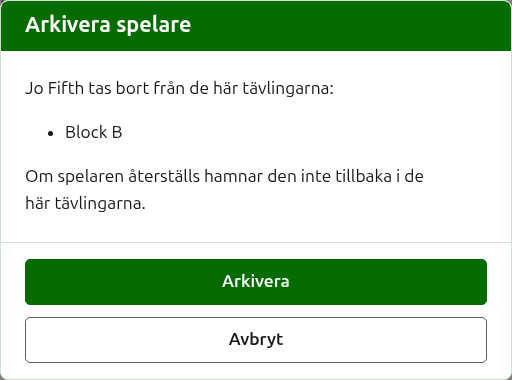

# Spelare

Fliken **Spelare** på en turnerings sida är där dess spelare läggs till, rättas, ordnas och läggs undan. Det är den flik sidan öppnas på, eftersom att lägga till spelarna är det första som görs med en turnering.

Spelarna läggs till här en gång, i turneringen. Vilka tävlingar var och en spelar i väljs efteråt, på varje tävlings egen sida, bland de spelare som har lagts till här. Se [Sätta in spelare i en tävling](entering-players-in-a-competition.md).

## Lägga till spelare

Tryck på **Lägg till spelare**, ovanför listan. En dialogruta öppnas över sidan.

**Namn** krävs. Det är spelarens namn så som det visas på varje sida, mellan 3 och 254 tecken. Två spelare i en turnering kan inte ha samma namn, hur det än skrivs med stora och små bokstäver; där två spelare verkligen delar namn, skilj dem åt i själva namnet, som "Andrew Hobbs (2)".

**Representerar** är det spelaren spelar för, skrivet som en läsare skulle säga det: en klubb, en region eller ett land, till exempel "Canterbury Croquet Club". Det visas inom parentes efter namnet. Det kan lämnas tomt.

**Flagga** är den flagga som visas bredvid spelarens namn. Den kan lämnas som ingen, vilket de flesta spelare har. Vad en spelare representerar och vilken flagga spelaren för hålls isär, eftersom en spelare kan spela för en klubb i ett land och föra ett annat lands flagga.

**Spelarens namn i världsrankingen** är det namn världsrankingen känner spelaren under. Det frågas efter bara i en turnering i associationscroquet eller golfcroquet, de två sporter vars spelare världsrankingen för en förteckning över. Spelarna i amerikansk 6-bågars croquet är kända i rankingen under sina egna namn, så det frågas inte efter där, och varje spelares namn i världsrankingen är alltid spelarens namn. Medan du lägger till en spelare följer det namnet medan du skriver, eftersom de flesta spelare är kända i rankingen under sitt eget namn, och slutar följa när du skriver i det. Lämnas det tomt sparas det som spelarens namn.

Medan du skriver ett namn erbjuds de spelare världsrankingen känner till vars namn börjar så, så att du kan ta ett namn så som rankingen stavar det i stället för att skriva ut det. Bredvid världsrankingnamnet säger en bock att rankingen känner till namnet, och ett frågetecken att den inte gör det: namnet kan vara felstavat, eller så kan spelaren vara ny i rankingen. Det är bara ett råd. Ett namn rankingen inte känner till sparas lika gärna som ett den känner till.

Tryck på **Lägg till**. Spelaren läggs till, dialogrutan säger det, och fälten töms för nästa spelare, med markören tillbaka i namnet. Lägg till hela listan på det sättet, och tryck sedan på **Avbryt** för att stänga dialogrutan. Avbryt sparar ingenting som inte redan har lagts till.

En spelare heter aldrig "Bye". En utslagsturnerings frilotter läggs till i själva utslagsturneringen, där dess spelare sätts in, så ett namn vars första ord är det engelska "bye" godtas inte, och dialogrutan förklarar varför.

## Rätta en spelare

Tryck på en spelares namn, eller på spelarens **Redigera**, för att öppna samma dialogruta på den spelaren, med rubriken Redigera spelare. Ändra det som är fel och tryck på **Spara**, som sparar ändringen och stänger dialogrutan. En spelare vars namn rättas behåller det världsrankingnamn spelaren hade, eftersom rankingen fortfarande känner spelaren under det. I amerikansk 6-bågars croquet är en spelares namn i världsrankingen alltid spelarens namn, så att rätta namnet rättar det också.

En spelare som rättas här rättas överallt: i varje tävling spelaren är med i, och på varje offentlig sida.

## Ordna spelarna

Spelarna listas i turneringens ordning, som är den ordning de erbjuds i när de sätts in i tävlingar, och den ordning en utslagsturnering lottas i. **Upp** och **Ned**, pilarna i slutet av varje rad, flyttar en spelare ett steg. Den första spelaren erbjuds inte Upp och den sista erbjuds inte Ned.

## Arkivera en spelare

**Arkivera** lägger undan en spelare: en som lades till av misstag, eller som har dragit sig ur hela turneringen. En arkiverad spelare listas under **Arkiverade spelare**, överstruken, efter de spelare som är i bruk, och erbjuder bara **Återställ**. En arkiverad spelare är inte med i någon tävling och visas inte på någon offentlig sida.

En spelare som har spelat något parti kan inte arkiveras, eftersom partierna då skulle vara mot någon som inte längre finns där, så en sådan spelare erbjuds inte Arkivera. En spelare vars enda partier är arkiverade kan arkiveras.

Att arkivera en spelare som inte är med i någon tävling frågar inte först, eftersom att återställa spelaren sätter tillbaka allt. Att arkivera en spelare som är med i någon tävling frågar först, eftersom arkiveringen tar bort spelaren från varje tävling spelaren är med i, och återställningen inte sätter tillbaka spelaren i dem.

Nästa: [Tävlingar](competitions.md).
