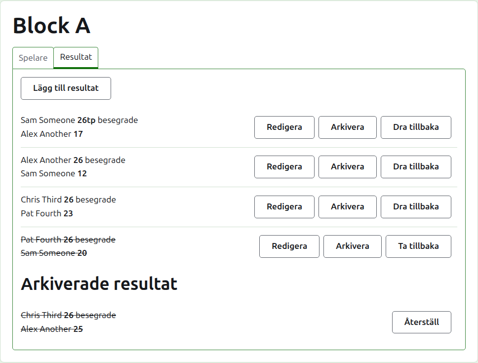
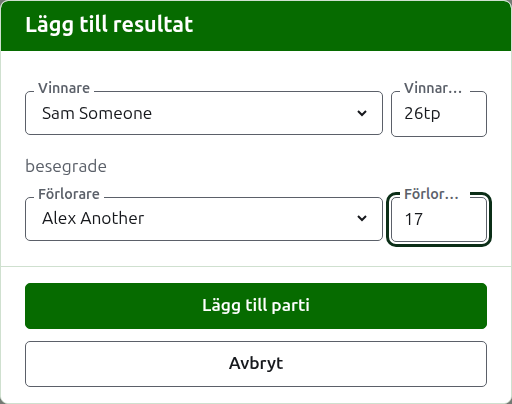
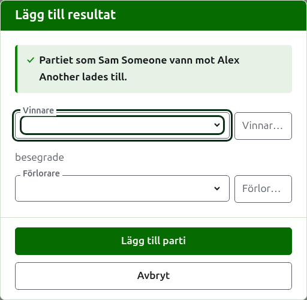
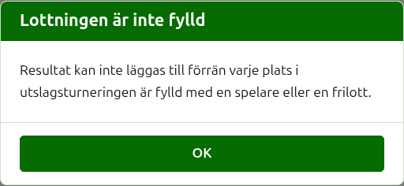
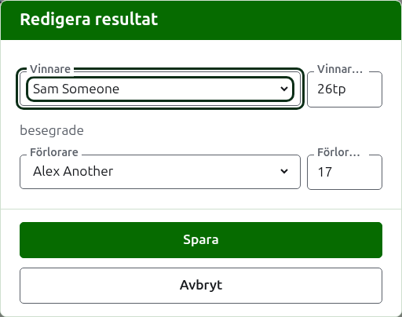

# Resultat

Fliken **Resultat** på en tävlings sida är där dess partier skrivs in, rättas och läggs undan. En resultatförare ser bara den här fliken, och kan göra allt på den som en arrangör kan.

## Skriva in ett resultat

Tryck på **Lägg till resultat**, ovanför listan. Dialogrutan läses som ett resultat sägs högt: vinnaren och dennes resultat, sedan "besegrade", sedan förloraren och dennes resultat.

Vinnaren och förloraren väljs var för sig bland tävlingens spelare som spelar, i tävlingens ordning. Ingen är vald från början, så att ett parti aldrig skrivs på en spelare du inte valde. I en utslagning väljer valet av vinnare den som vinnaren är lottad mot som förlorare, där du kan se det och välja en annan.

Ett resultat skrivs som resultatföraren skrev ned det: dess antal poäng, och det som följer, vilket behålls och visas som det skrevs, som "26tp" för 26 bågar och en triple peel. Antalet är de siffror resultatet börjar med; ett resultat som inte börjar med en siffra godtas inte.

Ett parti som vunnits på lika poäng, som när det stoppas av tiden och avgörs på något annat sätt, säger vem som vann genom en markering efter vinnarens resultat: "6w" besegrade "6". På Croquet Scores är markeringarna "w", "won" och "winner"; Gateball Scores tar också "cb" och "so". En vinnares resultat måste vara högre än förlorarens, eller markerat, såvida inte turneringen tillåter oavgjorda resultat, i vilket fall lika poäng utan markering sparas som oavgjort.

Tryck på **Lägg till parti**. Partiet läggs till, dialogrutan säger vilket, och fälten töms för nästa, eftersom resultaten kommer i en bunt läst från en tavla i slutet av en rond. Tryck på **Avbryt** när alla är inlagda.

Det som inte godtas sägs under det fält det gäller: en vinnare eller förlorare som inte valts, ett resultat som inte skrivits eller inte börjar med en siffra, samma spelare som båda, en förlorares resultat markerat som vunnet, eller en vinnares resultat lägre än förlorarens. I en utslagning godtas inte två spelare som inte är lottade att mötas, och det sägs ovanför fälten.

## En utslagnings lottning måste fyllas först

En utslagning spelas först när varje plats i dess lottning har en spelare eller en bye. Till dess förklarar Lägg till resultat varför resultat inte kan läggas till, i stället för att öppna dialogrutan.

## Listan över resultat

Resultaten i bruk listas i den ordning de skrevs in, äldst först, så att listan läses som tävlingen spelades. Varje resultat säger vinnaren och dennes resultat, sedan förloraren och dennes, och erbjuder **Redigera** och **Arkivera**.

## Rätta ett resultat

**Redigera** öppnar samma dialogruta på det resultatet, med rubriken Redigera resultat, med dess spelare valda och dess resultat som de skrevs. Tryck på **Spara** för att spara rättelsen och stänga dialogrutan.

En rättelse behåller utgången: ett vunnet parti förblir vunnet, och ett oavgjort parti förblir oavgjort. Ett parti vars utgång var fel arkiveras och skrivs in igen.

Där ett resultat skulle kunna arkiveras kan dess spelare ändras likaväl som dess siffror. I en utslagning behåller ett resultat vars vinnare redan har spelat i nästa rond sina spelare, eftersom en ändring av vem som vann skulle lämna nästa parti spelat av någon som inte hade kommit dit; bara siffrorna kan rättas.

## Arkivera ett resultat

**Arkivera** lägger undan ett resultat så att det inte räknas. Det listas under **Arkiverade resultat**, överstruket, och erbjuder bara **Återställ**. Ingetdera frågar först, eftersom vart och ett ångrar det andra.

I en utslagning går en matchs vinnare vidare till nästa rond, så ett resultat i en match vars vinnare har spelat i nästa rond erbjuds inte Arkivera. Partiet i nästa rond arkiveras först, och sedan kan de före det arkiveras. Där en rond spelas bäst av 3 eller 5 hålls varje parti i matchen på samma sätt. Ett block och en schweizer har inga ronder som beror på varandra, så varje resultat i dem kan arkiveras.

## Dra tillbaka ett resultat

En spelare som lämnar en tävling dras vanligen tillbaka från den, på fliken Spelare, och det är allt som behövs: spelaren spelar inte mer, och de partier spelaren spelade står kvar men räknas inte längre med i vinster/förluster och bågar. Att dra tillbaka ett resultat är för det ovanligare fallet där ett parti som spelades inte ska räknas. I Australian President's Eights, till exempel, står den första rondens resultat kvar när en spelare drar sig ur, och bara spelarens partier i den andra ronden tas ur räkningen: dra tillbaka de partierna.

I ett block eller en schweizer dras ett resultat som spelades men inte ska räknas tillbaka i stället för att arkiveras. **Dra tillbaka** behåller det bland resultaten i bruk, på sin plats, men överstruket och utan att räknas på de offentliga sidorna. **Återinsätt** får det att räknas igen. Ingetdera frågar först. En utslagnings resultat erbjuds inte Dra tillbaka, eftersom ett resultat där avgör mer än ställningen.

Nästa: [Anteckningar](notes.md).
