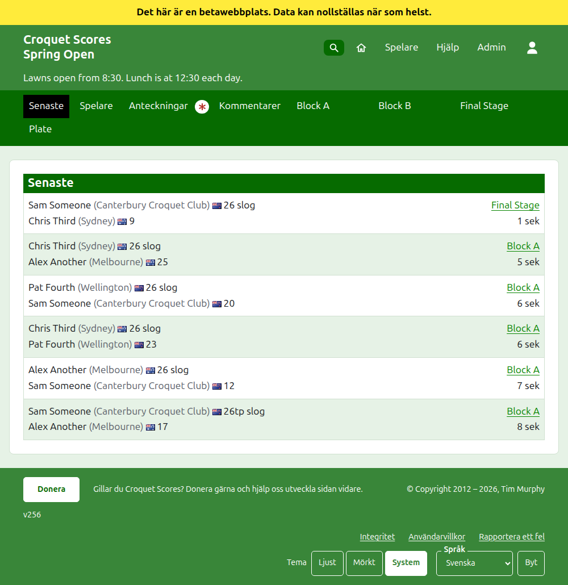
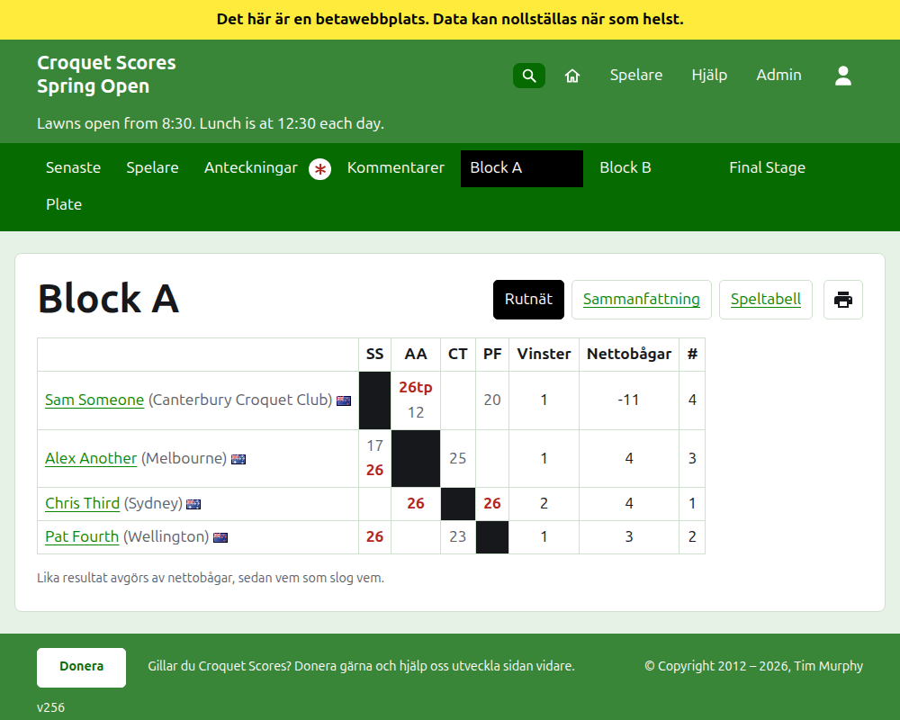
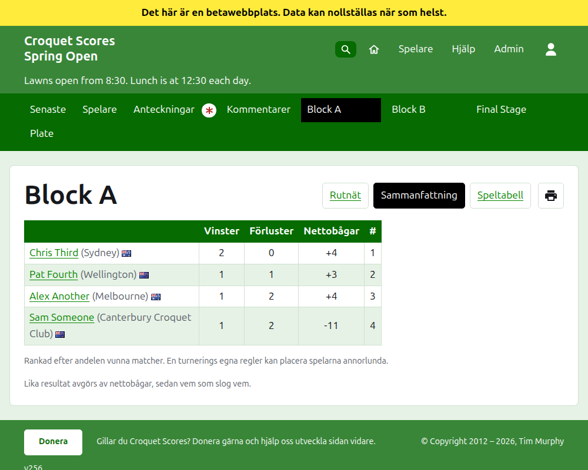
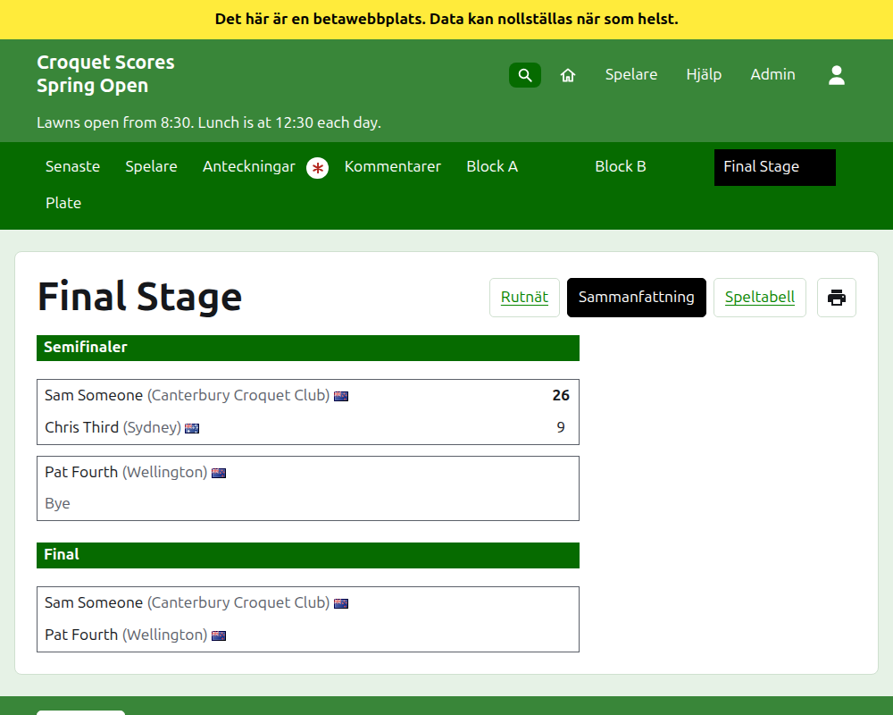
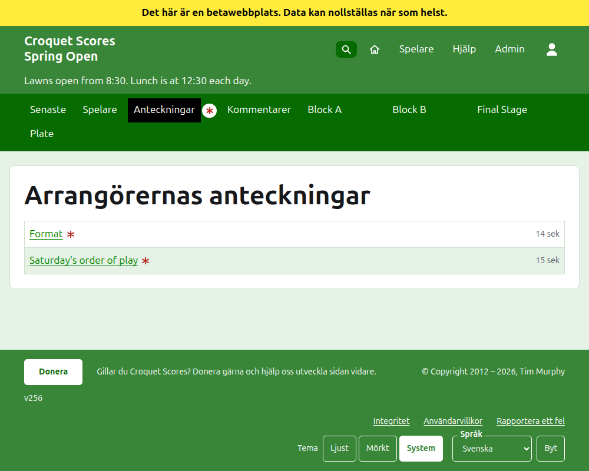

# Vad allmänheten ser

Ingenting publiceras: de offentliga sidorna hämtas från det administrationen innehåller, så ett resultat som skrivs in finns på dem på en gång. De kräver varken konto eller JavaScript, och är utformade för en telefon.

## Turneringens sida

Turneringens sida finns på dess år, dess sport och dess namn, som `/2026/ac/spring-open`. Den har turneringens namn som rubrik, med dess underrubrik under. Den listar varje parti i bruk, det senast tillagda först, så att en läsare som kommer tillbaka ser vad som har hänt sedan dess. Varje parti säger vinnaren, dennes handicap och vad den representerar, dess flagga och dess resultat, sedan förloraren och dennes, med den tävling det spelades i och hur länge sedan det lades till.

Det mörkgröna fältet erbjuder turneringens avdelningar: **Senaste**, som är den här sidan, **Spelare**, **Anteckningar** och **Kommentarer**, sedan varje tävling i bruk, i den ordning fliken Tävlingar har dem. Anteckningar markeras med en röd asterisk så länge det finns en anteckning läsaren inte har läst.

## Ett block

Ett blocks sida visar dess resultat som en tabell: en rad och en kolumn för varje spelare i blockets ordning, med partierna mellan två spelare där raden möter kolumnen, vart och ett markerat som vunnet, förlorat eller oavgjort för radens spelare. Efter spelarnas kolumner kommer varje spelares summor. Där varje match är ett enda parti är de vinster och nettobågar; där en match spelas bäst av fler än ett är de matcher, nettopartier, partier och nettobågar. Den sista kolumnen, med rubriken **#**, är varje spelares placering: 1 för den första och =2 där spelare inte kan skiljas åt och delar andraplatsen. Där spelare har vunnit lika stor andel av sina matcher säger en rad under tabellen hur de skiljs åt, så som blockets särskiljning anger (se Tävlingar).

Ett block, en utslagning och en schweizer visas var och en på tre sätt, som erbjuds på raden med tävlingens namn: **Rutnät**, **Sammanfattning** och **Speltabell**. Bredvid dem finns en skrivarknapp, som skriver ut turneringens namn, tävlingens namn och dess resultat, och inget annat. Sammanfattningen är den för en telefon: för ett block spelarna rangordnade, med sina vinster, förluster, nettobågar och placering; för en utslagning matcherna listade rond för rond; för en schweizer rutnätets tabell utan dess resultat. Speltabellen listar varje parti, äldst först till att börja med. Den har rubrikerna **Match** och **Datum**: ett tryck på **Match** sorterar partierna efter vinnarens namn och sedan förlorarens, ett tryck på **Datum** sorterar dem äldst eller nyast först, och ett tryck på rubriken en lista är sorterad efter vänder på den. Hur en läsare sorterade kommer ihåg på dennes enhet. En läsare som väljer en vy behåller den för varje tävling tills den väljer en annan.

En tävling som spelas till ett annat antal bågar än det vanliga för sin sport säger det under sitt namn, som "Spelas till 14 bågar" (se [Tävlingar](competitions.md#adding-a-competition)).

En tillbakadragen spelares rad säger det. Ett tillbakadraget resultat visas överstruket och räknas inte. Ett arkiverat resultat visas inte.

## En utslagning

En utslagnings sida ritar upp dess lottning rond för rond, en kolumn för varje rond från den första till finalen, med varje matchs två sidor över varandra och en cell för varje parti matchen spelas bäst av. En senare ronds match står bredvid de två matcher vars vinnare den spelas mellan. På en telefon rullar lottningen i sidled, med pilar till finalen och tillbaka.

## En schweizer

En schweizers sida rangordnar dess spelare i en tabell: deras partier, deras vinster, deras vinstprocent och deras resultat, vart och ett angivet som motståndaren och marginalen, som "+4" för ett parti vunnet med fyra.

## Spelare

Sidan Spelare listar varje spelare i turneringen som inte är arkiverad, i alfabetisk ordning, med sitt handikapp och vad de representerar inom parentes, och sin flagga.

## Anteckningar

Sidan Anteckningar, med rubriken Arrangörernas anteckningar, listar turneringens anteckningar, den senast skrivna först, var och en ledande till sin egen sida och med uppgift om hur länge sedan den skrevs. En anteckning läsaren inte har läst markeras med en röd asterisk tills den öppnas. En turnering utan anteckningar säger "Inga anteckningar än."

## Var turneringen listas

En turnering finns på startsidan medan den spelas eller snart ska börja. Dess års sida, som `/2026`, listar årets månader, och var och en listar, när den trycks på, de turneringar som startar i den. En kontroll under rubriken, **Visa alla** och sedan **Dölj alla**, öppnar eller stänger varje månad. En turnering som är förbockad som nationell eller internationell är fetstilt längs hela sin rad.

## Adresser som flyttar

En turnering behåller sin adress när namnet rättas. Där den flyttar, för att dess år eller dess sport ändrades, leder dess gamla adress till den nya, så att en länk som sparats från förr fortfarande fungerar. En arkiverad turnerings sidor hittas inte förrän den återställs.
