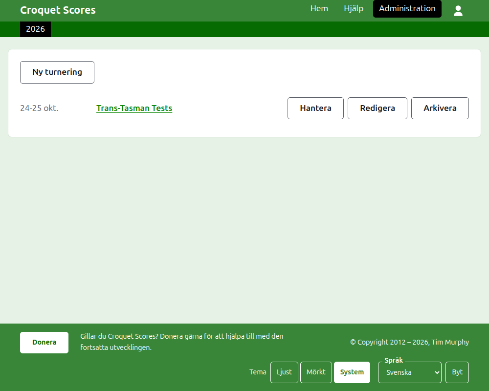
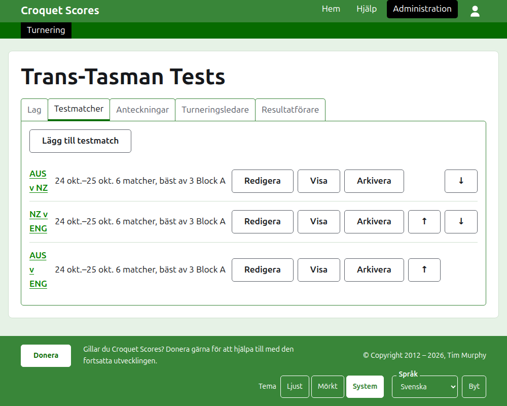

# Att leda en turnering som spelas av lag

En turnering som spelas av lag är en där sidor möts, i stället för spelare som anmäls en och en: en testserie mellan två länder, en interstate shield, ett världsmästerskap för lag. Lagen sätts upp med sina spelare, testmatcherna mellan lagen läggs till, och varje testmatchs partier läggs upp i takt med att de spelas. Den här guiden tar en turneringsledare från inloggningen till en turnering vars resultat är tillgängliga för allmänheten.

Den står på egna ben. Ingenting i den bygger på guiden till en standardturnering, som är skriven för sig.

## Innan du börjar

Du behöver ett konto. Klicka [här](/account/register) för att registrera ett konto.

Allt en turneringsledare gör görs i webbplatsens administrationsdel. De offentliga sidorna, där spelare och åskådare följer turneringen, hämtas från det som administrationen innehåller, så ingenting behöver publiceras: ett resultat som skrivs in finns på de offentliga sidorna på en gång.

## Orden

Ett **lag** är en sida, till exempel Australien, med ett namn, ett kortnamn som "AUS" och en flagga. Ett lag har egna **spelare**, som spelar för det och för ingen annan. En **testmatch** är en kamp mellan två lag, kallad med deras kortnamn, som "AUS v ENG", uppbyggd av ett antal **matcher** mellan en spelare från varje lag, där varje match spelas bäst av något antal **partier**. Testmatcher kan läggas i **grupper**, som "Block A", där många lag spelar sinsemellan.

## Sidorna i ordning

1. [Skapa en turnering](creating-a-tournament.md): dess namn, dess dagar, dess sport, dess format och var den spelas.
2. [Lag](teams.md): att lägga till lagen, med deras kortnamn och flaggor.
3. [Ett lags spelare](team-players.md): att lägga till varje lags spelare på lagets egen sida.
4. [Testmatcher](tests.md): att lägga till testmatcherna mellan lagen, deras dagar, hur många matcher var och en har och deras grupper.
5. [Resultat](scores.md): att skriva in en testmatchs partier, rätta dem och lägga undan dem som skrevs in av misstag.
6. [Anteckningar](notes.md): att berätta för spelarna vad de behöver veta medan turneringen pågår.
7. [Turneringsledare och resultatförare](managers-and-scorers.md): att dela på ledningen av turneringen, och att låta någon skriva in resultat utan att kunna ändra något annat.
8. [Ändra, arkivera och återställa en turnering](changing-and-archiving.md): att rätta turneringens uppgifter, och att lägga undan en turnering.
9. [Vad allmänheten ser](what-the-public-sees.md): sidorna dina spelare följer, och hur det du skriver in visas på dem.

## Så är administrationen upplagd

Administrationens startsida listar de turneringar du har en del i, ett år i taget.

Trycker du på en turnerings namn, eller på **Hantera**, öppnas dess sida. Allt som finns att sköta ligger i fem flikar under dess namn: **Lag**, **Testmatcher**, **Anteckningar**, **Turneringsledare** och **Resultatförare**. Sidan öppnas på Lag, eftersom lagen är det första som sätts upp.

Det mörkgröna fältet under sidhuvudet är till för att gå mellan sidor. På turneringens sida och på en testmatchs sida leder det till turneringen, som **Turnering**, och till varje testmatch med dess namn. På ett lags sida leder det i stället till turneringen och till varje lag med dess kortnamn, eftersom en turneringsledare på ett lags sida lägger till spelare lag för lag. Sidan du är på är markerad i svart.

## Sådant som gäller överallt

**Ingenting tas bort för gott utom en anteckning.** Lag, spelare, testmatcher, resultat och själva turneringen arkiveras i stället för att tas bort: de läggs undan, stryks över och listas under en egen rubrik, med **Återställ** för att hämta dem tillbaka. Att arkivera, återställa och flytta upp och ned ber aldrig om bekräftelse, eftersom vart och ett ångras genom att trycka åt andra hållet. Det som inte kan ångras, som att ta bort en anteckning eller ta bort en turneringsledare, frågar först.

**En dialogruta över sidan sparar ingenting förrän du trycker på dess knapp.** Avbryt, eller Escape-tangenten, stänger den och lämnar allt som det var. Dialogrutor som lägger till saker, som Lägg till lag och Lägg till resultat, står kvar öppna efter varje tillägg, så att en lista kan skrivas in i ett svep.

**Det som inte godtas sägs bredvid det fält det gäller.** Ingenting som inte godtas sparas, och det du skrev står kvar, så att det kan rättas i stället för att skrivas om.

**Administrationen fungerar på en telefon.** Varje knapp är stor nog att trycka på med tummen, och ingenting är bredare än skärmen.

Nästa: [Skapa en turnering](creating-a-tournament.md).
