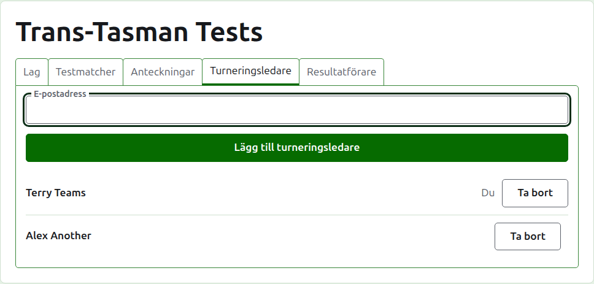
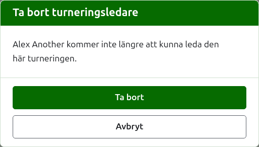
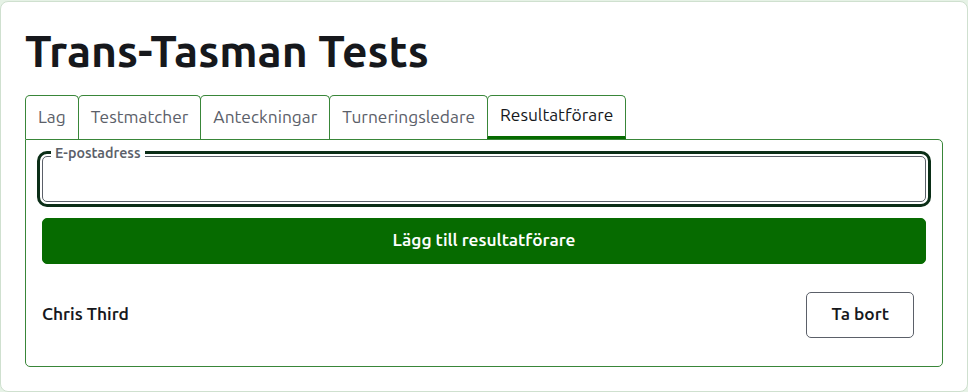
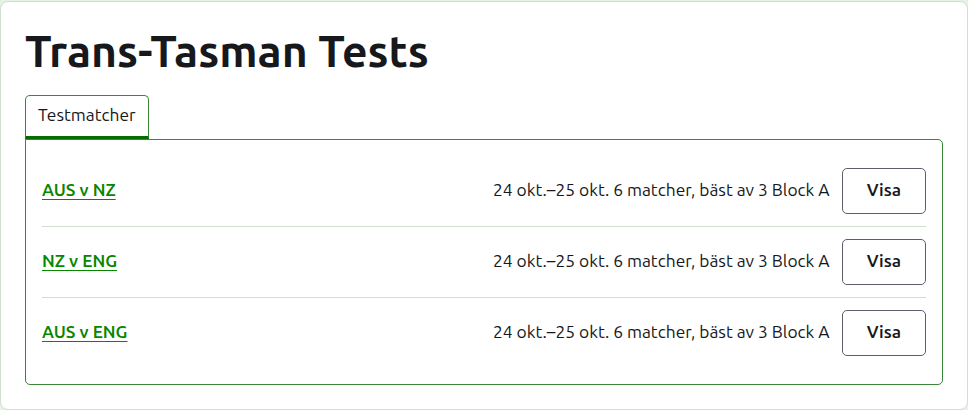

# Turneringsledare och resultatförare

En turnering har turneringsledare, som kan göra allt som kan göras med den, och kan ha resultatförare, som skriver in dess resultat och inget annat. Den som skapade turneringen är dess första turneringsledare.

## Turneringsledare

Fliken **Turneringsledare** listar vem som leder turneringen, i den ordning de gjordes till ledare, med ditt eget namn markerat som ditt. Det är där en turnering delas, eller lämnas över.

Någon görs till turneringsledare via sin e-postadress. Skriv in den i fältet ovanför listan och tryck på **Lägg till turneringsledare**. Adressen måste höra till ett konto som är registrerat och bekräftat; en adress utan ett sådant godtas inte, vilket sägs under fältet, och webbplatsen säger inte mer om det än så. En resultatförare som görs till turneringsledare slutar vara resultatförare.

**Ta bort** tar bort en turneringsledare. Ingenting behålls av en borttagen turneringsledare, så Ta bort frågar först; den görs till turneringsledare igen via sin adress om den vill ha tillbaka. En turnering har alltid en turneringsledare, så den sista erbjuds inte Ta bort.

Du kan ta bort dig själv. Frågan säger då vad det innebär: du förlorar din egen väg tillbaka till turneringen, och ingen på sidan kan ångra det åt dig. En annan turneringsledare kan göra dig till turneringsledare igen.

## Resultatförare

Fliken **Resultatförare** är fliken Turneringsledare för resultatförare, och fungerar på samma sätt: en e-postadress och **Lägg till resultatförare** ovanför listan, och **Ta bort** på var och en.

En resultatförare ser turneringen i sin egen lista i administrationen, med **Resultat** i stället för Hantera, och erbjuds bara dess testmatcher: inga lag, anteckningar, turneringsledare eller resultatförare. De kan inte öppna ett lags sida, eftersom vem som spelar för ett lag är turneringsledarnas sak. På en testmatchs sida kan de skriva in, rätta, arkivera, återställa och ordna om resultat som en turneringsledare kan.

En turneringsledare görs inte till resultatförare, eftersom en turneringsledare redan kan göra allt en resultatförare kan. En turnering behöver ingen resultatförare, så varje resultatförare kan tas bort, även den sista.

Nästa: [Ändra, arkivera och återställa en turnering](changing-and-archiving.md).
