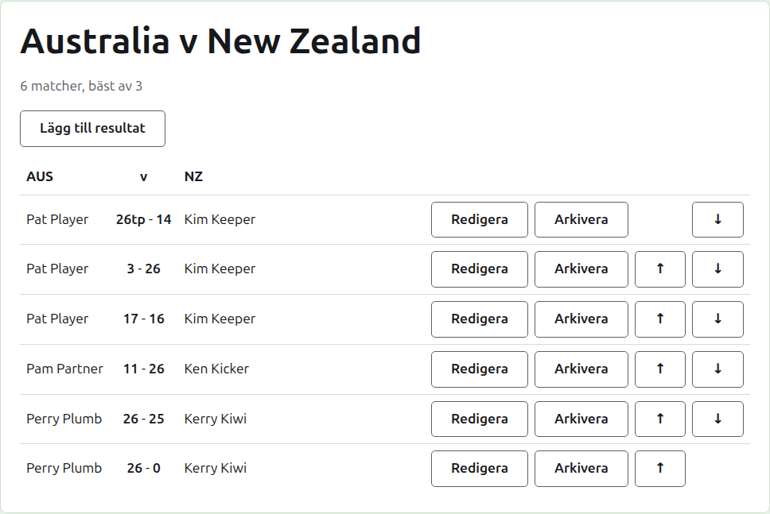
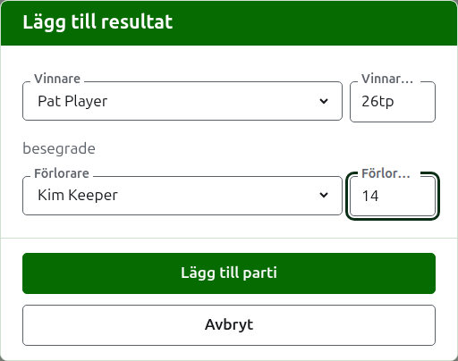

# Resultat

En testmatchs sida öppnas från dess namn på fliken Testmatcher, eller från det mörkgröna fältet. Den har lagens fullständiga namn som rubrik, som "Australia v New Zealand", med hur många matcher den förväntas ha och vad var och en spelas bäst av under. Dess resultat är sidan, utan flikar. En turneringsledare och en resultatförare ser samma sida, eftersom en resultatförare kan göra allt med ett resultat som en turneringsledare kan.

## Så är resultaten uppställda

Resultaten är uppställda lag för lag i stället för efter vem som vann, i en tabell med det första lagets kortnamn, "v" och det andra lagets som rubrik. Varje resultat är en rad: det första lagets spelare, sedan båda resultaten med det första lagets först, som "26tp - 14", sedan det andra lagets spelare, vem av dem som än vann. De arkiverade resultaten är uppställda på samma sätt under.

## Skriva in ett resultat

Tryck på **Lägg till resultat**, ovanför listan. Dialogrutan läses som ett resultat sägs högt: vinnaren och dennes resultat, sedan "besegrade", sedan förloraren och dennes resultat.

Vinnaren väljs bland båda lagens spelare i bruk, under varje lags namn, det första lagets spelare först och varje lags i lagets ordning. Ingen är vald från början. När vinnaren är vald erbjuds förloraren bara från det andra laget, eftersom ett parti mellan två spelare i samma lag inte är ett parti mellan lagen. En arkiverad spelare erbjuds inte.

Ett resultat skrivs som resultatföraren skrev ned det: dess antal poäng, och det som följer, vilket behålls och visas som det skrevs, som "26tp" för 26 bågar och en triple peel. Antalet är de siffror resultatet börjar med; ett resultat som inte börjar med en siffra godtas inte.

Ett parti som vunnits på lika poäng, som när det stoppas av tiden och avgörs på något annat sätt, säger vem som vann genom en markering efter vinnarens resultat: "6w" besegrade "6". Markeringarna är "w", "won" och "winner". En vinnares resultat måste vara högre än förlorarens, eller markerat, såvida inte turneringen tillåter oavgjorda resultat, i vilket fall lika poäng utan markering sparas som oavgjort.

Tryck på **Lägg till parti**. Partiet läggs till, dialogrutan säger vilket, och fälten töms för nästa, eftersom resultaten kommer i en bunt läst från en tavla i slutet av ett spelpass. Tryck på **Avbryt** när alla är inlagda.

## Matcher

Två spelare som möts spelar en match på testmatchens bäst av. Partierna mellan dem är den matchens partier, och ett parti mellan två spelare vars match redan är avgjord godtas inte: en av dem har vunnit fler partier än den andra fortfarande kan vinna, eller varje parti i den har spelats.

En match startas när dess två spelare har ett parti i bruk. En testmatch startar inte fler matcher än den förväntas ha: när så många har startat godtas inte ett parti mellan två spelare som inte har mötts, medan ännu ett parti i en match som redan startat godtas. Där testmatchen ska ha fler matcher, ändra den på fliken Testmatcher till att förvänta dem.

## Rätta ett resultat

**Redigera** öppnar samma dialogruta på det resultatet, med rubriken Redigera resultat, med dess spelare valda och dess resultat som de skrevs. Dess spelare kan ändras likaväl som dess siffror, valda som när man lägger till. Tryck på **Spara** för att spara rättelsen och stänga dialogrutan. En rättelse behåller utgången: ett vunnet parti förblir vunnet, och ett oavgjort parti förblir oavgjort. Ett parti vars utgång var fel arkiveras och skrivs in igen.

## Ordna resultaten

Resultaten kommer i den ordning de skrivs in, så varje resultat i bruk erbjuder **Upp** och **Ned**, som byter plats på det och resultatet bredvid, så att listan kan läggas i den ordning partierna spelades.

## Arkivera ett resultat

**Arkivera** lägger undan ett resultat så att det inte räknas. Det listas under **Arkiverade resultat**, överstruket, och erbjuder bara **Återställ**. Ingetdera frågar först, eftersom vart och ett ångrar det andra. Varje resultat i en testmatch kan arkiveras, eftersom en testmatch inte har några omgångar som beror på varandra.

Ett resultat vars spelare har arkiverats sedan dess återställs inte förrän spelaren är det, och sidan säger det.

Nästa: [Anteckningar](notes.md).
