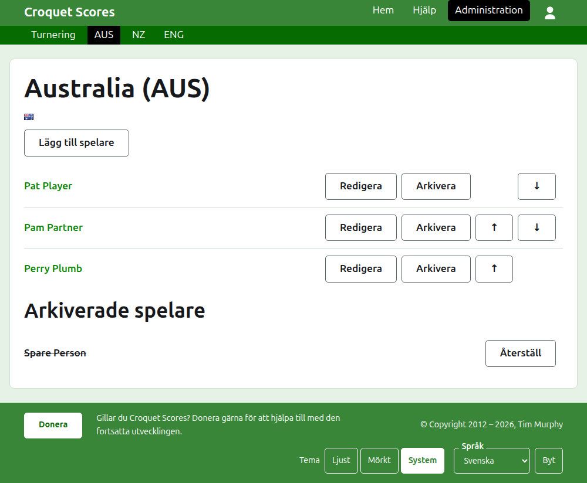
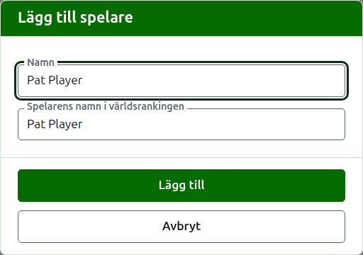

# Ett lags spelare

Ett lags sida öppnas från dess namn, eller dess **Visa**, på fliken Lag. Den har lagets namn som rubrik, med kortnamnet inom parentes, och dess flagga, så att en turneringsledare som kom till fel lag ser det på en gång. Den har en enda sak att visa, lagets spelare, så listan är sidan.

Det mörkgröna fältet på ett lags sida leder till turneringen och till varje lag i bruk med dess kortnamn, så att spelarna läggs till lag för lag utan att gå tillbaka till fliken Lag.

En spelare i ett lag hör till det laget ensamt, representerar laget och för lagets flagga i stället för en egen. Samma person som spelar för två lag, eller i två turneringar, är en spelare i vart och ett.

## Lägga till en spelare

Tryck på **Lägg till spelare**, ovanför listan. En dialogruta öppnas över sidan.

**Namn** krävs, mellan 3 och 254 tecken. Två spelare i ett lag kan inte ha samma namn, hur det än skrivs med stora och små bokstäver; en spelare i ett annat lag får dela det.

**Spelarens namn i världsrankingen** är det namn världsrankingen känner spelaren under. Det frågas efter bara i en turnering i associationscroquet eller golfcroquet, de två sporter som har världsranking. Medan du lägger till en spelare följer det namnet medan du skriver, och slutar följa när du skriver i det. Lämnas det tomt sparas det som spelarens namn. Medan du skriver erbjuds de spelare världsrankingen känner till vars namn börjar så, och bredvid världsrankingnamnet säger en bock att rankingen känner till namnet och ett frågetecken att den inte gör det. Det är bara ett råd: ett namn rankingen inte känner till sparas lika gärna som ett den känner till.

En spelare heter aldrig "Bye": ett namn vars första ord är det engelska "bye" godtas inte.

Tryck på **Lägg till**. Spelaren läggs till, dialogrutan säger det, och fälten töms för nästa, med markören tillbaka i namnet. Lägg till hela laget på det sättet, och tryck sedan på **Avbryt** för att stänga dialogrutan.

## Rätta en spelare

Tryck på en spelares namn, eller på spelarens **Redigera**, för att öppna samma dialogruta på den spelaren, med rubriken Redigera spelare. Tryck på **Spara** för att spara ändringen. En spelare vars namn rättas behåller det världsrankingnamn spelaren hade.

## Ordning

Spelarna listas i lagets ordning, som är den ordning de erbjuds i när en testmatchs resultat skrivs in. **Upp** och **Ned** flyttar en spelare ett steg inom laget.

## Arkivera en spelare

**Arkivera** lägger undan en spelare: en som lades till av misstag, eller som inte längre är med i laget. En arkiverad spelare listas under **Arkiverade spelare**, överstruken, efter de spelare som är i bruk, och erbjuder bara **Återställ**. Att arkivera frågar aldrig först, eftersom en spelare i ett lag inte är insatt i något annat och att återställa spelaren sätter tillbaka allt.

En spelare som har spelat något parti i bruk i en testmatch kan inte arkiveras, eftersom partierna då skulle vara mot någon som inte längre finns där, så en sådan spelare erbjuds inte Arkivera. En spelare vars enda partier är arkiverade kan arkiveras.

Nästa: [Testmatcher](tests.md).
