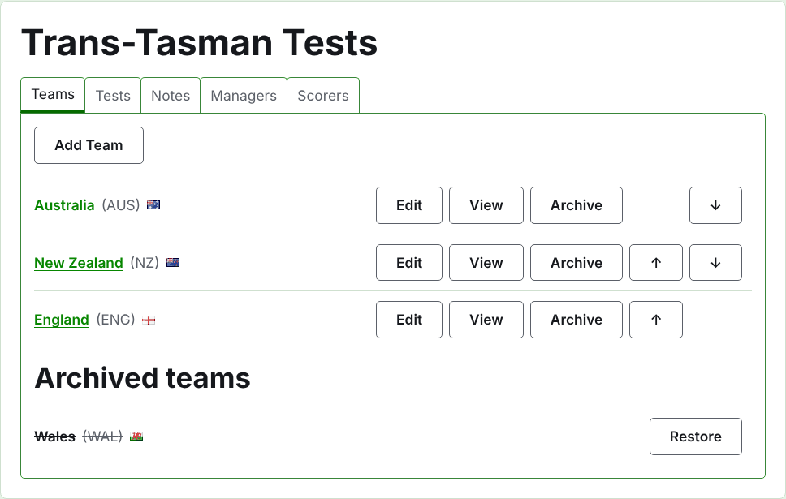
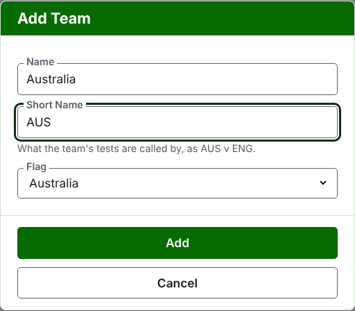
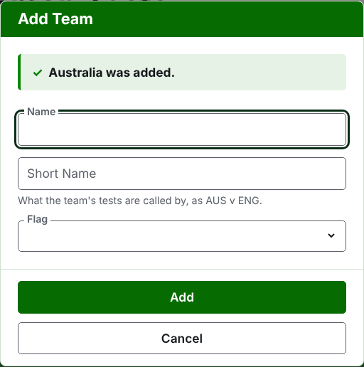
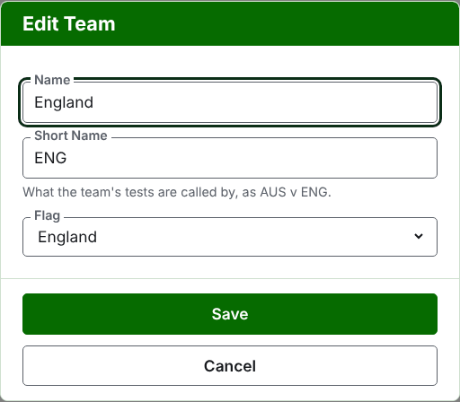

# Lag

Fliken **Lag** på en turnerings sida är där dess lag läggs till, rättas, ordnas och läggs undan. Det är den flik sidan öppnas på, eftersom lagen är det första som sätts upp. En testmatch spelas mellan två lag, så minst två behövs innan någon testmatch kan läggas till.

## Lägga till ett lag

Tryck på **Lägg till lag**, ovanför listan. En dialogruta öppnas över sidan.

**Namn** krävs: lagets fullständiga namn, som "Australia", vilket står som rubrik på lagets sida och över de offentliga sidornas tabeller. Två lag i en turnering kan inte ha samma namn.

**Kortnamn** krävs också: det lagets testmatcher kallas med, som "AUS v ENG", och det som det mörkgröna fältet kallar laget. Det är högst 10 tecken, och inte längre än namnet, eftersom ett kortnamn som är längre än det namn det kortar ned är de två skrivna i fel fält. Två lag kan inte heller ha samma kortnamn.

**Flagga** visas bredvid lagets namn överallt där det förekommer. Den kan lämnas som ingen, som för ett lag från en klubb eller en region.

Tryck på **Lägg till**. Laget läggs till, dialogrutan säger det, och fälten töms för nästa. Lägg till hela listan på det sättet, och tryck sedan på **Avbryt** för att stänga dialogrutan. Avbryt sparar ingenting som inte redan har lagts till.

## Rätta ett lag

Tryck på ett lags **Redigera** för att öppna samma dialogruta på det laget, med rubriken Redigera lag. Ändra det som är fel och tryck på **Spara**. Ett lag vars kortnamn ändras kallas med det nya överallt, så dess testmatcher byter namn med det.

## Ordning

Lagen listas i turneringens ordning, som är den ordning de erbjuds i när en testmatch läggs till, den ordning det mörkgröna fältet har dem i, och den ordning den offentliga sidan Spelare listar dem i. **Upp** och **Ned**, pilarna i slutet av varje rad, flyttar ett lag ett steg.

## Gå till ett lag

Ett lags namn, eller **Visa**, öppnar lagets egen sida, där dess spelare läggs till. Se [Ett lags spelare](team-players.md).

## Arkivera ett lag

**Arkivera** lägger undan ett lag. Dess spelare stannar hos det och kommer tillbaka när det återställs, så att arkivera frågar inte först. Ett arkiverat lag listas under **Arkiverade lag**, överstruket, erbjuder bara **Återställ**, och dess sida är stängd tills det återställs.

Ett lag som spelar i en testmatch i bruk kan inte arkiveras, eftersom testmatchen då skulle vara mot ett lag som inte längre finns där, så ett sådant lag erbjuds inte Arkivera. Ett lag vars enda testmatcher är arkiverade kan arkiveras.

Nästa: [Ett lags spelare](team-players.md).
