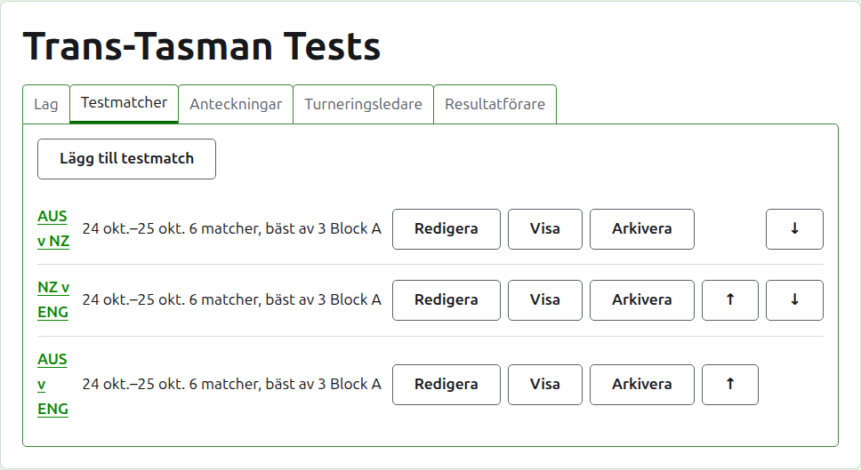
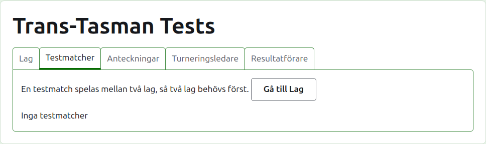
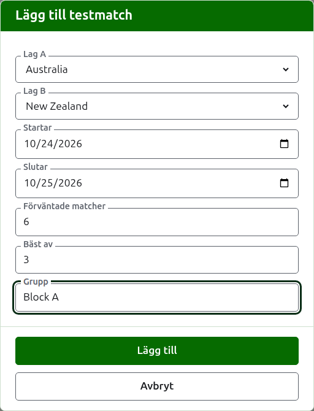
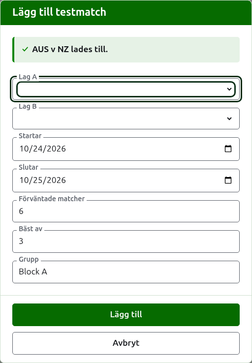
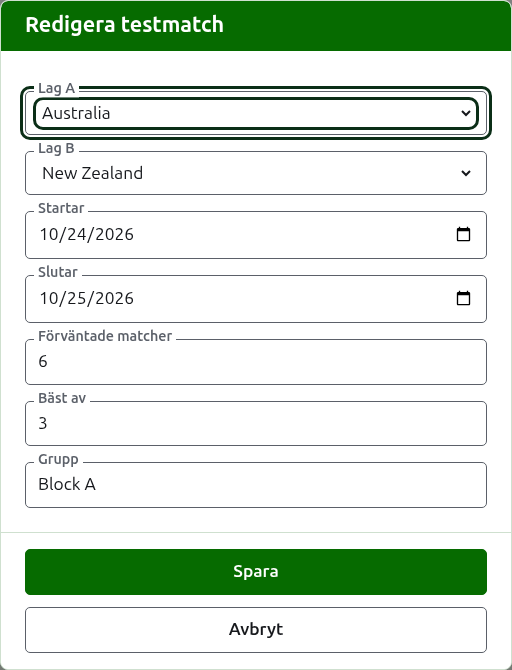

# Testmatcher

Fliken **Testmatcher** på en turnerings sida är där testmatcherna mellan dess lag läggs till, ändras, ordnas och läggs undan. En testmatch är en av turneringens tävlingar: en kamp mellan två lag, kallad med deras kortnamn, som "AUS v NZ", spelad som ett antal matcher mellan en spelare från varje lag. Varje testmatch har en egen sida, där dess resultat skrivs in.

Varje testmatch anger sitt namn, de dagar den spelas, hur många matcher den förväntas ha och vad var och en spelas bäst av, som "6 matcher, bäst av 3", och sin grupp där den är med i en.

## Två lag först

En testmatch spelas mellan två lag i bruk, så medan turneringen har färre än två säger fliken det där Lägg till testmatch skulle stå, och leder till fliken Lag.

## Lägga till en testmatch

Tryck på **Lägg till testmatch**, ovanför listan. En dialogruta öppnas över sidan, i den ordning en testmatch sägs högt.

**Lag A** och **Lag B** väljs var för sig bland turneringens lag i bruk, med namn, i turneringens ordning. Inget är valt från början, så att en testmatch aldrig läggs till mellan lag du inte valde. Lag B erbjuder varje lag utom det som valts som Lag A, eftersom ett lag inte spelar testmatch mot sig självt. Lag A är det första laget: dess spelare står till vänster på testmatchens sida och på den offentliga sidan. En testmatch har inget eget namn att skriva; den kallas med sina lags kortnamn.

**Startar** och **Slutar** är de dagar testmatchen spelas, och börjar på turneringens första dag. En testmatch spelas inom sin turnering, så dagar före turneringen startar eller efter att den slutar godtas inte.

**Förväntade matcher** är hur många matcher testmatchen ska ha, bestämt av evenemanget innan det börjar, så att den som läser dess resultat kan se hur långt den har kommit. Det är ett helt tal från 1 och uppåt. Det är också en gräns: när så många matcher har startat som testmatchen förväntas ha godtas inte ett parti som skulle starta ännu en, medan de matcher som redan startat spelas färdigt. En testmatch som ska ha fler ändras till att förvänta dem.

**Bäst av** är vad varje match spelas bäst av. Det får vara jämnt, eftersom en match kan delas.

**Grupp** är den grupp testmatchen ingår i, där evenemanget spelas i grupper, som "Block A". Den är frivillig: lämnas den tom ingår testmatchen i ingen. Testmatcherna i en grupp har en egen sida på den offentliga webbplatsen, som visar hur gruppens lag står.

Tryck på **Lägg till**. Testmatchen läggs till, dialogrutan säger vilken med dess namn, och lagen töms för nästa, med dagarna, de förväntade matcherna, bäst av och gruppen kvar som de var: testmatcher läggs till en omgång i taget, mellan lag som möts samma dag, så omgångens nästa testmatch är bara dess två lag. Tryck på **Avbryt** när alla är inlagda.

## Ändra en testmatch

**Redigera** öppnar samma dialogruta på testmatchen, med rubriken Redigera testmatch, ifylld som testmatchen är. Tryck på **Spara** för att spara ändringen.

En testmatch med partier i bruk behåller sina lag: dialogrutan visar dem men de kan inte ändras. Det övriga kan ändras, inom ramen för det som har spelats: färre förväntade matcher än de matcher som redan startat godtas inte, och inte heller ett bäst av som är lägre än det största antal partier två spelare har spelat.

## Ordning

Testmatcherna listas i turneringens ordning, som är den ordning de visas i på de offentliga sidorna och i det mörkgröna fältet. **Upp** och **Ned** flyttar en testmatch ett steg.

## Gå till en testmatch

En testmatchs namn, eller **Visa**, öppnar dess sida, där dess resultat skrivs in. Det mörkgröna fältet leder också dit, från turneringens sida eller från vilken annan testmatchs sida som helst.

## Arkivera en testmatch

**Arkivera** lägger undan en testmatch, och ångras med **Återställ**, så ingetdera frågar först. En arkiverad testmatch listas under **Arkiverade testmatcher**, överstruken, erbjuder bara Återställ och finns inte på de offentliga sidorna.

En testmatch med partier i bruk har spelats, och kan inte arkiveras förrän dess partier är det. En testmatch vars partier alla är arkiverade kan arkiveras, eftersom ett arkiverat parti inte räknas. En testmatch vars lag har arkiverats sedan dess återställs inte förrän laget är det, och fliken säger det.

Nästa: [Resultat](scores.md).
