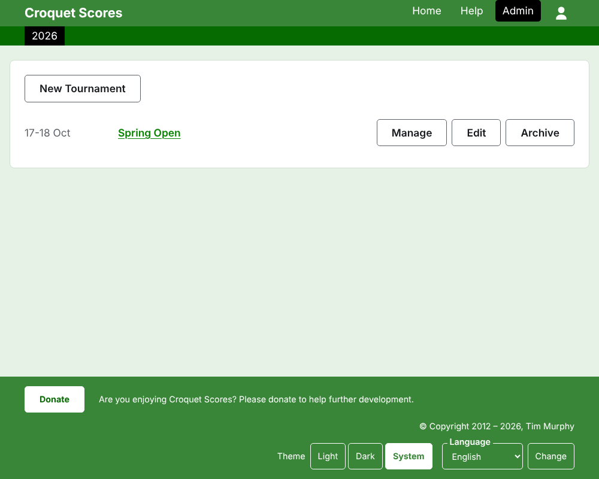

# Running a standard tournament

A standard tournament is one played between players entered one by one: a club weekend, an open, a championship. Its players are entered into blocks, knockouts and Swisses, and its scores go up as they are played. This guide takes a manager from signing in to a tournament whose results are availabe to the public.

It stands on its own. Nothing in it depends on the guide to a tournament played by teams, which is written separately.

## Before you start

You need an account. Click [here](/account/register) to register an account.

Everything a manager does is done in the admin section of the website. The public pages, where players and spectators follow the tournament, are drawn from what the admin holds, so nothing has to be published: a score entered is on the public pages at once.

## The pages in order

1. [Creating a tournament](creating-a-tournament.md): its name, its days, its sport, where it is played, and what it counts toward.
2. [Players](players.md): entering the tournament's players, correcting them, and setting aside the ones entered by mistake.
3. [Competitions](competitions.md): adding blocks, knockouts and Swisses, and putting them in order.
4. [Entering players in a competition](entering-players-in-a-competition.md): who plays in each competition, byes in a knockout, carry forwards, removing and withdrawing.
5. [Scores](scores.md): entering results, correcting them, and setting aside the ones entered by mistake.
6. [Notes](notes.md): telling the players what they need to know as the tournament goes on.
7. [Managers and scorers](managers-and-scorers.md): sharing the running of the tournament, and letting somebody enter scores without being able to change anything else.
8. [Changing, archiving and restoring a tournament](changing-and-archiving.md): correcting the tournament's details, and setting a tournament aside.
9. [What the public sees](what-the-public-sees.md): the pages your players follow, and how what you enter appears on them.

## How the admin is laid out

The admin's front door lists the tournaments you have a part in, one year at a time.

Pressing a tournament's name, or **Manage**, opens its page. Everything there is to run is in five tabs beneath its name: **Players**, **Competitions**, **Notes**, **Managers** and **Scorers**. The page opens on Players, since the players are the first thing entered.

The dark green bar beneath the header is for moving between pages. It leads to the tournament, as **Tournament**, and to each of its competitions by name, so that you can go from the tournament to a competition and between competitions without going back through the Competitions tab. The page you are on is marked in black.

## Things that hold everywhere

**Nothing is deleted outright except a note.** Players, competitions, scores and the tournament itself are archived rather than deleted: set aside, struck through, and listed under a heading of their own, with **Restore** to bring them back. Archiving, restoring and moving up and down never ask you to confirm, because each is undone by pressing the other way. The things that cannot be undone, such as removing a player from a competition or deleting a note, ask first.

**A dialog over the page keeps nothing until you press its button.** Cancel, or the Escape key, closes it and leaves everything as it was. Dialogs that add things, such as Add Player and Add Score, stay open after each one is added, so that a list can be typed in one after another.

**What is refused is said beside the field it is about.** Nothing refused is kept, and what you typed stays typed, so that it can be put right rather than typed again.

**The admin works on a phone.** Every button is big enough to press with a thumb, and nothing is wider than the screen.

Next: [Creating a tournament](creating-a-tournament.md).
