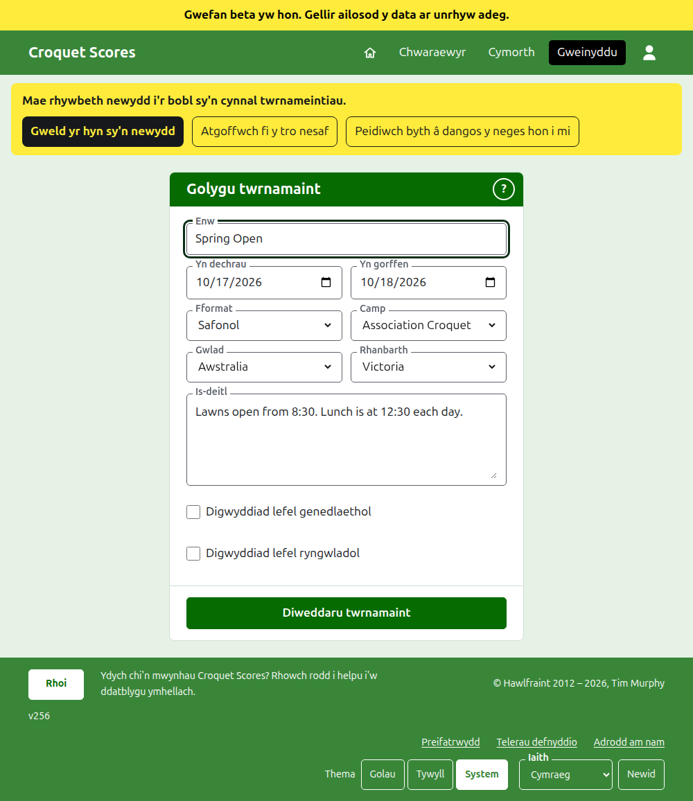
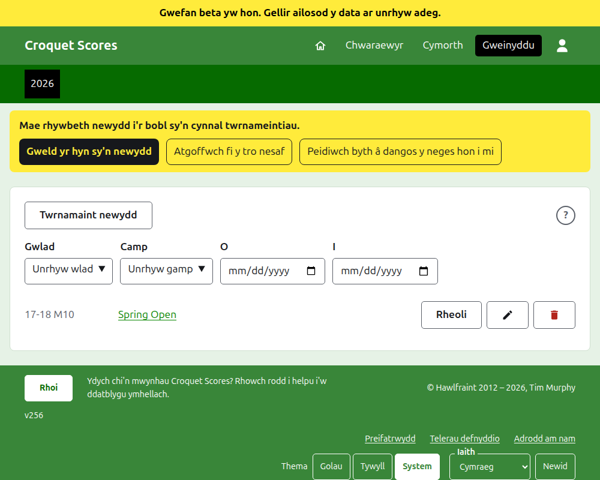
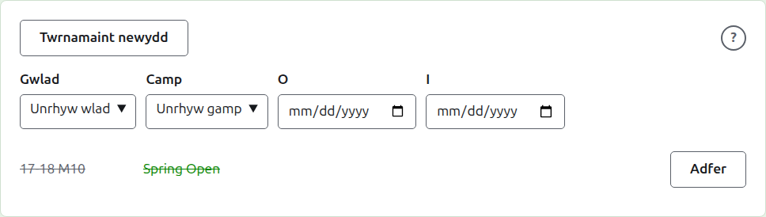

# Newid, archifo ac adfer twrnamaint

## Newid manylion y twrnamaint

Yn y rhestr o dwrnameintiau yn yr adran weinyddu, pwyswch **Golygu** ar y twrnamaint. Y ffurflen yw'r un a'i creodd, wedi'i dechrau fel y mae'r twrnamaint. Newidiwch beth sydd o'i le a phwyswch **Diweddaru twrnamaint**.

Unwaith y bydd gan y twrnamaint unrhyw chwaraewr neu gystadleuaeth, a'r rhai a archifwyd yn cyfrif, ni ellir newid ei fformat i un a chwaraeir gan dimau, sydd â thimau a phrofion yn eu lle.

Mae twrnamaint yn cadw ei gyfeiriad pan gaiff ei enw ei gywiro, fel bod dolen y mae rhywun eisoes wedi'i hanfon yn dal i ddod o hyd iddo. Mae'n symud dim ond pan fydd y flwyddyn y mae'n dechrau ynddi neu ei gamp yn newid, ac wedyn mae ei hen gyfeiriad yn arwain at yr un newydd. Mae cadw yn eich tywys i'r twrnamaint lle bynnag y'i ceir yn awr.

Dim ond rheolwr all newid twrnamaint. Dywedir hynny wrth sgorwr, neu unrhyw un arall, yn hytrach na dangos y ffurflen iddo.

## Y rhestr o dwrnameintiau

Mae'r adran weinyddu yn rhestru un flwyddyn ar y tro, gan ddechrau â'r flwyddyn hon, y twrnamaint mwyaf newydd yn gyntaf. Mae'r blynyddoedd y mae gennych dwrnamaint ynddynt yn dabiau yn y bar gwyrdd tywyll, y mwyaf newydd yn gyntaf; lle mae mwy nag sy'n ffitio ar ffôn, mae'r hynaf mewn cwymplen ar ddiwedd y rhes. Mae'r flwyddyn yn y cyfeiriad, felly gellir dolennu at flwyddyn.

Uwchben y rhestr, mae **Gwlad**, **Rhanbarth**, **Camp**, **O** ac **I** yn ei chyfyngu wrth iddynt gael eu dewis, heb fotwm i'w wasgu. Cynigir dim ond dewisiadau a fyddai'n rhestru rhywbeth, a chynigir rhanbarth unwaith y dewisir gwlad. Dyddiau yw **O** ac **I**: y rhestr yw'r twrnameintiau sy'n dechrau o'r naill i'r llall, y ddau wedi'u cynnwys, a rhaid dewis y ddau i gyfyngu'r rhestr yn ôl dyddiau. Mae'r hyn a ddewisir yn y cyfeiriad, felly gellir dolennu at restr gyfyngedig; mae dewis blwyddyn arall yn ei chlirio. Rhestrir blwyddyn â mwy na chant o dwrnameintiau gan gant i dudalen, gyda **Blaenorol** a **Nesaf** oddi tani. Gosodir twrnamaint cenedlaethol neu ryngwladol mewn print trwm ar hyd ei res.

## Archifo twrnamaint

Mae **Archifo** ar dwrnamaint yn y rhestr yn ei roi o'r neilltu. Caiff ei restru o hyd, â llinell drwyddo ac ar ôl y twrnameintiau sydd yn eu lle, ond dim ond **Adfer** a gynigir iddo: mae ei dudalen yn yr adran weinyddu, a'i dudalennau cyhoeddus, ar gau nes iddo gael ei adfer. Nid yw archifo'n gofyn yn gyntaf, gan fod adfer yn ei ddadwneud.

Nesaf: [Beth mae'r cyhoedd yn ei weld](what-the-public-sees.md).
