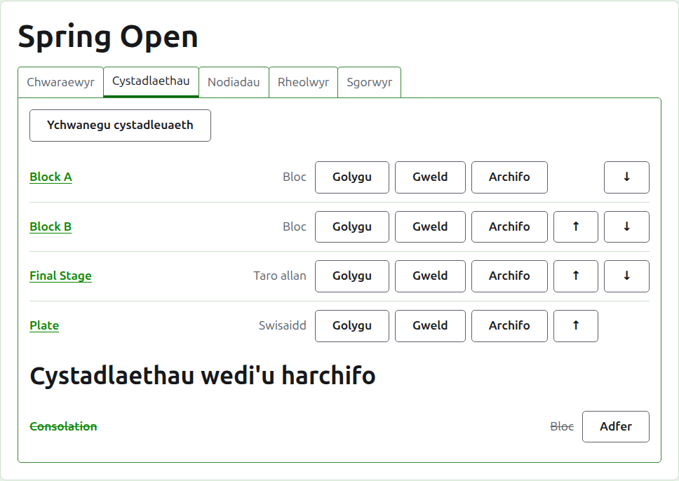
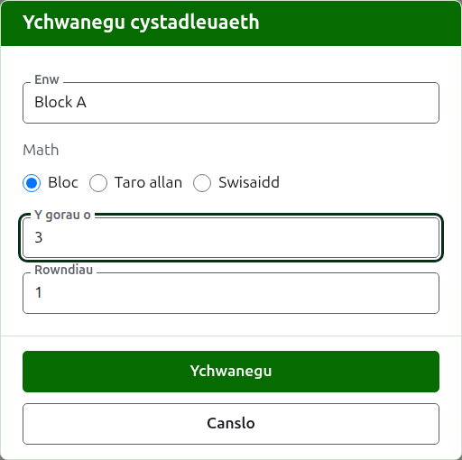
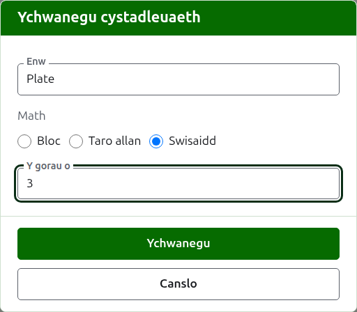
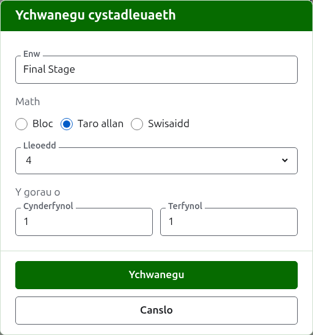

# Cystadlaethau

Tab **Cystadlaethau** tudalen twrnamaint yw lle caiff ei gystadlaethau eu hychwanegu, eu rhoi mewn trefn, a'u rhoi o'r neilltu. Mae cystadleuaeth yn floc, yn gystadleuaeth cnoc-owt neu'n gystadleuaeth Swisaidd. Mae gan bob un dudalen ei hun, lle rhoddir ei chwaraewyr i mewn a lle mae ei chanlyniadau'n mynd.

## Ychwanegu cystadleuaeth {#adding-a-competition}

Pwyswch **Ychwanegu cystadleuaeth**, uwchben y rhestr. Mae deialog yn agor dros y dudalen, yn gofyn am enw'r gystadleuaeth, ei math, a'r siâp sydd gan ei math.

**Enw** yw'r hyn y mae'r chwaraewyr yn chwilio amdano ar dudalen y twrnamaint i ddod o hyd i'w gemau. Mae rhwng 1 a 254 o gymeriadau, a bydd llythyren ar ei phen ei hun yn gwneud y tro, gan fod bloc yn aml yn cael ei alw wrth un. Ni all dwy gystadleuaeth yn yr un twrnamaint gael yr un enw.

**Math** yw bloc, cystadleuaeth cnoc-owt neu gystadleuaeth Swisaidd. Mae'r ddeialog yn dechrau ar floc, sef beth yw'r mwyafrif o gystadlaethau.

### Bloc

Mae bloc yn gofyn beth yw pob gêm **Yr orau o**, a sawl rownd y caiff ei chwarae ynddynt, sef **Rowndiau**.

Mae **Yr orau o** yn dechrau ar 1. Enillir yr orau o 3 gan bwy bynnag sy'n ennill dwy gêm unigol. Gall fod yn eilrif, gan fod chwaraewr mewn bloc yn cael ei safle yn ôl y gemau unigol y mae'n eu hennill, ac mae gêm o ddwy gêm unigol wedi'u rhannu un yr un yn ganlyniad fel unrhyw un arall.

Mae **Rowndiau** yn dweud sawl gwaith y mae pob pâr o chwaraewyr yn y bloc yn cwrdd, â gêm ym mhob rownd. Mae'n dechrau ar 1, ac 1 yw'r hyn y mae bloc ei eisiau bron bob amser: mae pob chwaraewr yn chwarae pob un arall unwaith. Codwch ef dim ond ar gyfer bloc lle maent yn cwrdd eto, fel cystadleuaeth gron ddwbl, lle mae 2 yn gwneud i bob pâr chwarae dwy gêm.

### Cystadleuaeth Swisaidd

Nid yw cystadleuaeth Swisaidd ond yn gofyn beth yw pob gêm **Yr orau o**, sy'n dechrau ar 1, yn union fel bloc. Enillir yr orau o 3 gan bwy bynnag sy'n ennill dwy gêm unigol. Gall fod yn eilrif, gan fod chwaraewr mewn cystadleuaeth Swisaidd yn cael ei safle yn ôl y gemau unigol y mae'n eu hennill, ac mae gêm o ddwy gêm unigol wedi'u rhannu un yr un yn ganlyniad fel unrhyw un arall.

### Cystadleuaeth cnoc-owt

Mae cystadleuaeth cnoc-owt yn gofyn sawl **Lleoedd** sydd gan ei siart, a beth yw pob rownd yr orau o. Cynigir y lleoedd fel 2, 4, 8, 16, 32, 64 a 128, gan na allai unrhyw rif arall haneru rownd wrth rownd hyd at rownd derfynol, ac mae'r ddeialog yn dechrau ar 8. Caiff lleoedd sydd ar ôl unwaith y rhoddir y chwaraewyr i mewn eu llenwi â byes, a ychwanegir lle mae'r chwaraewyr.

Mae gan siart gymaint o rowndiau ag sydd ei angen i haneru ei lleoedd i un, felly mae gan siart o 8 lle dair rownd. Mae'r ddeialog yn gofyn beth yw pob un yr orau o, gyda'i gilydd o dan **Yr orau o, fesul rownd**, yn y drefn y cânt eu chwarae. Enwir y tair olaf fel y sonnir am rowndiau siart, **Wyth olaf**, **Cyn-derfynol** a **Rownd derfynol**, ac unrhyw rai o'u blaen wrth eu rhif, Rownd 1 yn gyntaf. Mae dewis mwy o leoedd yn ychwanegu rowndiau ar ddechrau'r siart, a dewis llai yn eu tynnu o'r dechrau, felly mae'r hyn a deipiwyd ar gyfer y rownd derfynol yn dal i fod yn eiddo iddi. Mae pob rownd yr orau o odrif o gemau unigol, gan fod yn rhaid i gêm cnoc-owt gael enillydd.

### Cnoc-owt collwyr {#losers-knockout}

Gall cnoc-owt anfon y rhai sy'n colli rownd ymlaen i gnoc-owt eu hunain, cnoc-owt collwyr. O dan **Yr orau o, fesul rownd** cnoc-owt, pwyswch **Ychwanegu Cnoc-owt Collwyr**. Mae deialog yn gofyn am **Collwyr o**, y rownd y mae ei chollwyr yn chwarae ymlaen, o bob rownd ond y rownd derfynol, ac am **Enw'r cnoc-owt collwyr**. Pwyswch **Ychwanegu** i'w roi yn y rhestr o dan y botwm, lle mae **Tynnu** yn ei dynnu eto. Caiff ei ychwanegu gyda'r cnoc-owt pan gaiff hwnnw ei ychwanegu, ac os caiff un o'r ddau ei wrthod, ni chaiff yr un ei ychwanegu.

Mae gan gnoc-owt collwyr le i bob gêm yn y rownd honno, ac mae pob rownd ohono yn orau o 1, y gall **Golygu** ei newid. Rhoddir ei chwaraewyr i mewn wrth i gemau'r rownd honno gael eu penderfynu, yn nhrefn y tynnu, felly dim ond eu dangos y mae ei dab **Chwaraewyr**. Os caiff gêm ei chywiro neu ei rhoi o'r neilltu, caiff y collwr ei symud neu ei dynnu eto, oni bai ei fod eisoes wedi chwarae ymlaen.

Ar gnoc-owt sydd eisoes wedi'i ychwanegu, mae **Golygu** yn dangos yr un botwm, a chaiff y cnoc-owt collwyr ei ychwanegu ar unwaith. Ni ellir archifo cnoc-owt y mae cnoc-owt arall sydd ar waith yn cymryd ei chollwyr, na newid ei lefydd: archifwch y cnoc-owt collwyr yn gyntaf.

### Sut y caiff ei chwarae a'i chyfrif

Mae pob math yn gofyn yr un tri pheth o dan ei siâp.

**Chwarae gyda handicapiau.** Ticiwch hwn ar gyfer cystadleuaeth a chwaraeir gyda handicapiau.

**Caniatáu canlyniadau cyfartal.** Ticiwch hwn lle gall gêm orffen heb i'r un o'r ddau chwaraewr fod yn enillydd. Nid yw'r mwyafrif o gystadlaethau'n ei ganiatáu. Lle mae wedi'i dicio, caiff sgôr a roddir i mewn â phwyntiau cyfartal a dim marc ei chadw fel gêm gyfartal; lle nad yw, rhaid i gêm ar bwyntiau cyfartal ddweud pwy a'i henillodd â marc ar ôl sgôr yr enillydd, fel "6w". Mae gan gêm cnoc-owt enillydd bob amser, felly nid yw gêm unigol gyfartal yn penderfynu un.

**Yn cyfrif tuag at restr detholion y byd.** Gofynnir amdano dim ond lle gellir ei gyfrif: cystadleuaeth Association Croquet neu Golf Croquet na chaiff ei chwarae gyda handicapiau ac nad yw'n caniatáu canlyniadau cyfartal. Mae wedi'i dicio i ddechrau, felly dad-diciwch ef ar gyfer cystadleuaeth nad yw i gyfrif.

### Ychwanegu sawl un ar y tro

Pwyswch **Ychwanegu**. Caiff y gystadleuaeth ei hychwanegu, mae'r ddeialog yn dweud hynny, a chaiff yr enw ei wagio ar gyfer y nesaf, â'r math a'i siâp wedi'u gadael fel yr oeddent: mae cystadlaethau a ychwanegir gyda'i gilydd yn debyg i'w gilydd gan mwyaf, felly nid yw "Block B" ar ôl "Block A" ond ei enw yn unig. Pwyswch **Diddymu** i gau'r ddeialog unwaith y bydd pob un i mewn.

## Newid cystadleuaeth {#changing-a-competition}

Mae **Golygu** yn agor yr un ddeialog ar y gystadleuaeth, dan y teitl Golygu cystadleuaeth, â'i henw, ei siâp a sut y caiff ei chwarae a'i chyfrif fel y maent. Ni ofynnir am ei math, gan na wneir bloc yn gystadleuaeth cnoc-owt trwy ei newid: caiff cystadleuaeth o'r math anghywir ei harchifo a'i hychwanegu eto. Pwyswch **Cadw** i gadw'r newid a chau'r ddeialog.

Mae gan gystadleuaeth cnoc-owt sydd â gêm chwaraewyr wedi'u gosod yn ei siart, a byddai newid i'w lleoedd yn eu symud, felly gwrthodir hynny unwaith y rhoddwyd gêm i mewn. Gellir newid yr orau o ar gyfer ei rowndiau o hyd.

## Trefn

Rhestrir y cystadlaethau yn nhrefn y twrnamaint, sef y drefn y maent yn ymddangos ynddi ar y tudalennau cyhoeddus ac yn y bar gwyrdd tywyll. Mae **I fyny** ac **I lawr** yn symud cystadleuaeth un lle.

## Mynd i gystadleuaeth

Mae enw cystadleuaeth, neu **Gweld**, yn agor ei thudalen, lle rhoddir ei chwaraewyr i mewn a lle mae ei chanlyniadau'n mynd. Mae'r bar gwyrdd tywyll o dan y pennyn yn arwain yno hefyd, o unrhyw dudalen o'r twrnamaint.

## Archifo cystadleuaeth

Mae **Archifo** yn rhoi cystadleuaeth o'r neilltu, p'un a oes ganddi gemau neu beidio, a gedwir gyda hi ac sy'n dod yn ôl pan gaiff ei hadfer. Rhestrir cystadleuaeth a archifwyd o dan **Cystadlaethau wedi'u harchifo**, â llinell drwyddi, dim ond **Adfer** a gynigir iddi, ac nid yw ar y tudalennau cyhoeddus. Nid yw archifo'n gofyn yn gyntaf, gan fod adfer yn ei ddadwneud.

Nesaf: [Rhoi chwaraewyr mewn cystadleuaeth](entering-players-in-a-competition.md).
