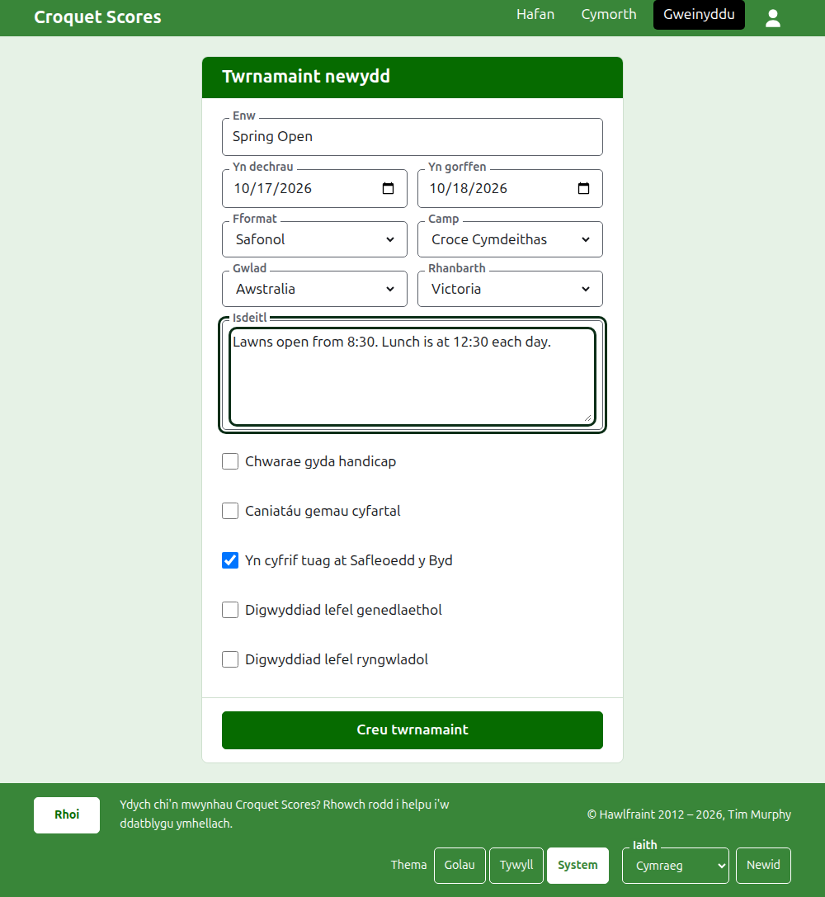

# Creu twrnamaint

Pwyswch **Twrnamaint newydd** uwchben y rhestr o dwrnameintiau yn yr adran weinyddu. Mae uwchben y rhestr yn hytrach nag oddi tani, fel na fydd rhestr hir yn ei wthio oddi ar sgrin ffôn.

Mae'r ffurflen yn gofyn am bopeth y mae twrnamaint yn dechrau ag ef. Nid yw twrnamaint o'r math cyffredin ond enw, dau ddyddiad a gwlad i ffwrdd: caiff popeth arall ei benderfynu drosoch a gellir ei newid.

## Beth mae'r ffurflen yn gofyn amdano

**Enw.** Yr hyn y mae darllenwyr yn chwilio amdano i ddod o hyd i'r twrnamaint, fel "Spring Open". Mae rhwng 3 a 254 o gymeriadau. Gwrthodir enw sydd i gyd mewn llythrennau bach, neu i gyd mewn prif lythrennau, gan y byddai'n edrych fel camgymeriad ar bob tudalen y caiff ei ddangos arni. Gall dau dwrnamaint gael yr un enw, gan fod yr un twrnamaint yn cael ei chwarae bob blwyddyn.

**Yn dechrau** ac **Yn gorffen.** Y dyddiau y mae'r twrnamaint yn rhedeg. Ni all twrnamaint orffen cyn iddo ddechrau, ac ni all ddechrau na gorffen yn hwyrach na diwedd y flwyddyn nesaf. Mae twrnamaint yn perthyn i'r flwyddyn y mae'n dechrau ynddi, sef y flwyddyn yn ei gyfeiriad hefyd, felly caiff un sy'n rhedeg dros y flwyddyn newydd ei restru yn y flwyddyn y mae'n dechrau.

**Fformat.** Dewiswch **Safonol** ar gyfer twrnamaint a chwaraeir rhwng chwaraewyr. Mae'r fformatau eraill ar gyfer twrnameintiau a chwaraeir rhwng timau, sydd â chanllaw eu hunain.

**Camp.** Y campau y mae'r wefan yn eu cynnig, yn ei threfn: Croce Cymdeithas, Croce Golff, Croce Americanaidd 6 Chylch a Ricochet ar Croquet Scores. Nid yw Gateball Scores yn gofyn am gamp na fformat, gan fod pob twrnamaint yno'n dwrnamaint safonol o gateball.

**Gwlad** a **Rhanbarth.** Lle caiff y twrnamaint ei chwarae. Gofynnir am ranbarth dim ond lle mae'r wlad a ddewiswch wedi'i rhannu'n rhanbarthau, fel taleithiau Awstralia; nid yw gwlad sy'n un rhanbarth ynddi ei hun yn gofyn am un. Nid oes raid dewis rhanbarth hyd yn oed lle cynigir un.

**Isdeitl.** Beth bynnag rydych am i ddarllenwyr ei wybod nad oes ganddo faes ei hun: lle i barcio, pryd mae cinio, pwy i'w ffonio. Caiff ei ddangos o dan enw'r twrnamaint ar bob tudalen gyhoeddus. Caiff ei ysgrifennu mewn Markdown, felly gellir gwneud gair mewn print trwm â sêr o'i gwmpas a gwneud rhestr â llinell doriad ar ddechrau pob llinell. Gall fod hyd at 2000 o gymeriadau, a gellir ei adael yn wag.

**Chwarae gyda handicap.** Ticiwch hwn ar gyfer twrnamaint handicap.

**Caniatáu gemau cyfartal.** Ticiwch hwn lle gall gêm orffen heb i'r un o'r ddau chwaraewr fod yn enillydd. Nid yw'r mwyafrif o dwrnameintiau'n ei ganiatáu. Lle mae wedi'i dicio, caiff sgôr a roddir i mewn â phwyntiau cyfartal a dim marc ei chadw fel gêm gyfartal; lle nad yw, rhaid i gêm ar bwyntiau cyfartal ddweud pwy a'i henillodd â marc ar ôl sgôr yr enillydd, fel "6w".

**Yn cyfrif tuag at Safleoedd y Byd.** Gofynnir amdano dim ond lle gellir ei gyfrif: twrnamaint Croce Cymdeithas, Croce Golff neu Groce Americanaidd 6 Chylch na chaiff ei chwarae gyda handicap ac nad yw'n caniatáu gemau cyfartal. Mae wedi'i dicio i ddechrau, felly dad-diciwch ef ar gyfer twrnamaint nad yw i gyfrif.

**Digwyddiad lefel genedlaethol** a **Digwyddiad lefel ryngwladol.** Gall twrnamaint fod yn un, y llall, neu'r un o'r ddau, ond byth y ddau: mae ticio un yn dad-dicio'r llall.

## Ei greu

Pwyswch **Creu twrnamaint**. Cewch eich tywys i dudalen y twrnamaint yn yr adran weinyddu, lle caiff ei redeg oddi yno, a chi yw ei reolwr cyntaf. Caiff ei restru yn yr adran weinyddu o dan y flwyddyn y mae'n dechrau ynddi.

Gwneir cyfeiriad cyhoeddus y twrnamaint o'i flwyddyn, ei gamp a'i enw, fel `/2026/ac/spring-open`. Mae'n cadw'r cyfeiriad hwnnw pan gaiff ei enw ei gywiro'n ddiweddarach, fel bod dolen a anfonwyd eisoes yn dal i ddod o hyd iddo; mae'n symud dim ond pan fydd y flwyddyn y mae'n dechrau ynddi, neu ei gamp, yn newid.

## Os gwrthodir rhywbeth

Dywedir beth a wrthodir o dan y maes y mae'n ymwneud ag ef, ac mae'r hyn a deipiasoch yn aros fel y'i teipiwyd. Ni chedwir dim nes bod pob maes wedi'i dderbyn. Y pethau a wrthodir fynychaf yw enw a deipiwyd i gyd mewn llythrennau bach, gorffen cyn dechrau, a gwlad heb ei dewis.

Nesaf: [Chwaraewyr](players.md).
