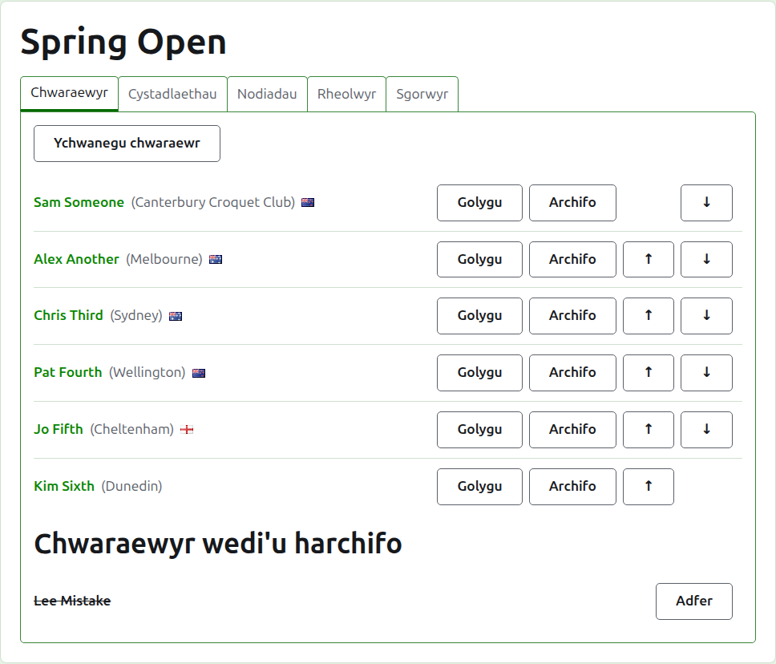
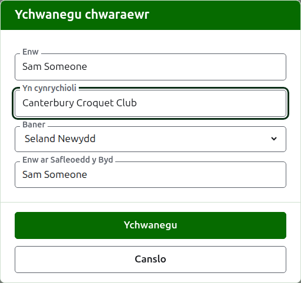
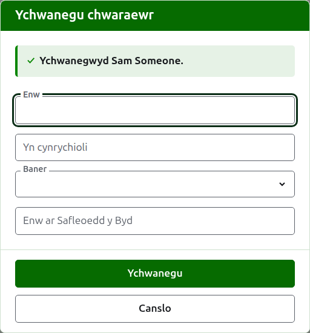
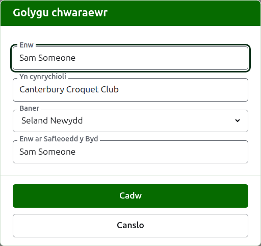
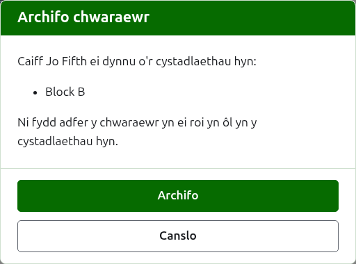

# Chwaraewyr

Tab **Chwaraewyr** tudalen twrnamaint yw lle caiff ei chwaraewyr eu rhoi i mewn, eu cywiro, eu rhoi mewn trefn, a'u rhoi o'r neilltu. Dyma'r tab y mae'r dudalen yn agor arno, gan mai rhoi'r chwaraewyr i mewn yw'r peth cyntaf a wneir i dwrnamaint.

Rhoddir chwaraewyr i mewn yma unwaith, i'r twrnamaint. Dewisir ym mha gystadlaethau y mae pob un yn chwarae wedyn, ar dudalen pob cystadleuaeth ei hun, o'r chwaraewyr a roddwyd i mewn yma. Gweler [Rhoi chwaraewyr mewn cystadleuaeth](entering-players-in-a-competition.md).



## Ychwanegu chwaraewyr {#add-a-player}

Pwyswch **Ychwanegu chwaraewr**, uwchben y rhestr. Mae deialog yn agor dros y dudalen.



Mae **Enw** yn ofynnol. Dyma enw'r chwaraewr fel y caiff ei ddangos ar bob tudalen, rhwng 3 a 254 o gymeriadau. Ni all dau chwaraewr yn yr un twrnamaint gael yr un enw, sut bynnag y caiff ei briflythrennu; lle mae dau chwaraewr yn rhannu enw mewn gwirionedd, gwahaniaethwch rhyngddynt yn yr enw ei hun, fel "Andrew Hobbs (2)".

**Yn cynrychioli** yw'r hyn y mae'r chwaraewr yn chwarae drosto, wedi'i ysgrifennu fel y byddai darllenydd yn ei ddweud: clwb, rhanbarth neu wlad, fel "Canterbury Croquet Club". Caiff ei ddangos mewn cromfachau ar ôl yr enw. Gellir ei adael yn wag.

**Baner** yw'r faner a ddangosir wrth ochr enw'r chwaraewr. Gellir ei gadael heb un, fel y mae'r mwyafrif o chwaraewyr. Cedwir yr hyn y mae chwaraewr yn ei gynrychioli a pha faner y mae'n ei chwifio ar wahân, gan y gall chwaraewr chwarae dros glwb mewn un wlad a chwifio baner gwlad arall.

**Enw'r chwaraewr ar restr detholion y byd** yw'r enw y mae detholion y byd yn adnabod y chwaraewr wrtho. Gofynnir amdano dim ond mewn twrnamaint Association Croquet neu Golf Croquet, y ddwy gamp y mae detholion y byd yn cadw rhestr o'u chwaraewyr. Mae chwaraewyr American 6 Wicket yn hysbys i'r detholion wrth eu henwau eu hunain, felly ni ofynnir amdano yno, ac enw pob chwaraewr ar restr detholion y byd yw ei enw bob amser. Tra byddwch yn ychwanegu chwaraewr mae'n dilyn yr enw wrth i chi ei deipio, gan fod y mwyafrif o chwaraewyr yn hysbys i'r detholion wrth eu henw eu hunain, ac mae'n rhoi'r gorau i ddilyn unwaith y byddwch yn teipio ynddo. Os caiff ei adael yn wag, caiff ei gadw fel enw'r chwaraewr.

Wrth i chi deipio enw, cynigir y chwaraewyr y mae detholion y byd yn eu hadnabod y mae eu henwau'n dechrau felly, fel y gallwch gymryd enw fel y mae'r detholion yn ei sillafu yn hytrach na'i deipio'n llawn. Wrth ochr yr enw ar restr detholion y byd, mae tic yn dweud bod y detholion yn adnabod yr enw, a marc cwestiwn yn dweud nad ydynt: efallai fod yr enw wedi'i gamsillafu, neu fod y chwaraewr yn newydd i'r detholion. Cyngor yn unig yw hyn. Cedwir enw nad yw'r detholion yn ei adnabod yr un mor rhwydd ag un y maent yn ei adnabod.

Pwyswch **Ychwanegu**. Caiff y chwaraewr ei ychwanegu, mae'r ddeialog yn dweud hynny, a chaiff ei meysydd eu gwagio ar gyfer y chwaraewr nesaf, â'r cyrchwr yn ôl yn yr enw. Ychwanegwch y rhestr gyfan fel hyn, yna pwyswch **Diddymu** i gau'r ddeialog. Nid yw Canslo yn cadw dim nad oedd eisoes wedi'i ychwanegu.



Ni chaiff chwaraewr byth ei alw'n "Bye". Caiff byes cystadleuaeth cnoc-owt eu hychwanegu yn y gystadleuaeth ei hun, lle bynnag y rhoddir ei chwaraewyr i mewn, felly gwrthodir enw y mae ei air cyntaf yn y gair Saesneg "bye", ac mae'r ddeialog yn egluro pam.

## Ychwanegu sawl chwaraewr {#adding-multiple-players}

I ychwanegu rhestr gyfan ar unwaith, pwyswch **Ychwanegu chwaraewyr**, wrth ochr **Ychwanegu chwaraewr**. Mae deialog yn agor dros y dudalen ag un blwch, sy'n derbyn sawl llinell o destun. Gallwch gopïo'r rhestr o daenlen a'i gludo i'r blwch.

**Mae'r llinell gyntaf yn enwi'r meysydd**, wedi'u gwahanu gan goma neu gan dabiau: **Name**, ac unrhyw rai o **Representing**, **Flag**, **Handicap** a **WorldRankingPlayerName**, mewn unrhyw drefn. Teipir yr enwau hyn yn Saesneg, ym mha bynnag iaith y mae'r safle. Rhaid i **Name** fod yn un ohonynt. **Mae pob llinell ar ei hôl yn chwaraewr**, â gwerth ar gyfer pob maes yn yr un drefn, wedi'u gwahanu yn yr un modd. Mae chwaraewr heb ddim ar gyfer maes yn ei adael yn wag, ond yn cadw'r goma neu'r tab. Er enghraifft, gyda choma:

```
Name,Representing,Flag
Sam Someone,Canterbury Croquet Club,New Zealand
Alex Another,,England
```

- Mae **Enw, Yn cynrychioli ac Enw'r chwaraewr ar restr detholion y byd** yn dilyn yr un rheolau ag wrth ychwanegu un chwaraewr (gweler [Ychwanegu chwaraewyr](players.md#add-a-player)). Mae enw rhwng 3 a 254 o gymeriadau, nid yw eisoes yn y twrnamaint, sut bynnag y caiff ei briflythrennu, ac nid yw'n "Bye".
- **Baner** yw enw'r wlad neu'r lle, yn eich iaith chi, fel y mae'r rhestr yn y ddeialog Ychwanegu chwaraewr yn ei gynnig, fel Seland Newydd.
- **Anfantais** yw arwydd, hyd at ddau ddigid a ffracsiwn o un digid, fel 4, +4 neu -1.5.
- Mae chwaraewr heb **WorldRankingPlayerName** yn cael ei adnabod wrth ei enw, fel pan gaiff ei ychwanegu fesul un.
- **Comas neu dabiau.** Mae celloedd a gopïir o daenlen wedi'u gwahanu gan dabiau, ac mae rhestr a deipir â llaw fel arfer wedi'i gwahanu gan goma. Mae'r naill neu'r llall yn gweithio. Os oes tab yn y llinell gyntaf, darllenir y rhestr gyfan â thabiau, ac fel arall â chomas.
- Ysgrifennir gwerth sydd â'r gwahanydd ynddo mewn dyfynodau dwbl, fel y mae taenlen yn ei ysgrifennu: "Smith, John" mewn rhestr a wahenir gan goma. Ysgrifennir dyfynnod y tu mewn i werth ddwywaith.
- Tynnir y bylchau o ddau ben pob gwerth, a hepgorir llinell heb ddim arni.
- Mae rhestr yn dal 500 o chwaraewyr ar y mwyaf. Ychwanegwch y gweddill mewn rhestr arall.

Pwyswch **Ychwanegu**. Gwirir y rhestr gyfan cyn cadw dim ohoni, felly nid yw rhestr â rhywbeth o'i le ynddi yn ychwanegu neb. Dywedir beth sydd o'i le o dan y blwch, ar y llinell y mae arni, gan gyfrif y llinell gyntaf fel llinell 1. Rhestrir pob nam, nid y cyntaf yn unig, ac erys yr hyn a deipiwyd gennych fel y gallwch ei gywiro. Unwaith y caiff y rhestr ei chadw, mae'r ddeialog yn cau ac mae'r tab **Chwaraewyr** yn rhestru'r chwaraewyr newydd, yn y drefn yr ysgrifennoch hwy. Yn wahanol i **Ychwanegu chwaraewr**, sy'n aros ar agor ar gyfer y chwaraewr nesaf, nid oes un nesaf: y rhestr oedd y nesaf.

Mae'r **?** ym mar teitl y ddeialog yn arwain yma.

## Cywiro chwaraewr {#correcting-a-player}

Pwyswch enw chwaraewr, neu ei **Golygu**, i agor yr un ddeialog ar y chwaraewr hwnnw, dan y teitl Golygu chwaraewr. Newidiwch beth sydd o'i le a phwyswch **Cadw**, sy'n cadw'r newid ac yn cau'r ddeialog. Mae chwaraewr y caiff ei enw ei gywiro yn cadw'r enw ar restr detholion y byd a oedd ganddo, gan fod y safleoedd yn dal i'w adnabod wrtho. Mewn American 6 Wicket enw chwaraewr ar restr detholion y byd yw ei enw bob amser, felly mae cywiro'r enw yn cywiro hwnnw hefyd.



Mae chwaraewr a gywirir yma wedi'i gywiro ym mhob man: ym mhob cystadleuaeth y mae ynddi, ac ar bob tudalen gyhoeddus.

## Rhoi chwaraewyr mewn trefn

Rhestrir y chwaraewyr yn nhrefn y twrnamaint, sef y drefn y cânt eu cynnig ynddi pan gânt eu rhoi mewn cystadlaethau, a'r drefn y caiff cystadleuaeth cnoc-owt ei thynnu ynddi. Mae **I fyny** ac **I lawr**, y saethau ar ddiwedd pob rhes, yn symud chwaraewr un lle. Ni chynigir I fyny i'r chwaraewr cyntaf ac ni chynigir I lawr i'r olaf.

## Archifo chwaraewr {#archiving-a-player}

Mae **Archifo** yn rhoi chwaraewr o'r neilltu: un a roddwyd i mewn trwy gamgymeriad, neu un sydd wedi tynnu'n ôl o'r twrnamaint cyfan. Rhestrir chwaraewr a archifwyd o dan **Chwaraewyr wedi'u harchifo**, â llinell drwyddo, ar ôl y chwaraewyr sydd yn eu lle, a dim ond **Adfer** a gynigir iddo. Nid yw chwaraewr a archifwyd mewn unrhyw gystadleuaeth ac nid yw'n ymddangos ar unrhyw dudalen gyhoeddus.

Ni ellir archifo chwaraewr sydd wedi chwarae unrhyw gêm, gan y byddai'r gemau wedyn yn erbyn rhywun nad yw yno mwyach, felly ni chynigir Archifo i chwaraewr o'r fath. Gellir archifo chwaraewr nad oes ganddo ond gemau a archifwyd.

Nid yw archifo chwaraewr nad yw mewn unrhyw gystadleuaeth yn gofyn yn gyntaf, gan fod ei adfer yn rhoi popeth yn ôl. Mae archifo chwaraewr sydd mewn unrhyw gystadleuaeth yn gofyn yn gyntaf, am fod archifo yn ei dynnu o bob cystadleuaeth y mae ynddi, ac nid yw ei adfer yn ei roi yn ôl.



Nesaf: [Cystadlaethau](competitions.md).
