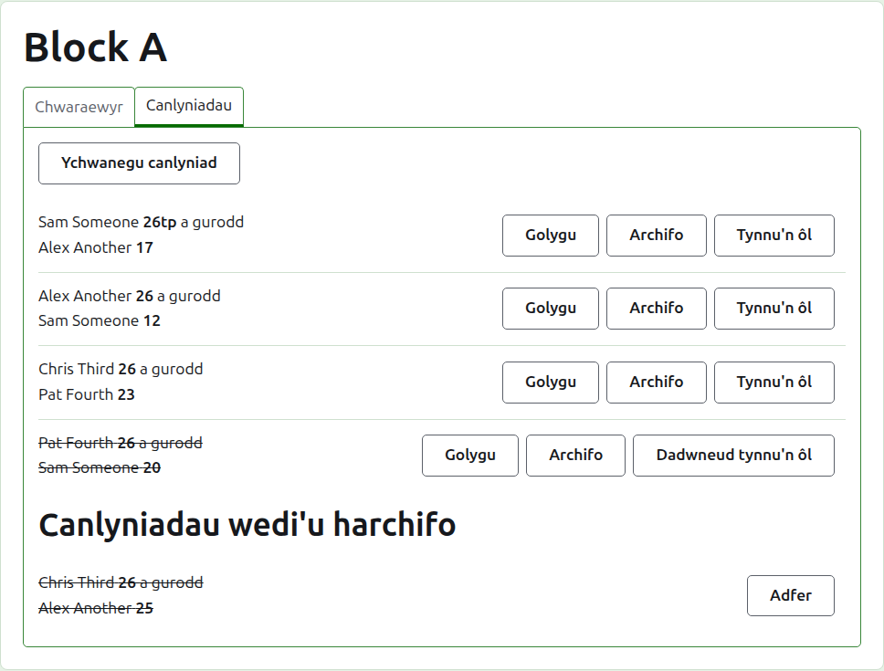
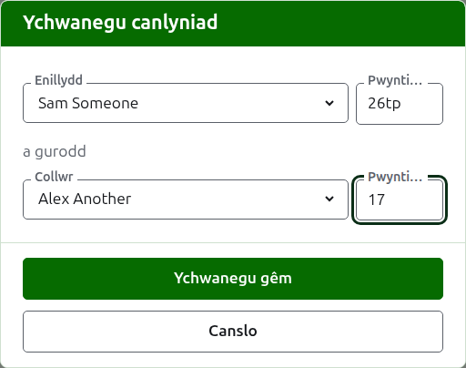
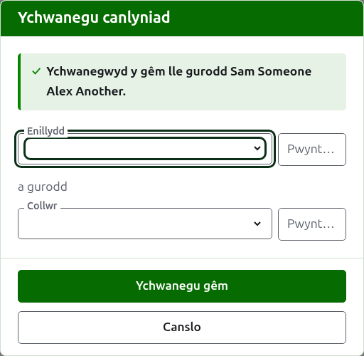
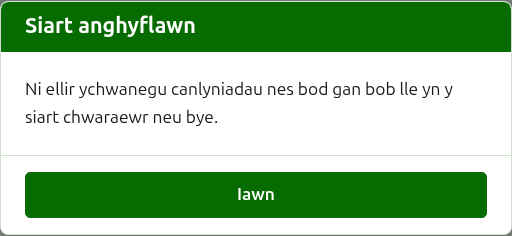
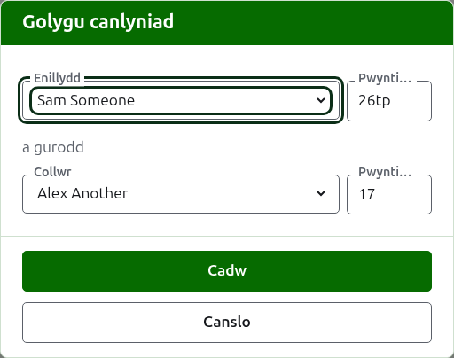

# Sgorau

Tab **Sgorau** tudalen cystadleuaeth yw lle caiff ei gemau eu rhoi i mewn, eu cywiro a'u rhoi o'r neilltu. Mae sgorwr yn gweld y tab hwn yn unig, a gall wneud arno bopeth y gall rheolwr ei wneud.

## Rhoi canlyniad i mewn

Pwyswch **Ychwanegu sgôr**, uwchben y rhestr. Mae'r ddeialog yn darllen fel y dywedir canlyniad ar lafar: yr enillydd a'i sgôr, yna "a gurodd", yna'r collwr a'i sgôr.

Dewisir yr enillydd a'r collwr, bob un, o chwaraewyr y gystadleuaeth sy'n chwarae, yn nhrefn y gystadleuaeth. Ni ddewisir neb i ddechrau, fel na roddir gêm byth yn erbyn chwaraewr na ddewisasoch. Mewn cystadleuaeth cnoc-owt, mae dewis yr enillydd yn dewis pwy y mae wedi'i dynnu yn ei erbyn fel y collwr, lle gallwch ei weld a dewis un arall.

Teipir sgôr fel y'i hysgrifennodd y sgorwr: ei nifer o bwyntiau, a beth bynnag sy'n dilyn, a gedwir ac a ddangosir fel y'i teipiwyd, fel "26tp" am 26 cylch a thriple peel. Y rhif yw'r digidau y mae'r sgôr yn dechrau â hwy; gwrthodir sgôr nad yw'n dechrau â digid.

Mae gêm a enillwyd ar bwyntiau cyfartal, fel pan gaiff ei hatal gan amser a'i setlo mewn ffordd arall, yn dweud pwy a'i henillodd â marc ar ôl sgôr yr enillydd: "6w" a gurodd "6". Ar Croquet Scores y marciau yw "w", "won" a "winner"; mae Gateball Scores yn cymryd "cb" a "so" hefyd. Rhaid i sgôr enillydd fod yn fwy na sgôr y collwr, neu wedi'i marcio, oni bai bod y twrnamaint yn caniatáu gemau cyfartal, ac yn yr achos hwnnw cedwir pwyntiau cyfartal heb farc fel gêm gyfartal.

Pwyswch **Ychwanegu gêm**. Caiff y gêm ei hychwanegu, mae'r ddeialog yn dweud pa un, a chaiff y meysydd eu gwagio ar gyfer y nesaf, gan fod canlyniadau'n dod mewn swp a ddarllenir oddi ar fwrdd ar ddiwedd rownd. Pwyswch **Diddymu** unwaith y bydd pob un i mewn.

Dywedir beth a wrthodir o dan y maes y mae'n ymwneud ag ef: enillydd neu gollwr heb ei ddewis, sgôr heb ei theipio neu nad yw'n dechrau â digid, yr un chwaraewr fel y ddau, sgôr collwr wedi'i marcio fel un a enillwyd, neu sgôr enillydd y tu ôl i sgôr y collwr. Mewn cystadleuaeth cnoc-owt, gwrthodir dau chwaraewr nad ydynt wedi'u tynnu i gwrdd uwchben y meysydd.

## Rhaid llenwi siart cystadleuaeth cnoc-owt yn gyntaf

Chwaraeir cystadleuaeth cnoc-owt dim ond unwaith y bydd gan bob lle yn ei siart chwaraewr neu bye. Hyd hynny, mae Ychwanegu canlyniad yn egluro pam na ellir ychwanegu canlyniadau yn hytrach nag agor y ddeialog.

## Y rhestr o ganlyniadau

Rhestrir y canlyniadau sydd yn eu lle yn y drefn y rhoddwyd hwy i mewn, yr hynaf yn gyntaf, fel bod y rhestr yn darllen fel y chwaraewyd y gystadleuaeth. Mae pob un yn dweud yr enillydd a'i sgôr, yna'r collwr a'i sgôr yntau, ac yn cynnig **Golygu** ac **Archifo**.

## Cywiro canlyniad

Mae **Golygu** yn agor yr un ddeialog ar y canlyniad hwnnw, dan y teitl Golygu canlyniad, â'i chwaraewyr wedi'u dewis a'i sgorau fel y'u teipiwyd. Pwyswch **Cadw** i gadw'r cywiriad a chau'r ddeialog.

Mae cywiriad yn cadw'r canlyniad: mae gêm a enillwyd yn parhau i fod wedi'i hennill, a gêm gyfartal yn parhau'n gyfartal. Caiff gêm yr oedd ei chanlyniad yn anghywir ei harchifo a'i rhoi i mewn eto.

Lle gellid archifo canlyniad, gellir newid ei chwaraewyr yn ogystal â'i sgorau. Mewn cystadleuaeth cnoc-owt, mae canlyniad y mae ei enillydd eisoes wedi chwarae yn y rownd nesaf yn cadw ei chwaraewyr, gan y byddai newid pwy a'i henillodd yn gadael y gêm nesaf wedi'i chwarae gan rywun nad oedd wedi cyrraedd yno; dim ond ei sgorau a ellir eu cywiro.

## Archifo canlyniad

Mae **Archifo** yn rhoi canlyniad o'r neilltu fel nad yw'n cyfrif dim. Rhestrir ef o dan **Sgorau wedi'u harchifo**, â llinell drwyddo, a dim ond **Adfer** a gynigir iddo. Nid yw'r un o'r ddau yn gofyn yn gyntaf, gan fod pob un yn dadwneud y llall.

Mewn cystadleuaeth cnoc-owt, mae enillydd gêm yn mynd ymlaen i'r rownd nesaf, felly ni chynigir Archifo i ganlyniad gêm y mae ei enillydd wedi chwarae yn y rownd nesaf. Caiff y gêm yn y rownd nesaf ei harchifo yn gyntaf, ac wedyn gellir archifo'r rhai o'i blaen. Lle mae rownd yr orau o 3 neu 5, cedwir pob gêm unigol o'r gêm yn yr un modd. Nid oes gan floc na chystadleuaeth Swisaidd rowndiau sy'n dibynnu ar ei gilydd, felly gellir archifo pob canlyniad ynddynt.

## Tynnu canlyniad yn ôl

Fel arfer caiff chwaraewr sy'n gadael cystadleuaeth ei dynnu'n ôl ohoni, ar y tab Chwaraewyr, a dyna'r cyfan sydd ei angen: nid yw'n chwarae rhagor, ac mae'r gemau a chwaraeodd yn sefyll ond nid yw ei gemau'n cyfrif mwyach tuag at fuddugoliaethau/colledion a chylchau. Mae tynnu canlyniad yn ôl ar gyfer yr achos prinnach lle nad yw gêm a chwaraewyd i gyfrif. Yn y President's Eights yn Awstralia, er enghraifft, mae canlyniadau'r rownd gyntaf yn sefyll pan fydd chwaraewr yn tynnu'n ôl, a dim ond ei gemau yn yr ail rownd a dynnir o'r cyfrif: tynnwch y gemau hynny'n ôl.

Mewn bloc neu gystadleuaeth Swisaidd, caiff canlyniad a chwaraewyd ond nad yw i gyfrif ei dynnu'n ôl yn hytrach na'i archifo. Mae **Tynnu'n ôl** yn ei gadw ymhlith y canlyniadau sydd yn eu lle, yn ei le, ond â llinell drwyddo ac yn cyfrif dim ar y tudalennau cyhoeddus. Mae **Dad-dynnu'n ôl** yn gwneud iddo gyfrif eto. Nid yw'r un o'r ddau yn gofyn yn gyntaf. Ni chynigir Tynnu'n ôl i ganlyniadau cystadleuaeth cnoc-owt, gan fod canlyniad yno'n penderfynu mwy na'r safleoedd.

Nesaf: [Nodiadau](notes.md).
