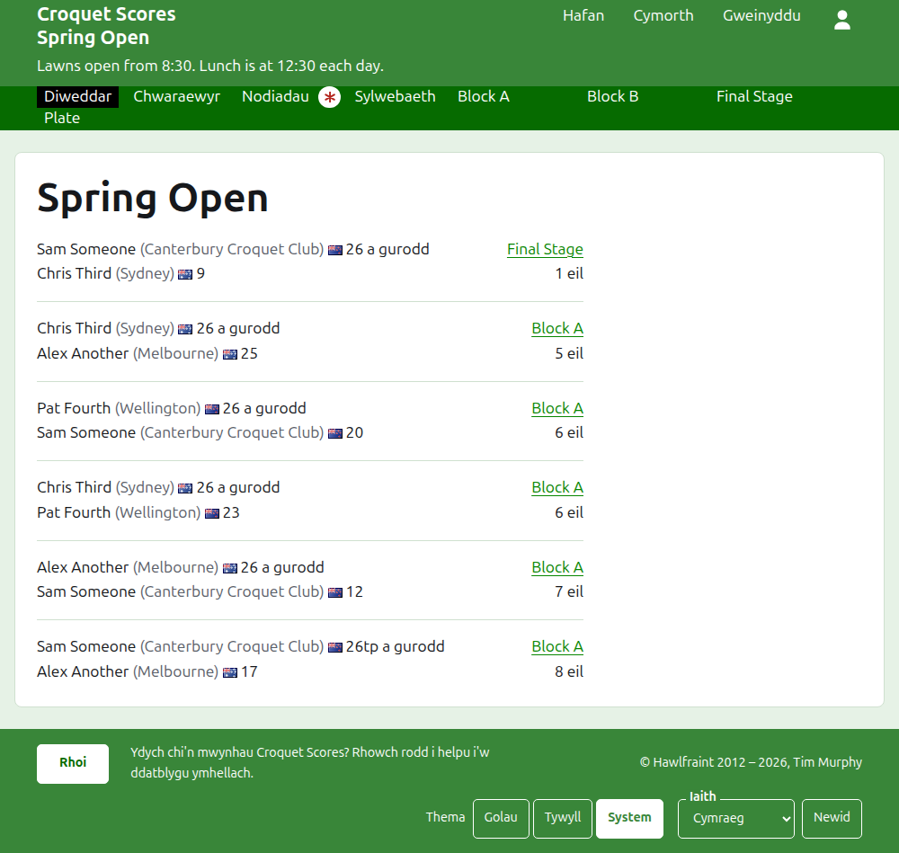
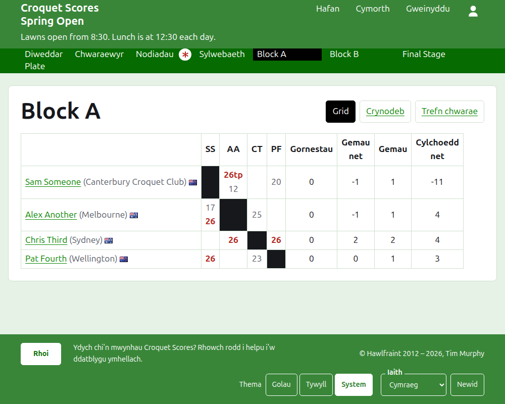
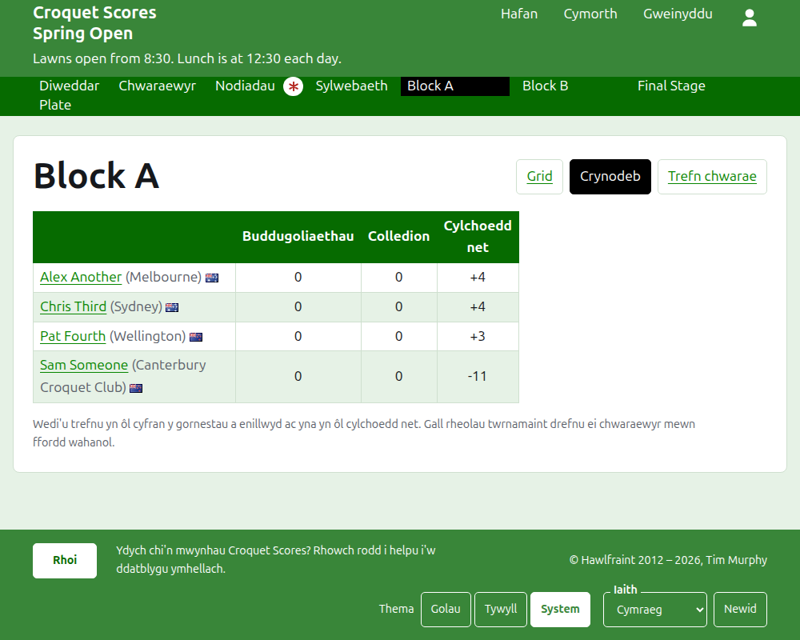
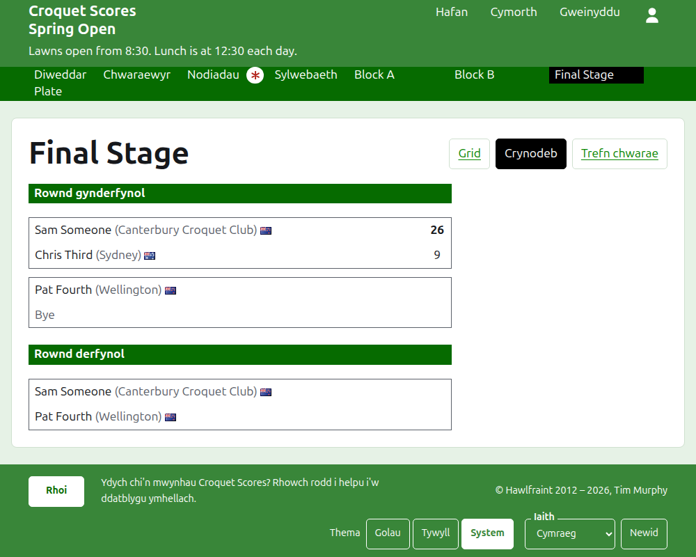
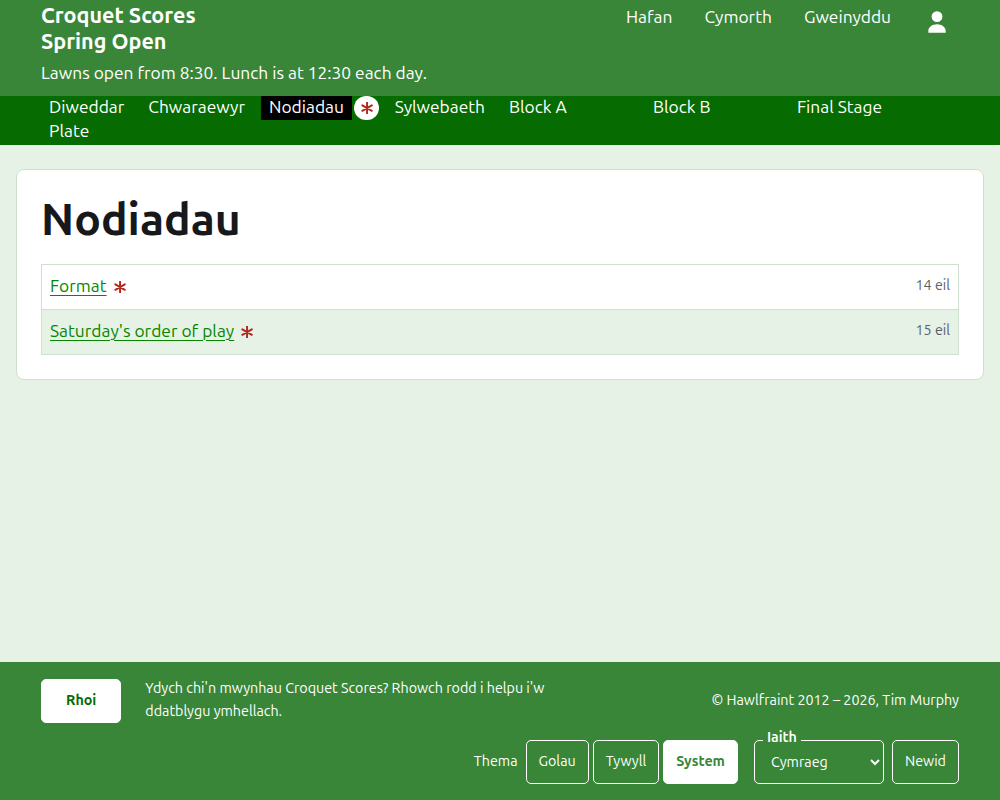

# Beth mae'r cyhoedd yn ei weld

Ni chyhoeddir dim: caiff y tudalennau cyhoeddus eu llunio o'r hyn sydd gan yr adran weinyddu, felly mae canlyniad a roddir i mewn arnynt ar unwaith. Nid oes angen cyfrif na sgriptio arnynt, ac maent wedi'u gosod ar gyfer ffôn.

## Tudalen y twrnamaint

Mae tudalen y twrnamaint yn ei flwyddyn, ei gamp a'i enw, fel `/2026/ac/spring-open`. Enw'r twrnamaint sydd ar ei phen, â'i is-deitl oddi tano. Mae'n rhestru pob gêm sydd yn ei lle, yr un a ychwanegwyd ddiweddaraf yn gyntaf, fel bod darllenydd sy'n dod yn ôl yn gweld beth sydd wedi digwydd ers hynny. Mae pob gêm yn dweud yr enillydd, yr hyn y mae'n ei gynrychioli, ei faner a'i sgôr, yna'r collwr a'i rai yntau, â'r gystadleuaeth y chwaraewyd hi ynddi a pha mor bell yn ôl y'i hychwanegwyd.

Mae'r bar gwyrdd tywyll yn cynnig adrannau'r twrnamaint: **Diweddar**, sef y dudalen hon, **Chwaraewyr**, **Nodiadau** a **Sylwebaeth**, yna pob cystadleuaeth sydd yn ei lle, yn y drefn sydd gan y tab Cystadlaethau iddynt. Mae Nodiadau wedi'i farcio â seren goch tra bo nodyn nad yw'r darllenydd wedi'i ddarllen.

## Bloc

Mae tudalen bloc yn dangos ei ganlyniadau fel grid: rhes a cholofn i bob chwaraewr yn nhrefn y bloc, â'r gemau rhwng dau chwaraewr lle mae'r rhes yn cwrdd â'r golofn, pob un wedi'i marcio fel un a enillwyd, a gollwyd neu'n gyfartal i chwaraewr y rhes. Ar ôl colofnau'r chwaraewyr daw cyfansymiau pob chwaraewr. Lle mae pob gêm yn un gêm unigol, buddugoliaethau a chylchau net yw'r rheini; lle mae gêm yr orau o fwy nag un, gemau, gemau net, gemau unigol a chylchau net ydynt.

Dangosir bloc mewn tair ffordd, a gynigir ar linell ei enw: **Grid**, **Crynodeb** a **Trefn chwarae**. Y crynodeb yw'r un ar gyfer ffôn: y chwaraewyr yn ôl eu safle, â'u buddugoliaethau, eu colledion a'u cylchau net. Mae'r drefn chwarae yn rhestru pob gêm, yr hynaf yn gyntaf. Mae darllenydd sy'n dewis golwg yn ei chadw ar gyfer pob cystadleuaeth nes iddo ddewis un arall.

Mae rhes chwaraewr a dynnwyd yn ôl yn dweud hynny. Dangosir canlyniad a dynnwyd yn ôl â llinell drwyddo ac nid yw'n cyfrif dim. Ni ddangosir canlyniad a archifwyd.

## Cystadleuaeth cnoc-owt

Mae tudalen cystadleuaeth cnoc-owt yn llunio ei siart rownd wrth rownd, colofn i bob rownd o'r gyntaf i'r rownd derfynol, â dwy ochr pob gêm un uwchben y llall a chell i bob gêm unigol y mae'r gêm yr orau ohonynt. Mae gêm rownd ddiweddarach yn sefyll wrth ochr y ddwy gêm y mae rhwng eu henillwyr. Ar ffôn mae'r siart yn sgrolio ar draws, â saethau i'r rownd derfynol ac yn ôl.

## Cystadleuaeth Swisaidd

Mae tudalen cystadleuaeth Swisaidd yn rhoi ei chwaraewyr yn ôl eu safle mewn tabl: eu gemau, eu buddugoliaethau, eu canran o fuddugoliaethau, a'u canlyniadau, pob un wedi'i ddweud fel y gwrthwynebydd a'r ymyl, fel "+4" am gêm a enillwyd o bedwar.

## Chwaraewyr

Mae'r dudalen Chwaraewyr yn rhestru pob chwaraewr yn y twrnamaint nad yw wedi'i archifo, yn nhrefn yr wyddor, â'r hyn y mae'n ei gynrychioli a'i faner.

## Nodiadau

Mae'r dudalen Nodiadau yn rhestru nodiadau'r twrnamaint, yr un a ysgrifennwyd ddiweddaraf yn gyntaf, pob un yn arwain at ei dudalen ei hun ac yn dweud pa mor bell yn ôl y'i hysgrifennwyd. Caiff nodyn nad yw'r darllenydd wedi'i ddarllen ei farcio â seren goch nes iddo ei agor.

## Cyfeiriadau sy'n symud

Mae twrnamaint yn cadw ei gyfeiriad pan gaiff ei enw ei gywiro. Lle mae'n symud, am fod ei flwyddyn neu ei gamp wedi newid, mae ei hen gyfeiriad yn arwain at yr un newydd, fel bod dolen a gadwyd o'r blaen yn dal i weithio. Ni cheir tudalennau twrnamaint a archifwyd nes iddo gael ei adfer.
