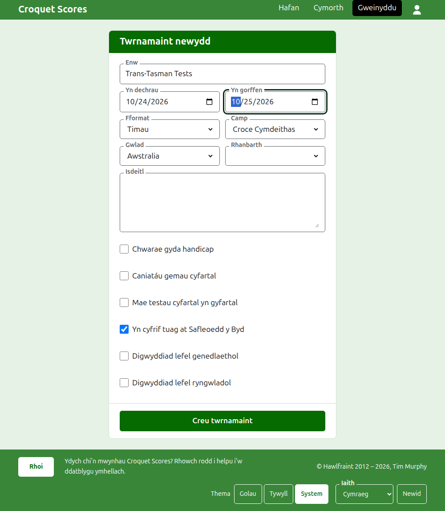
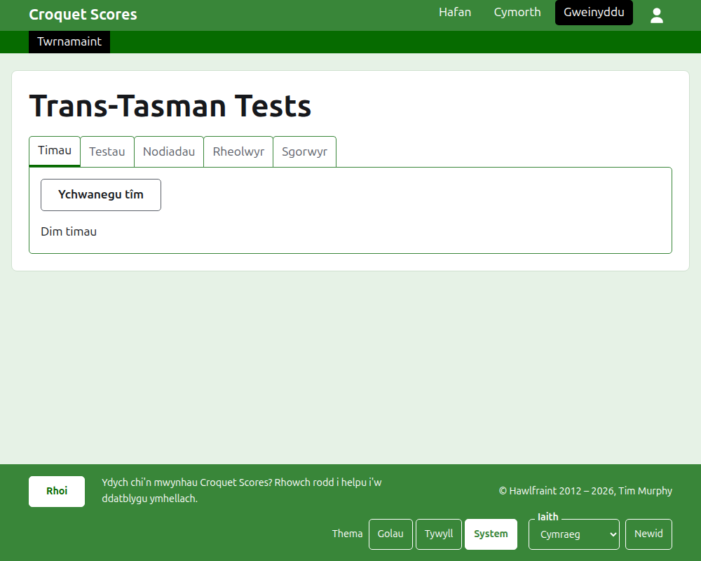

# Creu twrnamaint

Pwyswch **Twrnamaint newydd** uwchben y rhestr o dwrnameintiau yn yr adran weinyddu. Mae uwchben y rhestr yn hytrach nag oddi tani, fel na fydd rhestr hir yn ei wthio oddi ar sgrin ffôn.

Mae'r ffurflen yn gofyn am bopeth y mae twrnamaint yn dechrau ag ef. Y peth pwysicaf yma yw'r **Fformat**, sef yr hyn sy'n gwneud twrnamaint yn un a chwaraeir gan dimau.

## Beth mae'r ffurflen yn gofyn amdano

**Enw.** Yr hyn y mae darllenwyr yn chwilio amdano i ddod o hyd i'r twrnamaint, fel "Trans-Tasman Tests". Mae rhwng 3 a 254 o gymeriadau. Gwrthodir enw sydd i gyd mewn llythrennau bach, neu i gyd mewn prif lythrennau, gan y byddai'n edrych fel camgymeriad ar bob tudalen y caiff ei ddangos arni. Gall dau dwrnamaint gael yr un enw, gan fod yr un twrnamaint yn cael ei chwarae bob blwyddyn.

**Yn dechrau** ac **Yn gorffen.** Y dyddiau y mae'r twrnamaint yn rhedeg. Chwaraeir pob prawf o fewn iddynt, felly gosodwch hwy i gwmpasu'r digwyddiad cyfan. Ni all twrnamaint orffen cyn iddo ddechrau, ac ni all ddechrau na gorffen yn hwyrach na diwedd y flwyddyn nesaf. Mae twrnamaint yn perthyn i'r flwyddyn y mae'n dechrau ynddi, sef y flwyddyn yn ei gyfeiriad hefyd.

**Fformat.** Dewiswch un o'r fformatau a chwaraeir gan dimau:

- **Timau** yw'r fformat cyffredinol ar gyfer unrhyw ddigwyddiad rhwng timau.
- Mae **Cwpan Iwerddon**, **Tarian y Taleithiau** a **Pencampwriaeth Tîm y Byd GC** yn ddigwyddiadau penodol, pob un yn cael ei gadw fel fformat ei hun fel y gellir ei redeg yn y ffordd y caiff y digwyddiad hwnnw ei redeg.

Safonol yw'r un fformat na chwaraeir gan dimau, ac nid dyna rydych ei eisiau yma. Nid yw Gateball Scores yn cynnig fformat, gan fod pob twrnamaint yno'n dwrnamaint safonol o gateball; crëir twrnamaint a chwaraeir gan dimau ar Croquet Scores.

**Camp.** Y campau y mae'r wefan yn eu cynnig, yn ei threfn: Association Croquet, Golf Croquet, American 6 Wicket a Ricochet.

**Gwlad** a **Rhanbarth.** Lle caiff y twrnamaint ei chwarae. Gofynnir am ranbarth dim ond lle mae'r wlad a ddewiswch wedi'i rhannu'n rhanbarthau, fel taleithiau Awstralia, ac nid oes raid dewis un hyd yn oed wedyn.

**Is-deitl.** Beth bynnag rydych am i ddarllenwyr ei wybod nad oes ganddo faes ei hun: lle i barcio, pryd mae cinio, pwy i'w ffonio. Caiff ei ddangos o dan enw'r twrnamaint ar bob tudalen gyhoeddus. Caiff ei ysgrifennu mewn Markdown, felly gellir gwneud gair mewn print trwm â sêr o'i gwmpas a gwneud rhestr â llinell doriad ar ddechrau pob llinell. Gall fod hyd at 2000 o gymeriadau, a gellir ei adael yn wag.

Mater i bob prawf yw dweud, pan gaiff ei ychwanegu, sut y caiff ei chwarae a'i gyfrif: gyda handicapiau, gyda chanlyniadau cyfartal, ac tuag at restr detholion y byd.

**Digwyddiad lefel genedlaethol** a **Digwyddiad lefel ryngwladol.** Gall twrnamaint fod yn un, y llall, neu'r un o'r ddau, ond byth y ddau: mae ticio un yn dad-dicio'r llall.

## Ei greu

Pwyswch **Creu twrnamaint**. Cewch eich tywys i dudalen y twrnamaint yn yr adran weinyddu, ar agor ar ei thab Timau, a chi yw ei reolwr cyntaf. Caiff ei restru yn yr adran weinyddu o dan y flwyddyn y mae'n dechrau ynddi.

Gwneir cyfeiriad cyhoeddus y twrnamaint o'i flwyddyn, ei gamp a'i enw, fel `/2026/ac/trans-tasman-tests`. Mae'n cadw'r cyfeiriad hwnnw pan gaiff ei enw ei gywiro'n ddiweddarach, fel bod dolen a anfonwyd eisoes yn dal i ddod o hyd iddo; mae'n symud dim ond pan fydd y flwyddyn y mae'n dechrau ynddi, neu ei gamp, yn newid.

## Os gwrthodir rhywbeth

Dywedir beth a wrthodir o dan y maes y mae'n ymwneud ag ef, ac mae'r hyn a deipiasoch yn aros fel y'i teipiwyd. Ni chedwir dim nes bod pob maes wedi'i dderbyn. Y pethau a wrthodir fynychaf yw enw a deipiwyd i gyd mewn llythrennau bach, gorffen cyn dechrau, a gwlad heb ei dewis.

Nesaf: [Timau](teams.md).
