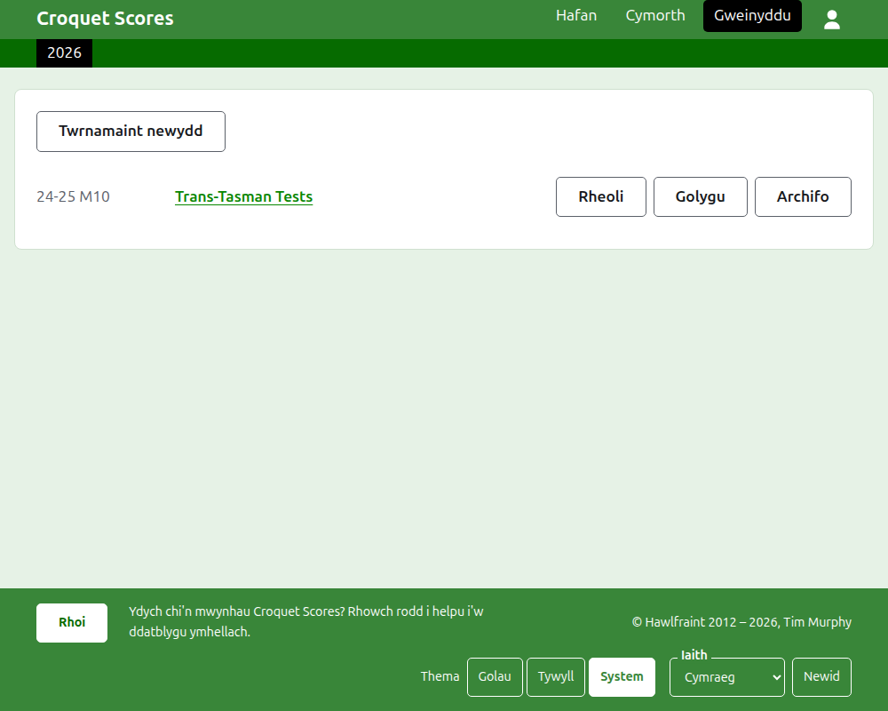
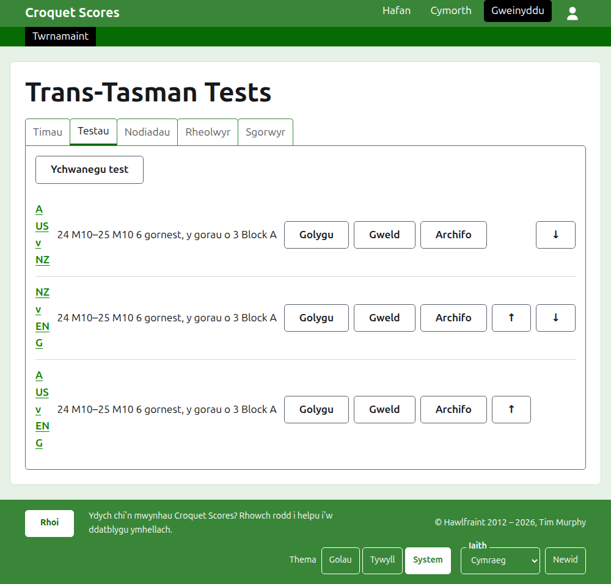

# Rhedeg twrnamaint a chwaraeir gan dimau

Twrnamaint a chwaraeir gan dimau yw un lle mae ochrau'n cwrdd, yn hytrach na chwaraewyr a gofrestrir fesul un: cyfres o destau rhwng dwy wlad, tarian rhwng taleithiau, pencampwriaeth timau'r byd. Caiff ei dimau eu gosod i fyny â'u chwaraewyr, caiff y testau rhwng timau eu hychwanegu, ac mae gemau pob test yn mynd i fyny fel y cânt eu chwarae. Mae'r canllaw hwn yn mynd â rheolwr o fewngofnodi hyd at dwrnamaint y mae ei ganlyniadau ar gael i'r cyhoedd.

Mae'n sefyll ar ei ben ei hun. Nid oes dim ynddo'n dibynnu ar y canllaw i dwrnamaint safonol, sydd wedi'i ysgrifennu ar wahân.

## Cyn i chi ddechrau

Mae angen cyfrif arnoch. Cliciwch [yma](/account/register) i gofrestru cyfrif.

Gwneir popeth a wna rheolwr yn adran weinyddu'r wefan. Caiff y tudalennau cyhoeddus, lle mae chwaraewyr a gwylwyr yn dilyn y twrnamaint, eu llunio o'r hyn sydd gan yr adran weinyddu, felly nid oes raid cyhoeddi dim: mae canlyniad a roddir i mewn ar y tudalennau cyhoeddus ar unwaith.

## Y geiriau

Mae **tîm** yn ochr, fel Awstralia, ag enw, enw byr fel "AUS", a baner. Mae gan dîm **chwaraewyr** ei hun, sy'n chwarae drosto a dros neb arall. Mae **test** yn ornest rhwng dau dîm, a elwir wrth eu henwau byr, fel "AUS v ENG", sy'n cynnwys nifer o **ornestau** rhwng chwaraewr o bob tîm, pob gornest y gorau o ryw nifer o **gemau**. Gellir rhoi testau mewn **grwpiau**, fel "Block A", lle mae llawer o dimau'n chwarae ymhlith ei gilydd.

## Y tudalennau yn eu trefn

1. [Creu twrnamaint](creating-a-tournament.md): ei enw, ei ddyddiau, ei gamp, ei fformat, a lle caiff ei chwarae.
2. [Timau](teams.md): ychwanegu'r timau, â'u henwau byr a'u baneri.
3. [Chwaraewyr tîm](team-players.md): rhoi chwaraewyr pob tîm i mewn ar dudalen y tîm ei hun.
4. [Testau](tests.md): ychwanegu'r testau rhwng timau, eu dyddiau, sawl gornest sydd gan bob un, a'u grwpiau.
5. [Canlyniadau](scores.md): rhoi gemau test i mewn, eu cywiro, a rhoi'r rhai a roddwyd i mewn trwy gamgymeriad o'r neilltu.
6. [Nodiadau](notes.md): dweud wrth y chwaraewyr beth sydd angen iddynt ei wybod wrth i'r twrnamaint fynd rhagddo.
7. [Rheolwyr a sgorwyr](managers-and-scorers.md): rhannu'r gwaith o redeg y twrnamaint, a gadael i rywun roi canlyniadau i mewn heb allu newid dim arall.
8. [Newid, archifo ac adfer twrnamaint](changing-and-archiving.md): cywiro manylion y twrnamaint, a rhoi twrnamaint o'r neilltu.
9. [Beth mae'r cyhoedd yn ei weld](what-the-public-sees.md): y tudalennau y mae eich chwaraewyr yn eu dilyn, a sut mae'r hyn a roddwch i mewn yn ymddangos arnynt.

## Sut mae'r adran weinyddu wedi'i gosod

Mae drws ffrynt yr adran weinyddu yn rhestru'r twrnameintiau y mae gennych ran ynddynt, un flwyddyn ar y tro.

Mae pwyso enw twrnamaint, neu **Rheoli**, yn agor ei dudalen. Mae popeth sydd i'w redeg mewn pum tab o dan ei enw: **Timau**, **Testau**, **Nodiadau**, **Rheolwyr** a **Sgorwyr**. Mae'r dudalen yn agor ar Timau, gan mai'r timau yw'r peth cyntaf a osodir i fyny.

Mae'r bar gwyrdd tywyll o dan y pennyn ar gyfer symud rhwng tudalennau. Ar dudalen y twrnamaint ac ar dudalen test mae'n arwain at y twrnamaint, fel **Twrnamaint**, ac at bob test wrth ei enw. Ar dudalen tîm mae'n arwain at y twrnamaint ac at bob tîm wrth ei enw byr yn lle hynny, gan fod rheolwr ar dudalen un tîm yn rhoi chwaraewyr i mewn dîm wrth dîm. Mae'r dudalen rydych arni wedi'i marcio mewn du.

## Pethau sy'n dal ym mhob man

**Ni chaiff dim ei ddileu'n llwyr ac eithrio nodyn.** Caiff timau, chwaraewyr, testau, canlyniadau a'r twrnamaint ei hun eu harchifo yn hytrach na'u dileu: eu rhoi o'r neilltu, â llinell drwyddynt, a'u rhestru o dan bennawd eu hunain, gydag **Adfer** i'w cael yn ôl. Nid yw archifo, adfer a symud i fyny ac i lawr byth yn gofyn i chi gadarnhau, am fod pob un yn cael ei ddadwneud trwy bwyso'r ffordd arall. Mae'r pethau na ellir eu dadwneud, fel dileu nodyn neu dynnu rheolwr, yn gofyn yn gyntaf.

**Nid yw deialog dros y dudalen yn cadw dim nes i chi bwyso ei botwm.** Mae Canslo, neu'r fysell Escape, yn ei chau ac yn gadael popeth fel yr oedd. Mae deialogau sy'n ychwanegu pethau, fel Ychwanegu tîm ac Ychwanegu canlyniad, yn aros ar agor ar ôl i bob un gael ei ychwanegu, fel y gellir teipio rhestr un ar ôl y llall.

**Dywedir beth a wrthodir wrth ochr y maes y mae'n ymwneud ag ef.** Ni chedwir dim a wrthodir, ac mae'r hyn a deipiasoch yn aros fel y'i teipiwyd, fel y gellir ei gywiro yn hytrach na'i deipio eto.

**Mae'r adran weinyddu'n gweithio ar ffôn.** Mae pob botwm yn ddigon mawr i'w bwyso â bawd, ac nid oes dim yn lletach na'r sgrin.

Nesaf: [Creu twrnamaint](creating-a-tournament.md).
