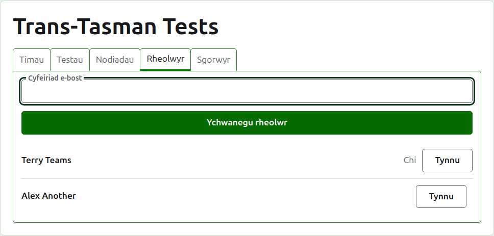
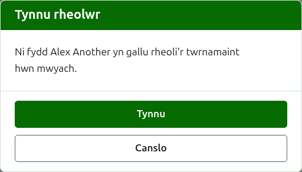
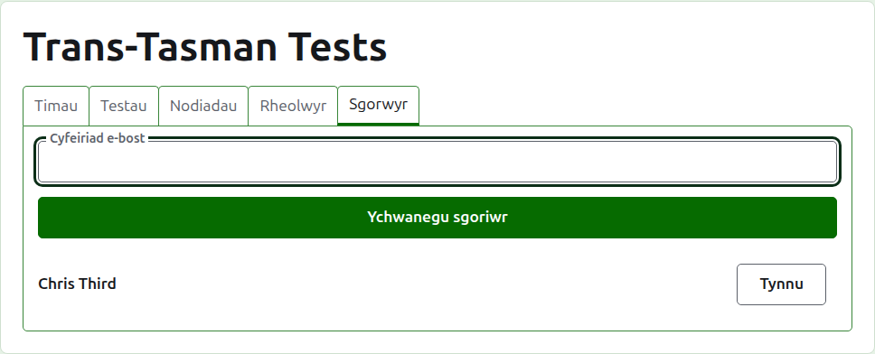
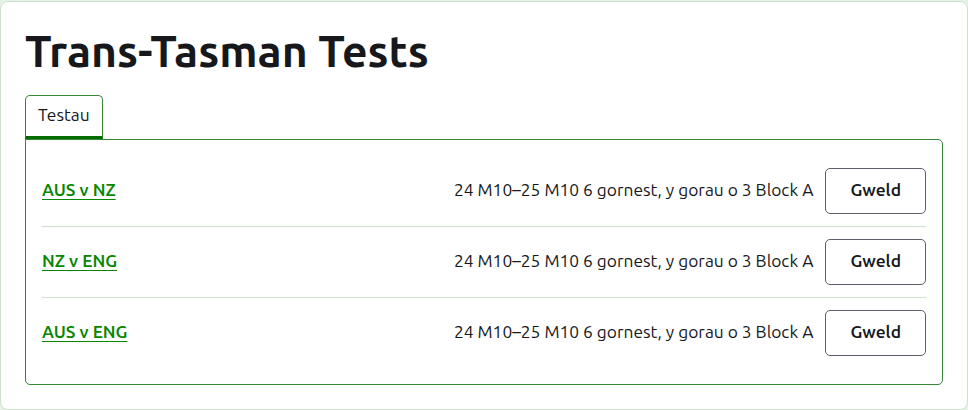

# Rheolwyr a sgorwyr

Mae gan dwrnamaint reolwyr, a all wneud popeth y gellir ei wneud iddo, a gall fod ganddo sgorwyr, sy'n rhoi ei ganlyniadau i mewn a dim arall. Pwy bynnag a greodd y twrnamaint yw ei reolwr cyntaf.

## Rheolwyr {#managers}

Mae'r tab **Rheolwyr** yn rhestru pwy sy'n rhedeg y twrnamaint, yn y drefn y cawsant eu gwneud, â'ch enw eich hun wedi'i farcio fel eich un chi. Dyma lle caiff twrnamaint ei rannu, neu ei drosglwyddo.

Gwneir rhywun yn rheolwr wrth ei gyfeiriad e-bost. Teipiwch ef yn y maes uwchben y rhestr a phwyswch **Ychwanegu rheolwr**. Rhaid i'r cyfeiriad fod yn eiddo i gyfrif sydd wedi'i gofrestru a'i gadarnhau; gwrthodir cyfeiriad heb un o dan y maes, ac nid yw'r safle'n dweud dim mwy amdano na hynny. Mae sgorwr a wneir yn rheolwr yn peidio â bod yn sgorwr.

Mae **Tynnu** yn tynnu rheolwr oddi ar y rhestr. Ni chedwir dim o reolwr a dynnwyd, felly mae Tynnu yn gofyn yn gyntaf; caiff ei wneud yn rheolwr eto wrth ei gyfeiriad os oes ei eisiau yn ôl. Mae gan dwrnamaint reolwr bob amser, felly ni chynigir Tynnu i'r olaf.

Gallwch dynnu eich hun oddi ar y rhestr. Mae'r cwestiwn wedyn yn dweud beth mae hynny'n ei olygu: rydych yn colli eich ffordd eich hun yn ôl i'r twrnamaint, ac ni all neb ar y dudalen ei ddadwneud i chi. Gall rheolwr arall eich gwneud yn rheolwr eto.

## Sgorwyr {#scorers}

Y tab **Sgorwyr** yw'r tab Rheolwyr ar gyfer sgorwyr, ac mae'n gweithio yn yr un ffordd: cyfeiriad e-bost ac **Ychwanegu sgorwr** uwchben y rhestr, a **Tynnu** ar bob un.

Mae sgorwr yn gweld y twrnamaint yn ei restr ei hun yn yr adran weinyddu, â **Sgorau** yn lle Rheoli, a dim ond ei brofion a gynigir iddo: dim timau, nodiadau, rheolwyr, sgorwyr na detholion. Ni all agor tudalen tîm, gan mai'r rheolwyr sy'n dweud pwy sy'n chwarae dros dîm. Ar dudalen prawf gall roi canlyniadau i mewn, eu cywiro, eu harchifo, eu hadfer a'u haildrefnu fel y gall rheolwr.

Ni wneir rheolwr yn sgorwr, gan y gall rheolwr eisoes wneud popeth y gall sgorwr ei wneud. Nid oes angen sgorwr ar dwrnamaint, felly gellir tynnu pob sgorwr, yr olaf yn eu plith.

Nesaf: [Detholion](rankings.md).
