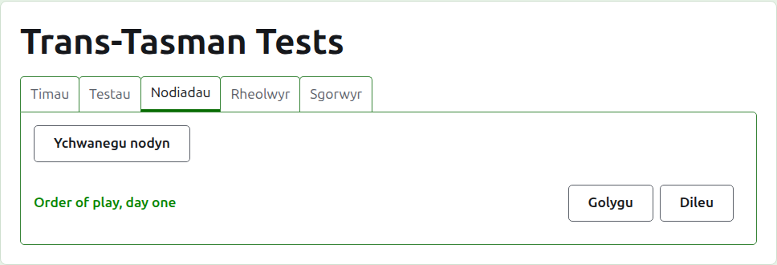
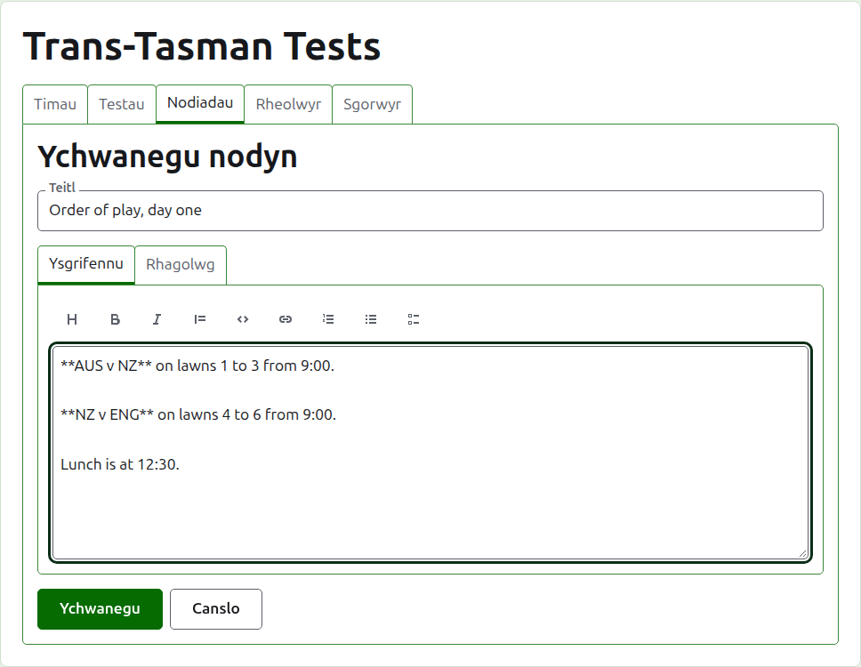
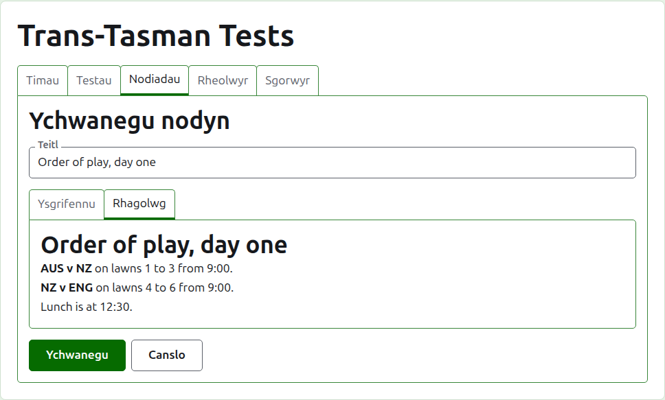
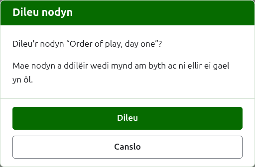

# Nodiadau

Tab **Nodiadau** tudalen twrnamaint yw lle mae ei reolwyr yn ysgrifennu'r hyn sydd angen i'r chwaraewyr ei wybod wrth i'r twrnamaint fynd rhagddo: y drefn chwarae, newid i'r lawntiau, amser cinio. Mae darllenwyr yn eu canfod ar dudalen Nodiadau gyhoeddus y twrnamaint, a chaiff nodyn nad ydynt wedi'i ddarllen ei farcio yno â seren goch, sydd hefyd yn marcio'r adran Nodiadau ar bob tudalen o'r twrnamaint nes iddynt ei agor.

## Ysgrifennu nodyn

Pwyswch **Ychwanegu nodyn**, uwchben y rhestr. Mae panel yn cymryd lle'r rhestr, gan fod nodyn yn cael ei ysgrifennu'n faith ac angen y lle.

Mae **Teitl** yn ofynnol, a dyma'r hyn y rhestrir y nodyn wrtho. Testun plaen yw.

Ysgrifennir **Disgrifiad** mewn Markdown a gellir ei adael yn wag lle mae'r teitl yn dweud y cyfan sydd i'w ddweud. Mae'r bar offer uwchben y blwch yn ysgrifennu'r Markdown drosoch: Pennawd, Print trwm, Italig, Dyfyniad, Cod, Dolen, Rhestr wedi'i rhifo, Rhestr bwyntiau bwled a Rhestr tasgau. Mae pob un yn gweithio ar yr hyn a ddewiswyd, neu ar ddechrau pob llinell a ddewiswyd, neu'n rhoi'r cyrchwr lle mae'r geiriau'n mynd.

Mae **Rhagolwg** yn dangos y nodyn fel y bydd darllenydd yn ei weld ar ei dudalen.

Pwyswch **Ychwanegu**. Cedwir y nodyn, mae'r rhestr yn dod yn ôl ag ef ar y brig, ac mae ar y dudalen Nodiadau gyhoeddus ar unwaith.

## Golygu nodyn

Pwyswch deitl nodyn, neu ei **Golygu**, i agor y panel ar y nodyn hwnnw. Pwyswch **Cadw** i gadw'r newid. Caiff nodyn a olygwyd ers i ddarllenydd ei ddarllen ei farcio iddo eto.

## Dileu nodyn {#deleting-a-note}

Caiff nodyn nad yw'n berthnasol mwyach ei ddileu. Mae nodyn a ddilëir wedi mynd am byth, felly mae **Dileu** yn gofyn yn gyntaf.

Nesaf: [Rheolwyr a sgorwyr](managers-and-scorers.md).
