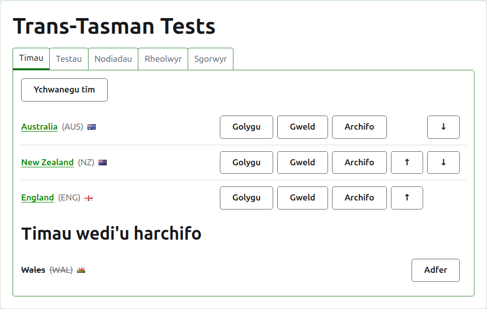
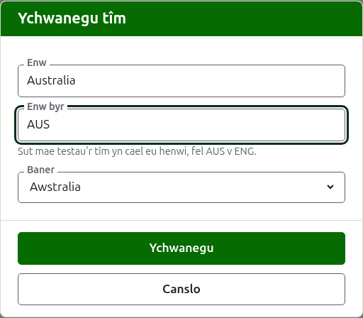
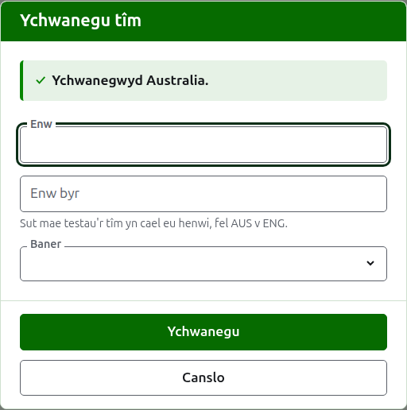
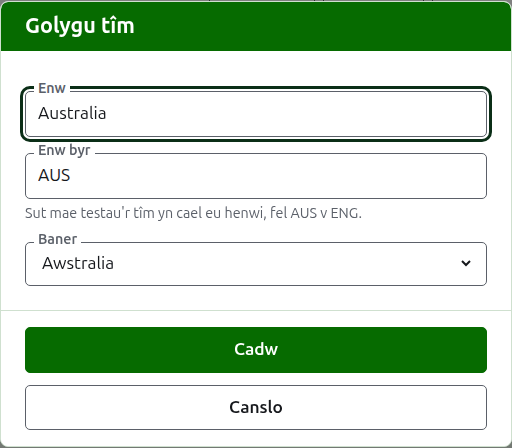

# Timau

Tab **Timau** tudalen twrnamaint yw lle caiff ei dimau eu hychwanegu, eu cywiro, eu rhoi mewn trefn, a'u rhoi o'r neilltu. Dyma'r tab y mae'r dudalen yn agor arno, gan mai'r timau yw'r peth cyntaf a osodir i fyny. Mae prawf rhwng dau dîm, felly mae angen o leiaf dau cyn y gellir ychwanegu unrhyw brawf.

## Ychwanegu tîm

Pwyswch **Ychwanegu tîm**, uwchben y rhestr. Mae deialog yn agor dros y dudalen.

Mae **Enw** yn ofynnol: enw llawn y tîm, fel "Australia", sydd ar ben tudalen y tîm a thablau'r tudalennau cyhoeddus. Ni all dau dîm yn yr un twrnamaint gael yr un enw.

Mae **Enw byr** yn ofynnol hefyd: yr hyn y gelwir profion y tîm wrtho, fel "AUS v ENG", a'r hyn y mae'r bar gwyrdd tywyll yn galw'r tîm. Mae hyd at 10 cymeriad, a dim hirach na'r enw, gan fod enw byr sy'n hirach na'r enw y mae'n ei gwtogi yn golygu bod y ddau wedi'u teipio y ffordd anghywir. Ni all dau dîm gael yr un enw byr chwaith.

Dangosir **Baner** wrth ochr enw'r tîm lle bynnag y mae'n ymddangos. Gellir ei gadael heb un, fel ar gyfer tîm clwb neu ranbarth.

Pwyswch **Ychwanegu**. Caiff y tîm ei ychwanegu, mae'r ddeialog yn dweud hynny, a chaiff ei meysydd eu gwagio ar gyfer y nesaf. Ychwanegwch y rhestr gyfan fel hyn, yna pwyswch **Diddymu** i gau'r ddeialog. Nid yw Canslo yn cadw dim nad oedd eisoes wedi'i ychwanegu.

## Cywiro tîm

Pwyswch **Golygu** tîm i agor yr un ddeialog ar y tîm hwnnw, dan y teitl Golygu tîm. Newidiwch beth sydd o'i le a phwyswch **Cadw**. Caiff tîm y mae ei enw byr yn newid ei alw wrth yr un newydd ym mhob man, felly caiff ei brofion eu hailenwi gydag ef.

## Trefn

Rhestrir y timau yn nhrefn y twrnamaint, sef y drefn y cânt eu cynnig ynddi pan ychwanegir prawf, y drefn sydd gan y bar gwyrdd tywyll iddynt, a'r drefn y mae'r dudalen Chwaraewyr gyhoeddus yn eu rhestru ynddi. Mae **I fyny** ac **I lawr**, y saethau ar ddiwedd pob rhes, yn symud tîm un lle.

## Mynd i dîm

Mae enw tîm, neu **Gweld**, yn agor tudalen y tîm ei hun, lle rhoddir ei chwaraewyr i mewn. Gweler [Chwaraewyr tîm](team-players.md).

## Archifo tîm

Mae **Archifo** yn rhoi tîm o'r neilltu. Mae ei chwaraewyr yn aros gydag ef ac yn dod yn ôl pan gaiff ei adfer, felly nid yw archifo'n gofyn yn gyntaf. Rhestrir tîm a archifwyd o dan **Timau wedi'u harchifo**, â llinell drwyddo, dim ond **Adfer** a gynigir iddo, ac mae ei dudalen ar gau nes iddo gael ei adfer.

Ni ellir archifo tîm sy'n chwarae mewn prawf sydd yn ei le, gan y byddai'r prawf wedyn yn erbyn tîm nad yw yno mwyach, felly ni chynigir Archifo i dîm o'r fath. Gellir archifo tîm nad oes ganddo ond profion a archifwyd.

Nesaf: [Chwaraewyr tîm](team-players.md).
