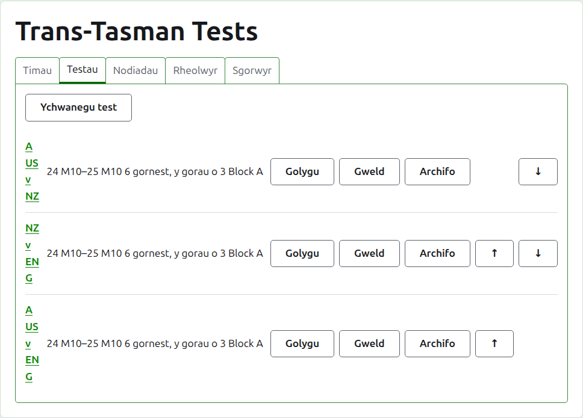
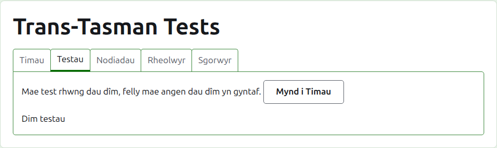
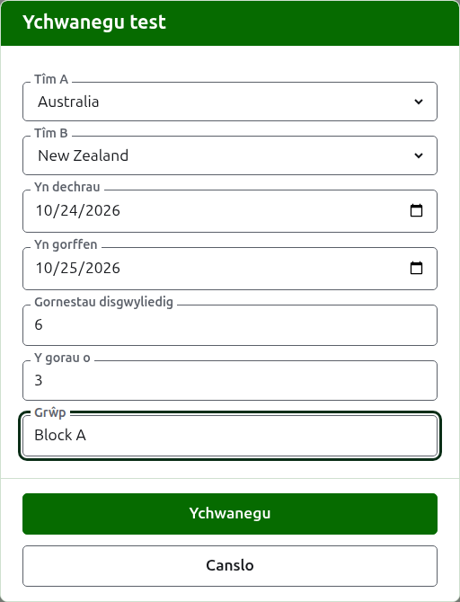
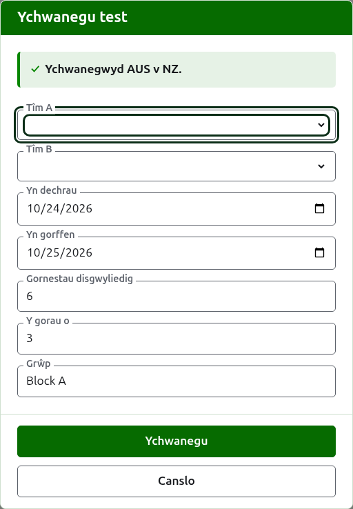
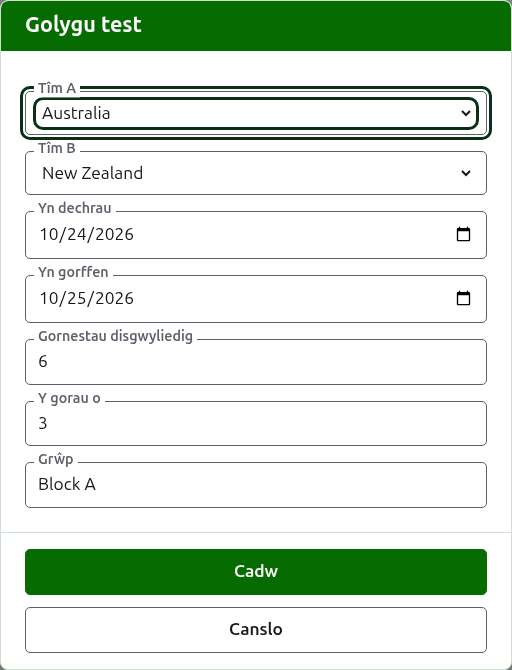

# Profion

Tab **Profion** tudalen twrnamaint yw lle caiff y profion rhwng ei dimau eu hychwanegu, eu newid, eu rhoi mewn trefn, a'u rhoi o'r neilltu. Mae prawf yn un o gystadlaethau'r twrnamaint: gornest rhwng dau dîm, a elwir wrth eu henwau byr, fel "AUS v NZ", a chwaraeir fel nifer o gemau rhwng chwaraewr o bob tîm, pob un yr orau o ryw nifer o gemau unigol. Mae gan bob prawf dudalen ei hun, lle mae ei ganlyniadau'n mynd.

Mae pob prawf yn dweud ei enw, y dyddiau y caiff ei chwarae, sawl gêm y disgwylir iddo ei chael a beth yw pob un yr orau ohono, fel "6 gêm, yr orau o 3", a'i grŵp lle mae mewn un.

## Dau dîm yn gyntaf

Mae prawf rhwng dau dîm sydd yn eu lle, felly tra bo gan y twrnamaint lai na dau mae'r tab yn dweud hynny lle byddai Ychwanegu prawf, ac yn arwain at y tab Timau.

## Ychwanegu prawf {#adding-a-test}

Pwyswch **Ychwanegu prawf**, uwchben y rhestr. Mae deialog yn agor dros y dudalen, yn darllen yn y drefn y dywedir prawf ar lafar.

Dewisir **Tîm A** a **Tîm B**, bob un, o dimau'r twrnamaint sydd yn eu lle, wrth eu henw, yn nhrefn y twrnamaint. Ni ddewisir yr un o'r ddau i ddechrau, fel na ychwanegir prawf byth rhwng timau na ddewisasoch. Mae Tîm B yn cynnig pob tîm ac eithrio'r un a ddewiswyd fel Tîm A, gan nad yw tîm yn chwarae prawf yn erbyn ei hun. Tîm A yw'r tîm cyntaf: mae ei chwaraewyr ar y chwith ar dudalen y prawf a'r dudalen gyhoeddus. Nid oes gan brawf enw ei hun i'w deipio; caiff ei alw wrth enwau byr ei dimau.

**Yn dechrau** ac **Yn gorffen** yw'r dyddiau y caiff y prawf ei chwarae, sy'n dechrau ar ddiwrnod cyntaf y twrnamaint. Chwaraeir prawf o fewn ei dwrnamaint, felly gwrthodir dyddiau cyn i'r twrnamaint ddechrau neu ar ôl iddo orffen.

**Gemau disgwyliedig** yw sawl gêm y mae'r prawf i'w chael, a osodir gan y digwyddiad cyn iddo ddechrau, fel y gall pwy bynnag sy'n darllen ei ganlyniadau weld pa mor bell drwyddo y mae. Mae'n rhif cyflawn o 1 i fyny. Mae hefyd yn derfyn: unwaith y bydd cymaint o gemau wedi dechrau ag y disgwylir i'r prawf ei chael, gwrthodir gêm a fyddai'n dechrau un arall, tra chwaraeir y gemau sydd eisoes wedi dechrau hyd eu diwedd. Caiff prawf sydd i gael mwy ei newid i'w disgwyl.

**Yr orau o** yw beth yw pob gêm yr orau ohono. Gall fod yn eilrif, gan y gellir rhannu gêm.

Gofynnir am **Chwarae gyda handicapiau**, **Caniatáu canlyniadau cyfartal** a **Yn cyfrif tuag at restr detholion y byd** fel ar gyfer unrhyw gystadleuaeth. Gofynnir am yr olaf dim ond lle gellir ei gyfrif: prawf Association Croquet neu Golf Croquet na chaiff ei chwarae gyda handicapiau ac nad yw'n caniatáu canlyniadau cyfartal. Mae wedi'i dicio i ddechrau.

**Grŵp** yw'r grŵp y mae'r prawf ynddo, lle chwaraeir y digwyddiad mewn grwpiau, fel "Block A". Mae'n ddewisol: os caiff ei adael yn wag, nid yw'r prawf mewn un. Mae gan y profion mewn grŵp dudalen eu hunain ar y safle cyhoeddus, yn dangos safle timau'r grŵp.

Pwyswch **Ychwanegu**. Caiff y prawf ei ychwanegu, mae'r ddeialog yn dweud pa un wrth ei enw, a chaiff y timau eu gwagio ar gyfer y nesaf, â'r dyddiau, y gemau disgwyliedig, yr orau o a'r grŵp wedi'u gadael fel yr oeddent: ychwanegir profion rownd ar y tro, rhwng timau sy'n cwrdd ar yr un diwrnod, felly nid yw prawf nesaf y rownd ond ei ddau dîm yn unig. Pwyswch **Diddymu** unwaith y bydd pob un i mewn.

## Newid prawf {#changing-a-test}

Mae **Golygu** yn agor yr un ddeialog ar y prawf, dan y teitl Golygu prawf, wedi'i dechrau fel y mae'r prawf. Pwyswch **Cadw** i gadw'r newid.

Mae prawf â gemau yn eu lle yn cadw ei dimau: mae'r ddeialog yn eu dangos ond ni ellir eu newid. Gellir newid y gweddill, o fewn yr hyn a chwaraewyd: gwrthodir gemau disgwyliedig sy'n llai na'r gemau sydd eisoes wedi dechrau, ac felly hefyd yr orau o sy'n llai na'r nifer fwyaf o gemau unigol y mae unrhyw ddau chwaraewr wedi'u chwarae.

## Trefn

Rhestrir y profion yn nhrefn y twrnamaint, sef y drefn y maent yn ymddangos ynddi ar y tudalennau cyhoeddus ac yn y bar gwyrdd tywyll. Mae **I fyny** ac **I lawr** yn symud prawf un lle.

## Mynd i prawf

Mae enw prawf, neu **Gweld**, yn agor ei dudalen, lle mae ei ganlyniadau'n mynd. Mae'r bar gwyrdd tywyll yn arwain yno hefyd, o dudalen y twrnamaint neu dudalen unrhyw prawf arall.

## Archifo prawf

Mae **Archifo** yn rhoi prawf o'r neilltu, a chaiff ei ddadwneud gan **Adfer**, felly nid yw'r un o'r ddau yn gofyn yn gyntaf. Rhestrir prawf a archifwyd o dan **Profion wedi'u harchifo**, â llinell drwyddo, dim ond Adfer a gynigir iddo, ac nid yw ar y tudalennau cyhoeddus.

Mae prawf â gemau yn eu lle wedi'i chwarae, ac ni ellir ei archifo nes y caiff ei gemau eu harchifo. Gellir archifo prawf y mae ei gemau i gyd wedi'u harchifo, gan nad yw gêm a archifwyd yn cyfrif dim. Ni chaiff prawf y mae ei dîm wedi'i archifo ers hynny ei adfer nes y caiff y tîm ei adfer, ac mae'r tab yn dweud hynny.

Nesaf: [Sgorau](scores.md).
