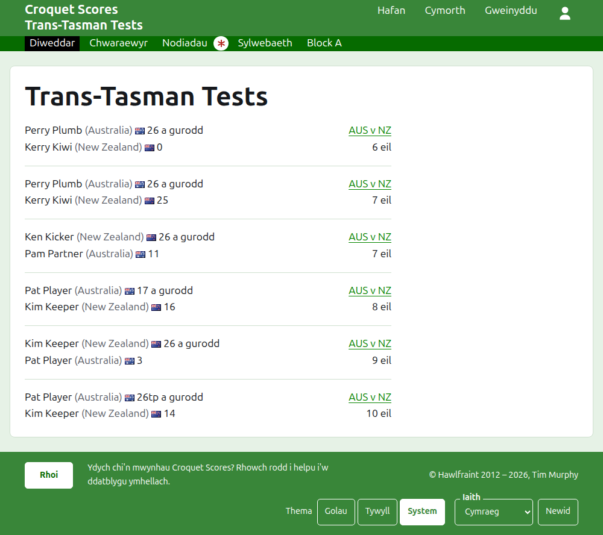
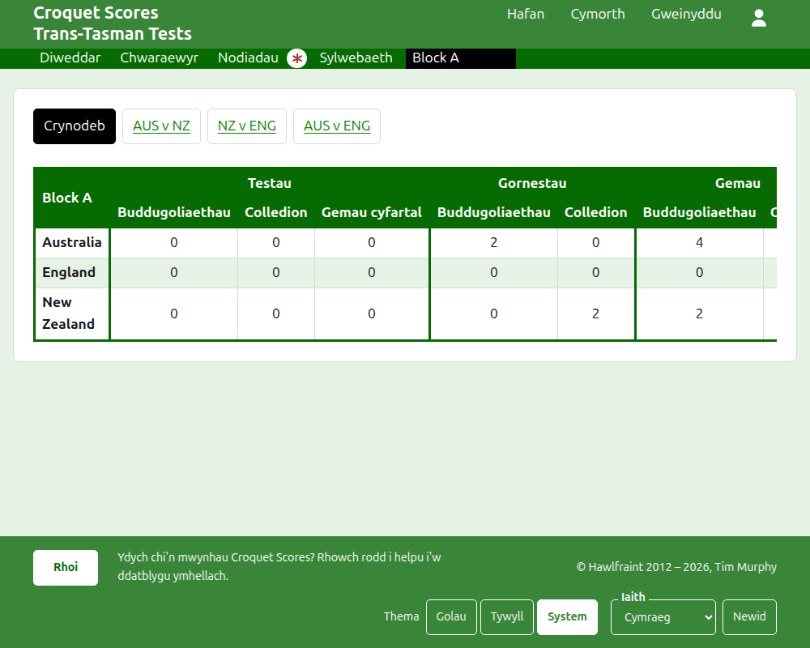
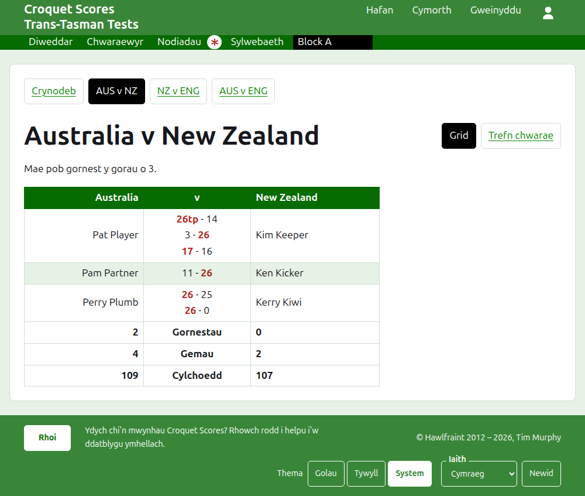
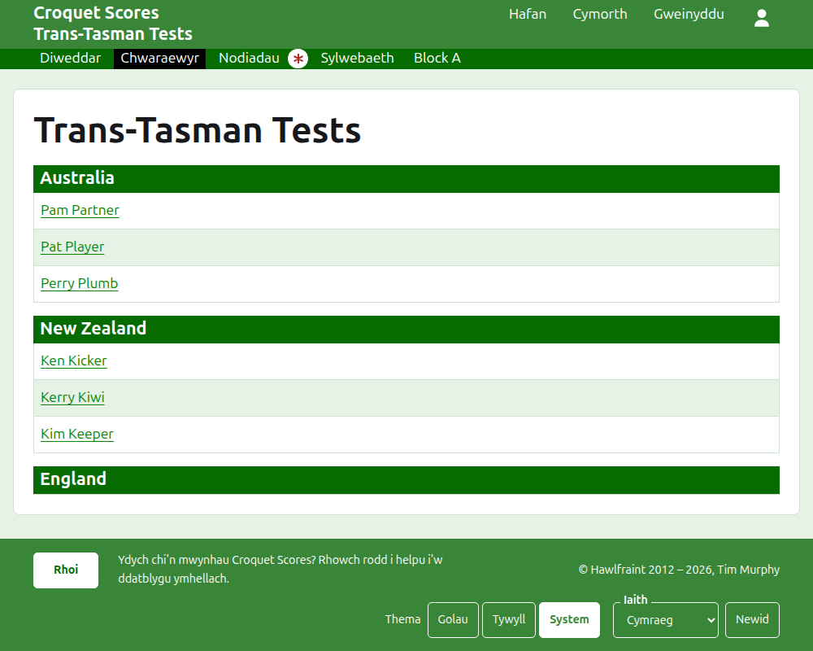

# Beth mae'r cyhoedd yn ei weld

Ni chyhoeddir dim: caiff y tudalennau cyhoeddus eu llunio o'r hyn sydd gan yr adran weinyddu, felly mae canlyniad a roddir i mewn arnynt ar unwaith. Nid oes angen cyfrif na sgriptio arnynt, ac maent wedi'u gosod ar gyfer ffôn.

## Tudalen y twrnamaint

Mae tudalen y twrnamaint yn ei flwyddyn, ei gamp a'i enw, fel `/2026/ac/trans-tasman-tests`. Enw'r twrnamaint sydd ar ei phen, â'i isdeitl oddi tano. Mae'n rhestru pob gêm sydd yn ei lle, yr un a ychwanegwyd ddiweddaraf yn gyntaf, fel bod darllenydd sy'n dod yn ôl yn gweld beth sydd wedi digwydd ers hynny. Mae pob gêm yn dweud yr enillydd, ei dîm a'i sgôr, yna'r collwr a'i rai yntau, â'r test y chwaraewyd hi ynddo a pha mor bell yn ôl y'i hychwanegwyd.

Mae'r bar gwyrdd tywyll yn cynnig adrannau'r twrnamaint: **Diweddar**, sef y dudalen hon, **Crynodeb**, **Chwaraewyr**, **Nodiadau** a **Sylwebaeth**, yna'r testau. Dywedir test fel enwau byr ei dimau â "v" rhyngddynt, fel "AUS v NZ". Ni chynigir testau mewn grŵp fesul un: mae'r grŵp yn un adran, wedi'i henwi fel y grŵp, yn sefyll lle byddai ei test cyntaf. Mae Nodiadau wedi'i farcio â seren goch tra bo nodyn nad yw'r darllenydd wedi'i ddarllen.

## Y crynodeb

Mae gan dwrnamaint nad yw ei destau mewn unrhyw grŵp **Crynodeb**: un tabl o bob tîm, yn ôl eu safle, â'r testau y mae wedi'u hennill, eu colli a'u cael yn gyfartal, ei gemau a enillwyd ac a gollwyd, a'i gylchoedd dros, yn erbyn a net. Lle mae gornestau unrhyw test y gorau o fwy nag un, daw'r gornestau a enillwyd ac a gollwyd ar ôl y testau. Y crynodeb yw lle mae darllenydd yn chwilio am bob tîm yn ei gyfanrwydd.

Nid oes gan dwrnamaint â test mewn grŵp Grynodeb. Mae tudalen pob grŵp yn dangos safle timau'r grŵp hwnnw yn lle hynny, gan na fyddai un tabl o dimau ar draws grwpiau nad ydynt erioed wedi chwarae yn erbyn ei gilydd yn rhoi safle i ddim.

## Grŵp

Mae tudalen grŵp yn dangos safle timau'r grŵp, gan gyfrif testau'r grŵp yn unig, yn y tabl y mae'r crynodeb yn ei ddefnyddio. Uwchben y tabl, mewn rhes eu hunain, mae'n cynnig **Crynodeb**, sef y dudalen hon, a phob un o destau'r grŵp, yn arwain at dudalen y test.

## Test

Enwau llawn ei dimau sydd ar ben tudalen test, fel "Australia v New Zealand", ac mae'n dweud beth yw pob gornest y gorau o. Y ddau dîm sydd ar ben ei dabl, y cyntaf ar y chwith. Mae pob gornest a chwaraewyd yn rhes, yn y drefn y dechreuodd, â chwaraewr y tîm cyntaf ar y chwith, chwaraewr yr ail dîm ar y dde, a gemau'r ornest rhyngddynt, pob un â sgôr yr ochr gyntaf yna sgôr yr ail, â sgôr yr enillydd wedi'i marcio. O dan y gornestau mae gemau a chylchoedd pob tîm, ac, lle mae pob gornest y gorau o fwy nag un, ei ornestau a enillwyd, ar ei ochr ei hun.

Dangosir test mewn dwy ffordd, a gynigir ar linell ei enw: **Grid**, sef y tabl hwn, a **Trefn chwarae**, sy'n rhestru pob gêm o'r test, yr hynaf yn gyntaf. Mae test mewn grŵp yn cynnig Crynodeb a thestau ei grŵp mewn rhes uwchben ei bennawd, â'r test hwn wedi'i farcio.

## Chwaraewyr

Mae'r dudalen Chwaraewyr yn rhestru'r chwaraewyr dîm wrth dîm: pob tîm o dan bennawd ei enw, yn nhrefn y twrnamaint o'i dimau, a'i chwaraewyr oddi tano yn nhrefn yr wyddor.

## Nodiadau

Mae'r dudalen Nodiadau yn rhestru nodiadau'r twrnamaint, yr un a ysgrifennwyd ddiweddaraf yn gyntaf, pob un yn arwain at ei dudalen ei hun ac yn dweud pa mor bell yn ôl y'i hysgrifennwyd. Caiff nodyn nad yw'r darllenydd wedi'i ddarllen ei farcio â seren goch nes iddo ei agor.

## Cyfeiriadau sy'n symud

Mae twrnamaint yn cadw ei gyfeiriad pan gaiff ei enw ei gywiro. Lle mae'n symud, am fod ei flwyddyn neu ei gamp wedi newid, mae ei hen gyfeiriad yn arwain at yr un newydd, fel bod dolen a gadwyd o'r blaen yn dal i weithio. Ni cheir tudalennau twrnamaint a archifwyd nes iddo gael ei adfer.
